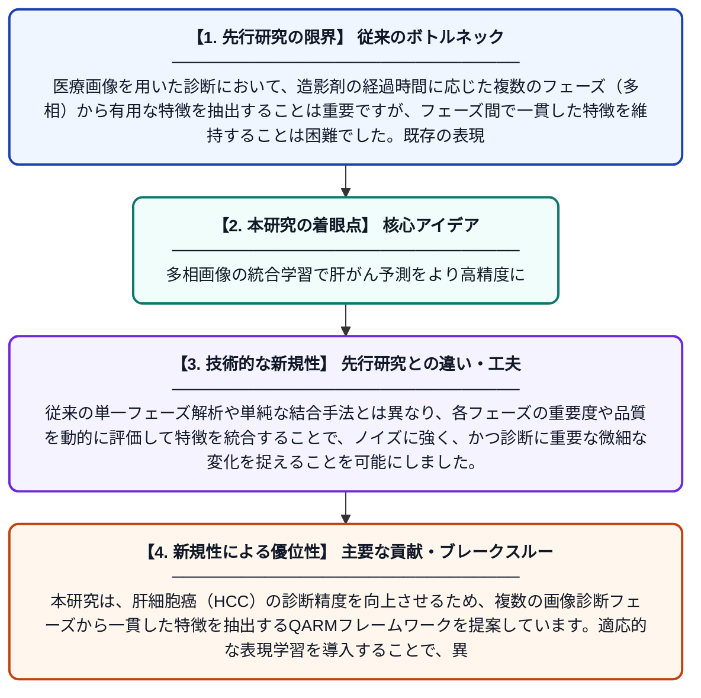

# QARMフレームワークを用いた適応的多相表現学習による肝細胞癌の予測

**Original Title**: *Hepatocellular Carcinoma Disease Prediction Using Adaptive Multiphase Representation Learning with QARM Framework*

> **💡 一言要約**: 多相画像の統合学習で肝がん予測をより高精度に

| 項目 | 内容 |
|---|---|
| **著者** | R Govindaraj |
| **掲載誌** | International Conference on Science Technology … 2026 |
| **アラートキーワード** | representation learning |
| **原文リンク** | [https://ieeexplore.ieee.org/abstract/document/11735628/](https://ieeexplore.ieee.org/abstract/document/11735628/) |
| **PDF版要約** | [README.pdf](./README.pdf) |

---

## 📊 新規性の図解（先行研究との違いと本研究のブレークスルー）

## 📝 要約

本研究は、肝細胞癌（HCC）の診断精度を向上させるため、複数の画像診断フェーズから一貫した特徴を抽出するQARMフレームワークを提案しています。適応的な表現学習を導入することで、異なる造影相間での特徴維持の難しさを克服し、信頼性の高い疾患予測を実現しています。

## ❓ どんな問題に取り組んだか

医療画像を用いた診断において、造影剤の経過時間に応じた複数のフェーズ（多相）から有用な特徴を抽出することは重要ですが、フェーズ間で一貫した特徴を維持することは困難でした。既存の表現学習手法では、多相間の情報の差異や品質のバラつきを十分に処理しきれないという課題がありました。

## ✨ 何が新しい？何がすごい？（新規性）

本論文の主な貢献は、QARM（Quality-Aware Representation Matching）フレームワークを用いた適応的多相表現学習を提案した点にあります。従来の単一フェーズ解析や単純な結合手法とは異なり、各フェーズの重要度や品質を動的に評価して特徴を統合することで、ノイズに強く、かつ診断に重要な微細な変化を捉えることを可能にしました。

## 🎓 大学1年生向けの解説

肝臓がんの診断では、時間の経過とともに見え方が変わる何枚ものCTやMRI画像を比較しますが、AIにとってこれらをセットで理解するのは難しい作業でした。この研究では、バラバラな画像から「がんの特徴」だけを賢く抜き出してまとめる新しい仕組み（QARM）を作りました。これにより、AIがより正確にがんを見つけられるようになり、お医者さんの診断を強力に助けることができるようになります。
