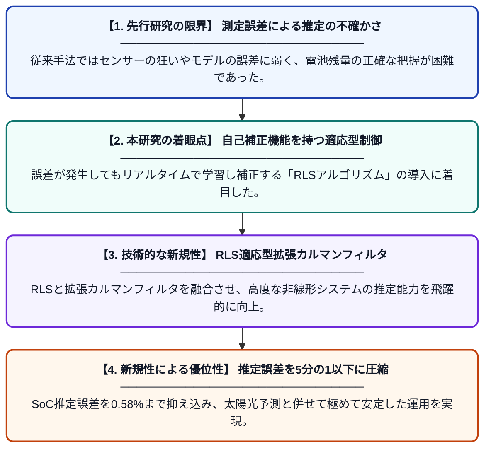

# 適応フィルタ予測、充電状態、高調波解析を用いた小型電気自動車用太陽光発電・蓄電池併設型充電ステーションのデータ駆動型季節評価

**Original Title**: *Data informed seasonal assessment of a PV battery grid charging station for light electric vehicles with adaptive filter forecasting, state of charge and harmonic …*

> **💡 一言要約**: 誤差に強い新フィルタでEV電池残量を精密に特定

| 項目 | 内容 |
|---|---|
| **著者** | A Singh, M Rajoriya, S Dhar, P Gupta |
| **掲載誌** | 2026 |
| **アラートキーワード** | kalman filter |
| **PDF** | [https://assets-eu.researchsquare.com/files/rs-11399297/v1_covered_c22cdb86-b4ac-4553-a9a5-be9241799780.pdf?c=1794988796](https://assets-eu.researchsquare.com/files/rs-11399297/v1_covered_c22cdb86-b4ac-4553-a9a5-be9241799780.pdf?c=1794988796) |
| **原文リンク** | [https://www.researchsquare.com/article/rs-11399297/latest.pdf](https://www.researchsquare.com/article/rs-11399297/latest.pdf) |
| **PDF版要約** | [README.pdf](./README.pdf) |

---

## 📊 新規性の図解（先行研究との違いと本研究のブレークスルー）

## 📝 要約

小型電気自動車（LEV）向けの太陽光発電・蓄電池・系統連系型充電ステーションにおいて、高度なフィルタリング技術を用いた運用評価を行う研究です。逐次最小二乗法（RLS）を組み合わせた適応型拡張カルマンフィルタを提案し、センサーやモデルに誤差がある条件下でも蓄電池の充電状態を極めて正確に推定することに成功しました。

## ❓ どんな問題に取り組んだか

従来の充電ステーションの制御では、センサーの測定誤差や数理モデルの不完全さにより、蓄電池の正確な残量（SoC）を把握することが困難でした。また、天候に左右される太陽光発電の出力変動を考慮した、高精度な翌日予測と安定した電力品質の維持も大きな課題となっていました。

## ✨ 何が新しい？何がすごい？（新規性）

本研究の核心は、逐次最小二乗法（RLS）と拡張カルマンフィルタを統合した「RLS適応型拡張カルマンフィルタ」の開発にあります。これにより、センサーやモデルに意図的な誤差が含まれる過酷な環境下でも、SoCの推定誤差（RMSE）を従来手法の3.16%から0.58%へと劇的に低減しました。さらに、翌日の太陽光発電予測も統合し、季節変動に強い包括的な管理システムを実現した点が画期的です。

## 🎓 大学1年生向けの解説

電気自動車のための「太陽光パネル付き充電スタンド」を、より賢く、より正確に動かすための研究です。充電スタンドに内蔵された大きな電池の残量を計算する際、これまではセンサーが少しずれるだけで計算が狂ってしまう問題がありました。この研究では、計算のズレを自分で修正する新しいAIのような仕組みを取り入れることで、電池の残量をほぼ完璧に当てられるようにしました。これにより、太陽のエネルギーを無駄なく使い、電池を長持ちさせることが可能になります。
