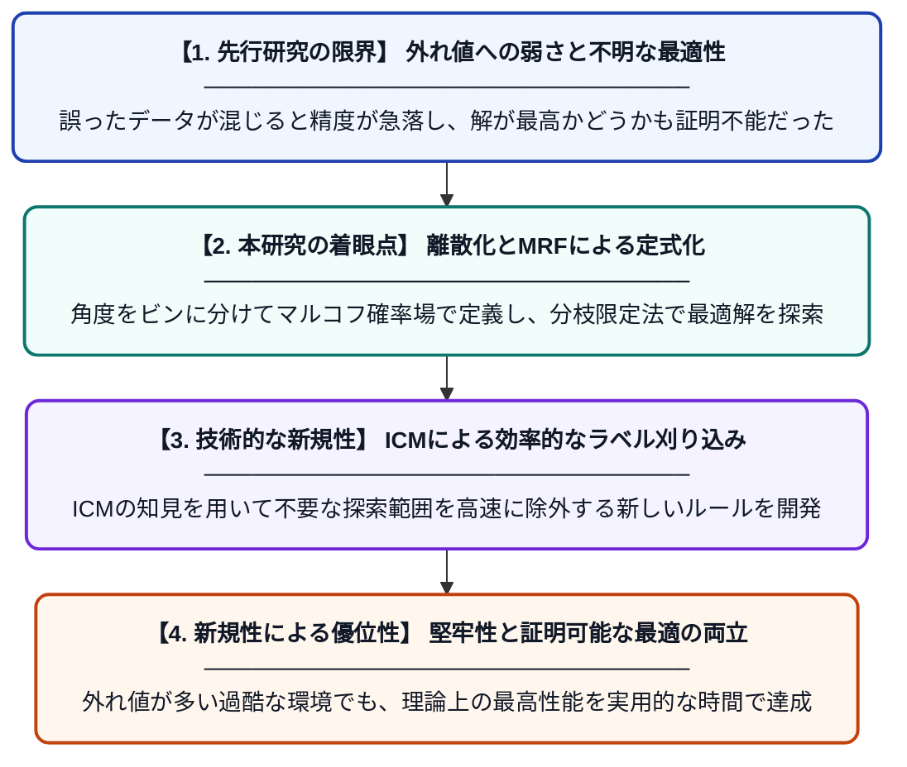

# 証明可能に最適な堅牢な角度同期

**Original Title**: *Certifiably Optimal Robust Angular Synchronization*

> **💡 一言要約**: 理論的最適解を保証する、ノイズに強い角度推定技術

| 項目 | 内容 |
|---|---|
| **著者** | D Barath, K Tateno, M Pollefeys, F Tombari |
| **掲載誌** | The Fortieth Annual Conference on Neural … |
| **アラートキーワード** | Markov random"  fields |
| **原文リンク** | [https://openreview.net/forum?id=M7UwJ21cjC](https://openreview.net/forum?id=M7UwJ21cjC) |
| **PDF版要約** | [README.pdf](./README.pdf) |

---

## 📊 新規性の図解（先行研究との違いと本研究のブレークスルー）

## 📝 要約

複数の相対角度から真の角度を推定する「角度同期」問題において、外れ値に強く、かつ数学的に最適であることが保証された解を導き出す新しいアルゴリズムを提案しています。円を均一な領域に分割してマルコフ確率場として定式化し、分枝限定法と効率的なラベル刈り込みを組み合わせることで、複雑な問題でも高速に最適解を見つけ出します。

## ❓ どんな問題に取り組んだか

画像やセンサの向きを合わせる「角度同期」は、データの誤り（外れ値）が混じると計算が極端に難しくなり、従来手法では計算が終わらなかったり局所的な解に陥ったりする課題がありました。特に、得られた答えが本当に数学的に一番良いもの（大域的最適解）であるかを証明しつつ、実用的な時間で解くことは非常に困難でした。

## ✨ 何が新しい？何がすごい？（新規性）

本研究の最大の特徴は、角度の探索空間を離散化し、マルコフ確率場（MRF）と分枝限定法を組み合わせることで「証明可能な最適性」を維持した点にあります。さらに、逐次条件付きモード（ICM）を応用した独自のラベル刈り込みルールを導入したことで、探索に必要な計算量を劇的に削減することに成功しました。これにより、先行研究では扱えなかった大量の外れ値を含む複雑なシナリオでも、最適解を効率的に導出できます。

## 🎓 大学1年生向けの解説

バラバラの向きで撮られた何枚もの写真から、それらが本来どの方向を向いていたのかをピタリと当てるパズルのような問題を解く研究です。これまではパズルのピースに嘘の情報（ノイズ）が混じると、どれが正解か分からなくなったり、計算に何日もかかったりしていました。この研究は、数学的な工夫を使って「嘘の情報」を賢く無視し、短時間で「これが絶対に正しい向きの組み合わせだ」という正解を導き出せるようにしました。
