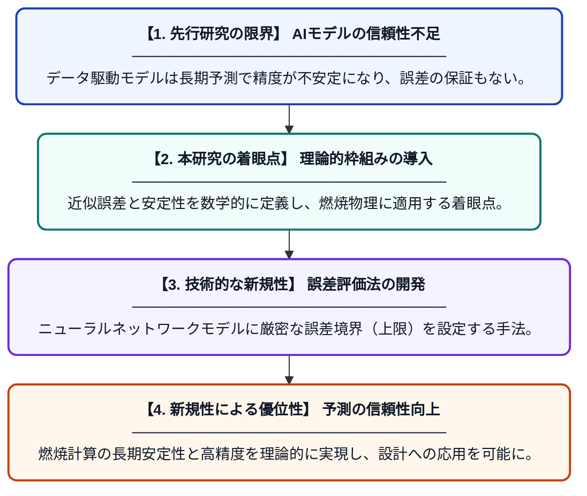

# 燃焼動力学におけるニューラル次元圧縮モデルの誤差評価と安定性

**Original Title**: *Error bounds and stability of neural reduced-order models for combustion dynamics*

> **💡 一言要約**: 燃焼AIシミュレーションの精度と安定性を理論で保証

| 項目 | 内容 |
|---|---|
| **著者** | KM Owolabi |
| **掲載誌** | Combustion Theory and Modelling 2026 |
| **アラートキーワード** | manifold learning |
| **原文リンク** | [https://www.tandfonline.com/doi/abs/10.1080/13647830.2026.2765511](https://www.tandfonline.com/doi/abs/10.1080/13647830.2026.2765511) |
| **PDF版要約** | [README.pdf](./README.pdf) |

---

## 📊 新規性の図解（先行研究との違いと本研究のブレークスルー）

## 📝 要約

複雑な燃焼現象を高速に計算するための「ニューラル次元圧縮モデル」において、理論的な誤差の限界と長期的な安定性を解析した研究です。データ駆動型アプローチが抱える「予測精度の保証がない」という課題に対し、数学的な裏付けを与える枠組みを提示しています。

## ❓ どんな問題に取り組んだか

高次元で非線形な燃焼システムを低コストで近似する手法としてデータ駆動型モデルが注目されていますが、その多くは近似精度や長時間実行時の安定性に関する厳密な理論的保証を欠いていました。そのため、極端な条件下での予測信頼性が不明確であるという課題がありました。

## ✨ 何が新しい？何がすごい？（新規性）

本研究は、ニューラルネットワークを用いた低次元モデルに対し、厳密な誤差評価（Error Bounds）と安定性の解析手法を統合した点が最大の特徴です。先行研究が経験的な精度向上に留まっていたのに対し、燃焼ダイナミクスの物理的性質を考慮した数学的な解析を行うことで、モデルの挙動を理論的に制御可能にしました。これにより、燃焼予測における信頼性の欠如という重要課題を克服しています。

## 🎓 大学1年生向けの解説

ロケットやエンジンの燃焼は非常に複雑で、普通に計算するとスーパーコンピュータを使っても膨大な時間がかかります。そこでAIを使って計算をサボる（簡略化する）技術がありますが、今までは「たまたま上手くいっている」のか「本当に正しいのか」が分かりませんでした。この研究は、そのAIの計算がどれくらい正確で、長い時間計算してもデタラメな結果にならないことを数学的に証明しました。これにより、AIを安心してエンジン設計などに使えるようになります。
