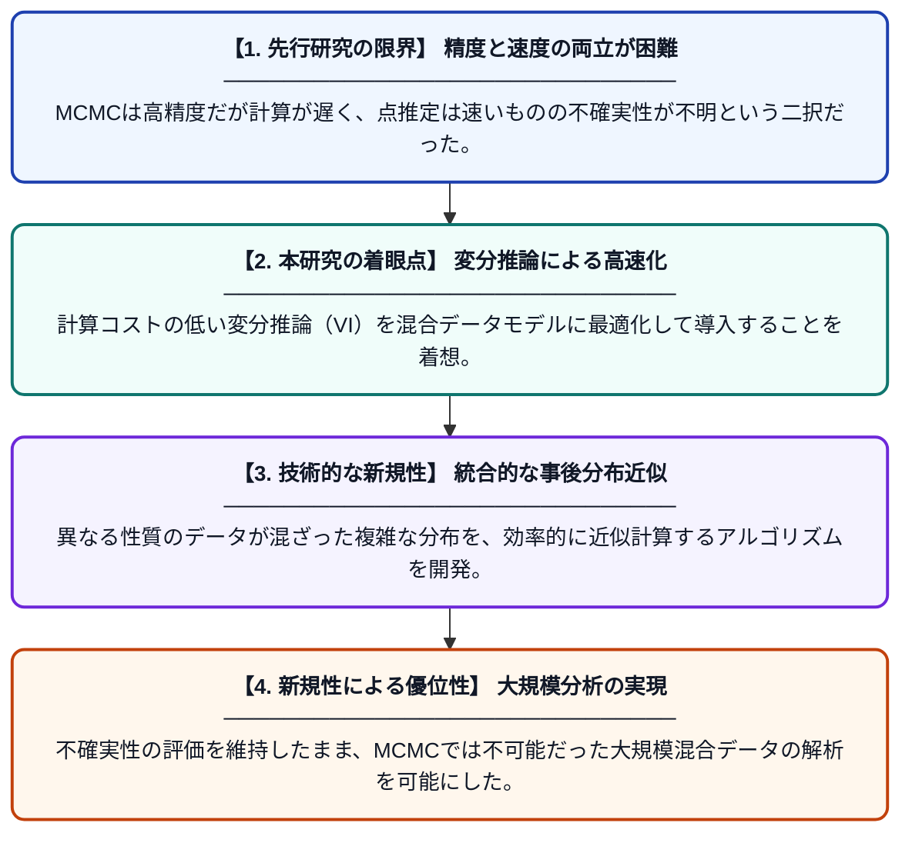

# 混合データ混合モデルに対するベイズ変分推論

**Original Title**: *Bayesian variational inference for mixed data mixture models*

> **💡 一言要約**: 混合データの解析を高速かつ不確実性込みで実現

| 項目 | 内容 |
|---|---|
| **著者** | S Filippi, J Wang, J Bennett, V Lhoste |
| **掲載誌** | 2026 |
| **アラートキーワード** | MCMC |
| **原文リンク** | [https://spiral.imperial.ac.uk/entities/publication/e2b3a48e-62a1-4063-a70e-7fd42922a375](https://spiral.imperial.ac.uk/entities/publication/e2b3a48e-62a1-4063-a70e-7fd42922a375) |
| **PDF版要約** | [README.pdf](./README.pdf) |

---

## 📊 新規性の図解（先行研究との違いと本研究のブレークスルー）

## 📝 要約

数値データやカテゴリデータが混在する「混合データ」を扱う混合モデルにおいて、計算負荷の高いMCMCに代わる高速なベイズ変分推論手法を提案しました。不確実性の評価を維持しつつ、大規模なデータセットに対しても実用的な時間での解析を可能にしています。

## ❓ どんな問題に取り組んだか

混合データのモデリングでは、不確実性を無視した点推定にとどまるか、あるいは計算コストが非常に高いMCMC（マルコフ連鎖モンテカルロ法）を用いる必要がありました。特に大規模なデータセットにおいては、精度と計算速度の両立が困難という課題がありました。

## ✨ 何が新しい？何がすごい？（新規性）

本研究は、混合データ特有の複雑な構造に対して変分推論（VI）を適用することで、MCMCのボトルネックを解消しました。不確実性の定量化というベイズ統計の利点を保ちながら、計算スピードを劇的に向上させた点が最大の貢献です。これにより、多様なデータ型が混在する複雑な事後分布を効率的に近似する新たな枠組みを構築しました。

## 🎓 大学1年生向けの解説

世の中のデータには「身長のような数値」と「血液型のような種類」が混ざっています。これを分析するとき、これまでは「計算に数日かかる正確な方法」か「速いけれど結果の自信のなさを教えてくれない方法」のどちらかしか選べませんでした。この研究は、その中間をいく「速くて、しかも結果の自信のなさ（不確実性）もしっかり教えてくれる」便利な計算テクニックを発明しました。
