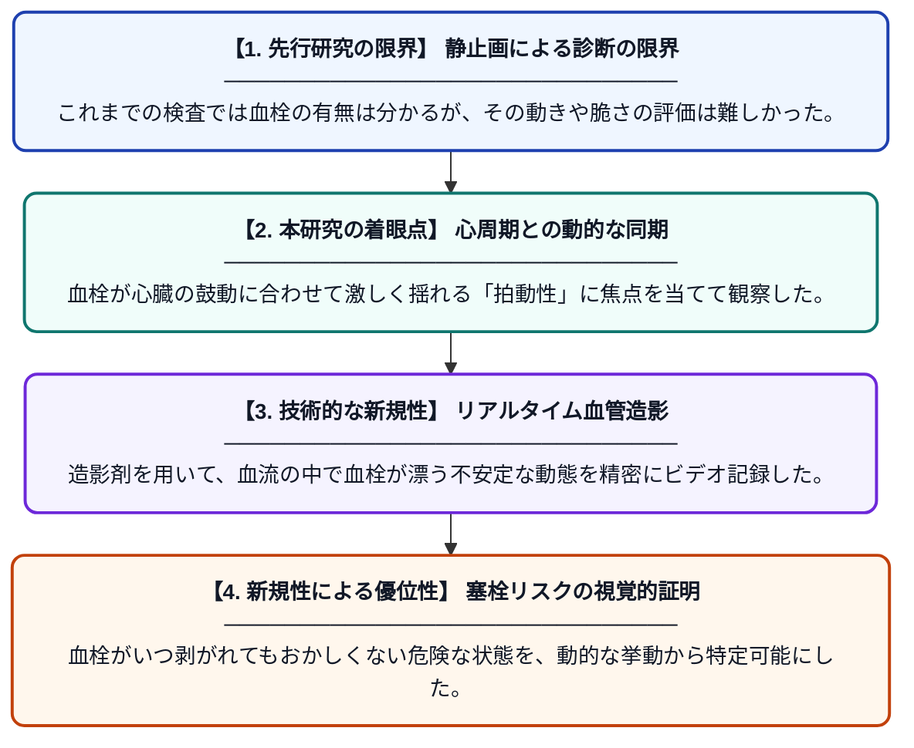

# 心原性遊離浮遊血栓（FFT）の動態解析：頸動脈における拍動性血栓の症例

**Original Title**: *cardioembolic free-floating*

> **💡 一言要約**: 血管内を漂う「浮遊血栓」の危険な動きを捉える

| 項目 | 内容 |
|---|---|
| **著者** | B Hu, J Li, L Li |
| **掲載誌** | Chronic Large-Vessel Occlusion in Cerebrovascular … 2026 |
| **アラートキーワード** | ICA |
| **原文リンク** | [https://books.google.com/books?hl=ja&lr=lang_ja|lang_en&id=6c0rEgAAQBAJ&oi=fnd&pg=PA7&dq=ICA&ots=n3oys1heTa&sig=AxaFn78eNV3-7O7MQKj0cbi1xwc](https://books.google.com/books?hl=ja&lr=lang_ja|lang_en&id=6c0rEgAAQBAJ&oi=fnd&pg=PA7&dq=ICA&ots=n3oys1heTa&sig=AxaFn78eNV3-7O7MQKj0cbi1xwc) |
| **PDF版要約** | [README.pdf](./README.pdf) |

---

## 📊 新規性の図解（先行研究との違いと本研究のブレークスルー）

## 📝 要約

内頸動脈および外頸動脈の分岐部において、心周期と同期して拍動する遊離浮遊血栓（FFT）の動態を血管造影により観察した症例報告です。血流が維持された状態で血栓が不安定に漂う様子を詳細に捉え、その臨床的な重要性を示しました。

## ❓ どんな問題に取り組んだか

頸動脈内に発生する遊離浮遊血栓は、脳梗塞を引き起こす極めて高いリスクがありますが、その動的な挙動は完全には解明されていません。特に、血栓が血流に乗って脳へ飛散する直前の不安定な状態をどのように評価すべきかが課題となっています。

## ✨ 何が新しい？何がすごい？（新規性）

本研究の新規性は、心周期と完全に同期して動く血栓の拍動特性（Pulsatile motion）をリアルタイムの血管造影で詳細に記録した点にあります。従来の静的な画像診断では見落とされがちな「血栓の物理的な揺らぎ」を可視化し、血流が維持されている（順行性血流）状態での塞栓リスクを具体的に示しました。これにより、緊急の治療介入を判断するための動的な指標を提供しています。

## 🎓 大学1年生向けの解説

血管の中に「ゆらゆらと揺れる血の塊」が浮いている状態を想像してみてください。この塊が千切れて脳に流れてしまうと、脳梗塞という恐ろしい病気が起きます。この論文では、心臓のドクンドクンというリズムに合わせて、その血の塊がどう動いているかを最新の装置で観察しました。敵（血栓）がいつ襲ってくるかを知るための、貴重な観察記録です。
