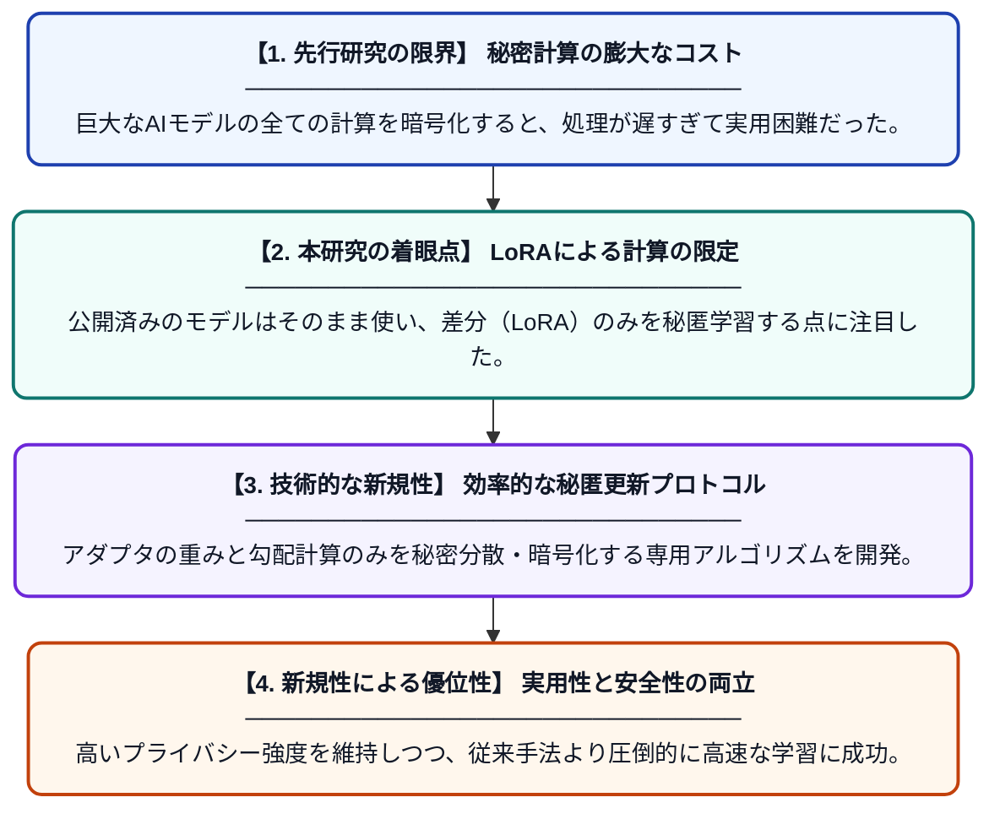

# VeilTune: 公開済み事前学習モデルを用いたプライベートLoRAアダプタの安全なファインチューニング

**Original Title**: *VeilTune: Secure Fine-Tuning of Private LoRA Adapters on Public Pretrained Language Models*

> **💡 一言要約**: 秘密を守ったままAIを自分好みに育てる新技術

| 項目 | 内容 |
|---|---|
| **著者** | H Xie, T Zhou, T Hu, X Liu, H Ma |
| **掲載誌** | arXiv preprint arXiv:2611.11817 2026 |
| **アラートキーワード** | Secure Computing |
| **PDF** | [https://arxiv.org/pdf/2611.11817](https://arxiv.org/pdf/2611.11817) |
| **原文リンク** | [https://arxiv.org/pdf/2611.11817](https://arxiv.org/pdf/2611.11817) |
| **PDF版要約** | [README.pdf](./README.pdf) |

---

## 📊 新規性の図解（先行研究との違いと本研究のブレークスルー）

## 📝 要約

VeilTuneは、公開されている大規模言語モデルを活用しながら、ユーザーの機密データを用いてLoRAアダプタを安全に学習させるフレームワークです。秘密計算技術を最適化することで、データのプライバシーを完全に守りつつ、実用的な速度でのカスタマイズを実現しています。

## ❓ どんな問題に取り組んだか

大規模言語モデルのカスタマイズには機密データが必要ですが、クラウド上で学習させるとデータ漏洩のリスクがあります。また、従来のプライバシー保護技術（秘密計算など）は計算負荷が極めて高く、巨大なモデルの学習には多大な時間とコストがかかるという課題がありました。

## ✨ 何が新しい？何がすごい？（新規性）

本研究は、モデル全体ではなくごく少数のパラメータのみを更新するLoRAに着目し、アダプタ部分の更新のみを秘匿化する手法を開発しました。公開モデルの重みは非暗号化状態で利用し、ユーザーデータとアダプタの計算のみを秘密計算で行うことで、計算コストを劇的に削減しています。さらに、通信量と計算効率を最適化した新しいプロトコルにより、実用的な時間での秘密ファインチューニングを可能にしました。

## 🎓 大学1年生向けの解説

AIを自分専用に賢くするには、自分の個人的なデータ（日記や仕事の書類など）を読み込ませる必要があります。しかし、そのデータをそのままAIを管理する会社に送ると、中身を見られてしまう心配があります。この研究は、データを「暗号化したまま」AIの一部を書き換える技術を作りました。これにより、大事な秘密を誰にも明かすことなく、自分専用の高性能なAIを作ることができるようになります。
