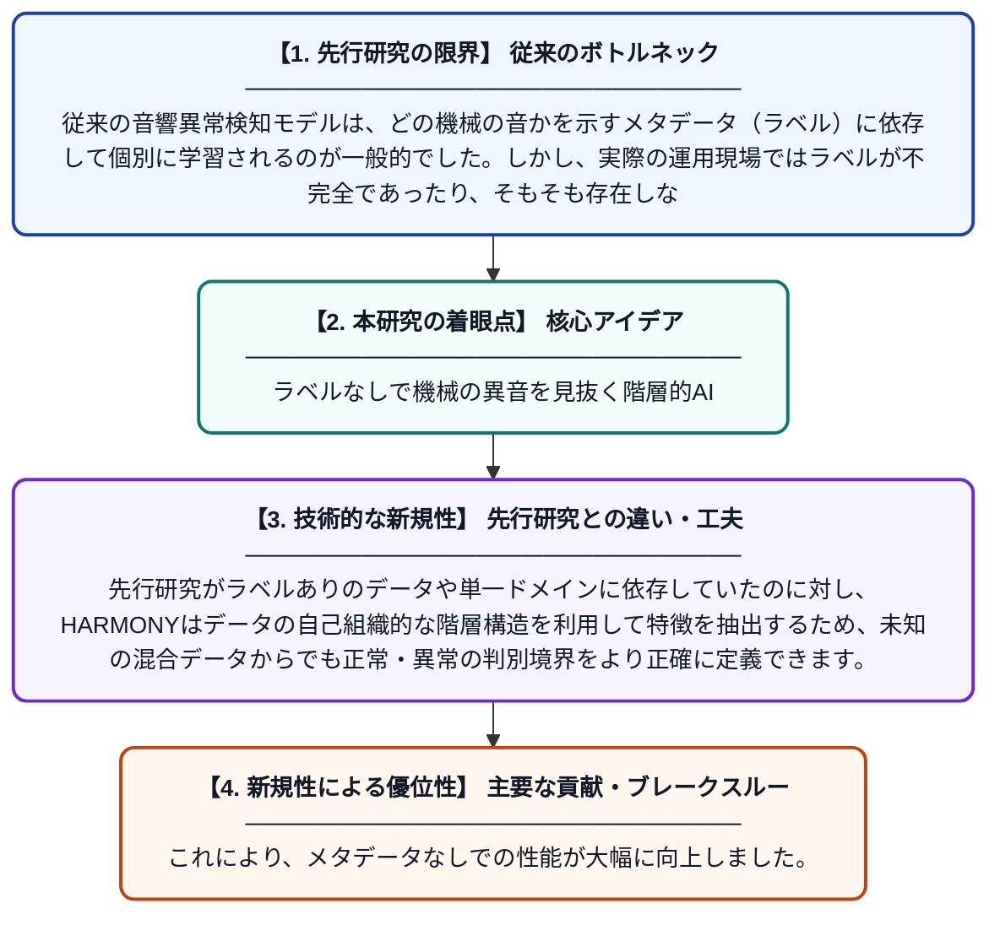

# HARMONY: 情報源が不明な機械音響異常検知のための多様体上の階層的アンカー検索

**Original Title**: *HARMONY: Hierarchical Anchor Retrieval on Manifold for Oblivious-source Machinery Acoustic Anomaly Detection*

> **💡 一言要約**: ラベルなしで機械の異音を見抜く階層的AI

| 項目 | 内容 |
|---|---|
| **著者** | Y Zhang, Y Li, Q Wu, M Li |
| **掲載誌** | arXiv preprint arXiv:2610.31093 2026 |
| **アラートキーワード** | manifold learning |
| **PDF** | [https://arxiv.org/pdf/2610.31093](https://arxiv.org/pdf/2610.31093) |
| **Git リポジトリ** | [https://github.com/Zzyh0208/HARMONY](https://github.com/Zzyh0208/HARMONY) |
| **原文リンク** | [https://arxiv.org/pdf/2610.31093](https://arxiv.org/pdf/2610.31093) |
| **PDF版要約** | [README.pdf](./README.pdf) |

---

## 📊 新規性の図解（先行研究との違いと本研究のブレークスルー）

## 📝 要約

機械の種類や設置環境といった属性ラベルが利用できない状況下で、高精度な音響異常検知を実現する新手法「HARMONY」を提案しています。データの幾何学的構造から階層的に代表的な特徴（アンカー）を抽出することで、ラベルのない混合データから効率的に学習することが可能です。

## ❓ どんな問題に取り組んだか

従来の音響異常検知モデルは、どの機械の音かを示すメタデータ（ラベル）に依存して個別に学習されるのが一般的でした。しかし、実際の運用現場ではラベルが不完全であったり、そもそも存在しなかったりすることが多く、複数の音源が混ざった状況で精度を維持することが困難でした。

## ✨ 何が新しい？何がすごい？（新規性）

本研究は、情報源が不明（Oblivious-source）な環境に対し、多様体学習に基づいた階層的なアンカー検索を導入した点が画期的です。先行研究がラベルありのデータや単一ドメインに依存していたのに対し、HARMONYはデータの自己組織的な階層構造を利用して特徴を抽出するため、未知の混合データからでも正常・異常の判別境界をより正確に定義できます。これにより、メタデータなしでの性能が大幅に向上しました。

## 🎓 大学1年生向けの解説

工場の機械が壊れそうな時の「変な音」をAIで見つける研究です。これまでは、AIに「これはこの機械の音だよ」と教えてあげる必要がありましたが、この新しい方法では、名前のわからない機械の音が混ざっていても、AIが自分で音の特徴を整理して学習します。たくさんの音の中から似た音をグループ分けして整理することで、人間が細かくラベルを貼らなくても、効率よく故障の兆候を見つけられるようになります。
