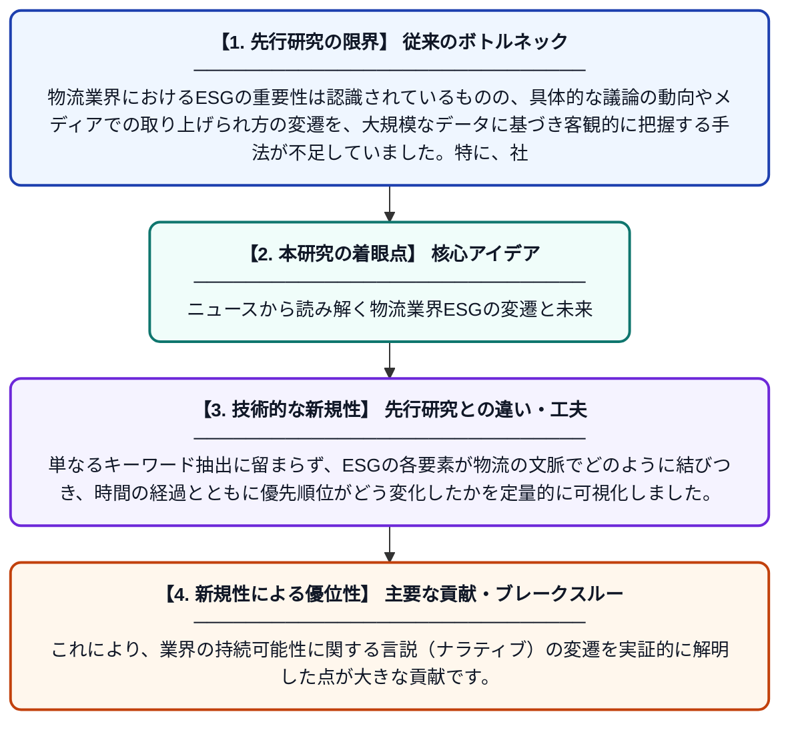

# 物流業界における世界的なESG言説の解釈：ニュースメディアのナラティブを用いた意味論的・トレンド分析

**Original Title**: *Mapping global ESG discourse in logistics: a semantic and trend-based analysis of news media narratives*

> **💡 一言要約**: ニュースから読み解く物流業界ESGの変遷と未来

| 項目 | 内容 |
|---|---|
| **著者** | J Shin, G Oh, H Liu, D Kim |
| **掲載誌** | … Journal of Shipping and Transport Logistics 2026 |
| **アラートキーワード** | logistics |
| **原文リンク** | [https://www.inderscienceonline.com/doi/abs/10.1504/IJSTL.2026.157165](https://www.inderscienceonline.com/doi/abs/10.1504/IJSTL.2026.157165) |
| **PDF版要約** | [README.pdf](./README.pdf) |

---

## 📊 新規性の図解（先行研究との違いと本研究のブレークスルー）

## 📝 要約

本研究は、2015年から2024年に公開された4,764件のニュース記事を対象に、物流セクターにおける環境・社会・ガバナンス（ESG）の統合トレンドを大規模に分析しました。テキストマイニング手法を用いることで、過去10年間で物流業界のESGに関する議論がどのように進化し、どのようなテーマが重要視されてきたかを包括的に示しています。

## ❓ どんな問題に取り組んだか

物流業界におけるESGの重要性は認識されているものの、具体的な議論の動向やメディアでの取り上げられ方の変遷を、大規模なデータに基づき客観的に把握する手法が不足していました。特に、社会的な関心の変化を直接的に反映するニュース報道を対象とした、長期的かつ体系的な分析は十分に行われていませんでした。

## ✨ 何が新しい？何がすごい？（新規性）

本研究の新規性は、10年間にわたる約5,000件のニュース記事という膨大な非構造化データに対し、意味論的分析とトレンド分析を統合した点にあります。単なるキーワード抽出に留まらず、ESGの各要素が物流の文脈でどのように結びつき、時間の経過とともに優先順位がどう変化したかを定量的に可視化しました。これにより、業界の持続可能性に関する言説（ナラティブ）の変遷を実証的に解明した点が大きな貢献です。

## 🎓 大学1年生向けの解説

「物流」と聞くとトラックや船で荷物を運ぶイメージが強いですが、最近は「環境や社会、ルールをどれだけ守っているか（ESG）」が投資や評判において非常に重要視されています。この研究は、世界中のニュース記事を約5,000本もAIのように分析して、過去10年で物流のESGに関する話題がどう変わってきたかを調べました。難しい理論だけでなく、ニュースという身近な情報から業界の流行り廃りを分析しているのが特徴です。これからの物流が、ただ運ぶだけでなく、地球や社会のためにどうあるべきかを考えるための地図のような研究です。
