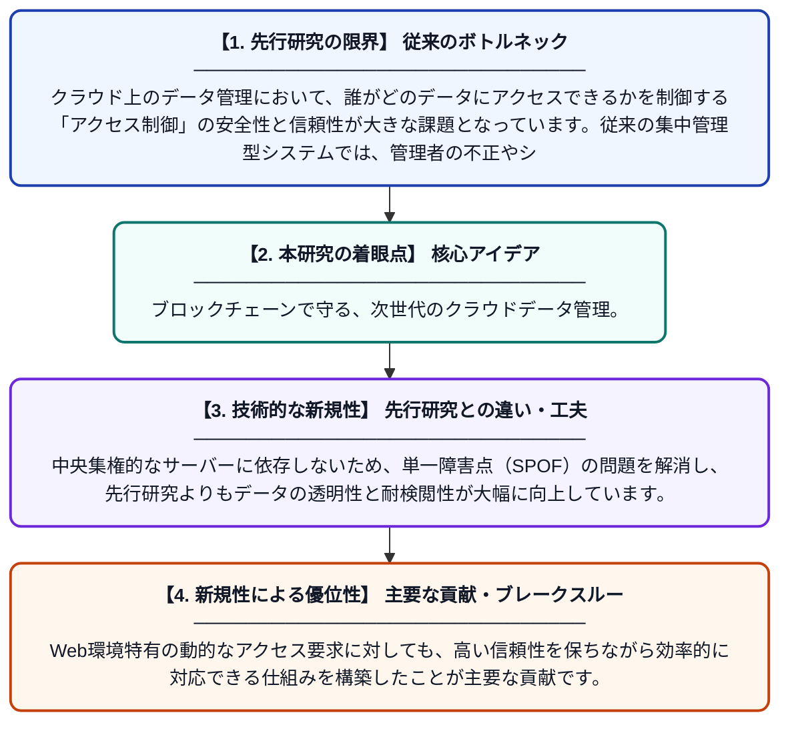

# ブロックチェーンを用いたアクセス制御システムのセキュアなクラウドストレージ戦略

**Original Title**: *Secure cloud storage strategy of access control system using blockchain*

> **💡 一言要約**: ブロックチェーンで守る、次世代のクラウドデータ管理。

| 項目 | 内容 |
|---|---|
| **著者** | LS Rao, P Santhosh, D Satyanarayana, A Latha… |
| **掲載誌** | Cluster Computing 2026 |
| **アラートキーワード** | Secure Computing |
| **原文リンク** | [https://link.springer.com/article/10.1007/s10586-026-06641-5](https://link.springer.com/article/10.1007/s10586-026-06641-5) |
| **PDF版要約** | [README.pdf](./README.pdf) |

---

## 📊 新規性の図解（先行研究との違いと本研究のブレークスルー）

## 📝 要約

クラウド環境におけるデータの安全性とプライバシーを確保するため、ブロックチェーン技術を活用した新しいアクセス制御手法を提案しています。Webユーザーがデータへのアクセス権を適切に管理できるようにし、不正アクセスを防ぐ強固なセキュリティ基盤の構築を目指しています。

## ❓ どんな問題に取り組んだか

クラウド上のデータ管理において、誰がどのデータにアクセスできるかを制御する「アクセス制御」の安全性と信頼性が大きな課題となっています。従来の集中管理型システムでは、管理者の不正やシステム障害による情報漏洩のリスクがあり、より安全で透明性の高い管理体制が求められていました。

## ✨ 何が新しい？何がすごい？（新規性）

この研究の革新性は、ブロックチェーンの分散型台帳技術をアクセス制御に直接統合し、改ざんが不可能なアクセス記録と権限管理を実現した点にあります。中央集権的なサーバーに依存しないため、単一障害点（SPOF）の問題を解消し、先行研究よりもデータの透明性と耐検閲性が大幅に向上しています。Web環境特有の動的なアクセス要求に対しても、高い信頼性を保ちながら効率的に対応できる仕組みを構築したことが主要な貢献です。

## 🎓 大学1年生向けの解説

インターネット上の巨大な倉庫（クラウド）に大切なデータを預けるとき、その鍵の管理を特定の業者一人に任せるのは少し不安ですよね。この研究は、ブロックチェーンという「みんなで記録を共有し、監視し合う仕組み」を使って、データの鍵が不正に使われないようにする方法を開発しました。これにより、悪い人が勝手にデータを見たり書き換えたりすることを防ぎ、私たちがより安心してネットのサービスを使えるようになります。
