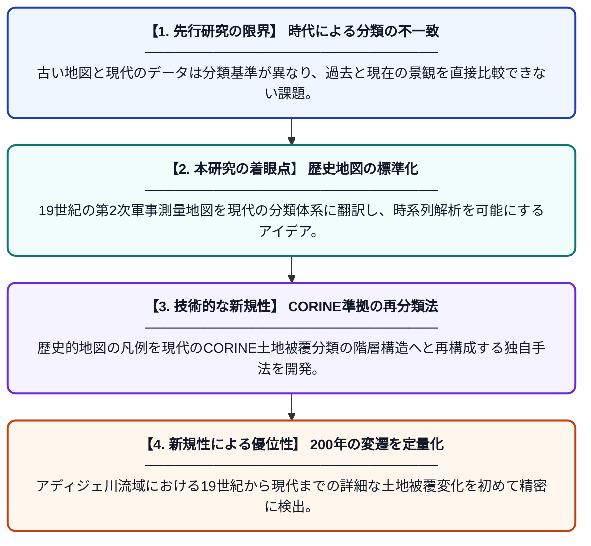

# CORINEに基づく第2次軍事測量地図の再分類によるアディジェ川流域の19世紀から21世紀にかけての土地被覆変化の検出

**Original Title**: *Detection of land-cover changes between the 19th and 21st centuries in the Adige River basin through a CORINE-based reclassification of the Second Military Survey*

> **💡 一言要約**: 19世紀の軍事地図で200年の環境変化を可視化

| 項目 | 内容 |
|---|---|
| **著者** | A Mekonen, M Umair, G Timàr, M Balistrocchi, R Ranzi |
| **掲載誌** | 20th ICA Conference Digital … 2026 |
| **アラートキーワード** | ICA |
| **PDF** | [https://iris.unibs.it/bitstream/11379/655787/1/2026%20Mekonen%20et%20al@DACH_Conference_Land%20Cover%20changes%20Adige%20River_.pdf](https://iris.unibs.it/bitstream/11379/655787/1/2026%20Mekonen%20et%20al@DACH_Conference_Land%20Cover%20changes%20Adige%20River_.pdf) |
| **原文リンク** | [https://iris.unibs.it/bitstream/11379/655787/1/2026 Mekonen et al@DACH_Conference_Land Cover changes Adige River_.pdf](https://iris.unibs.it/bitstream/11379/655787/1/2026 Mekonen et al@DACH_Conference_Land Cover changes Adige River_.pdf) |
| **PDF版要約** | [README.pdf](./README.pdf) |

---

## 📊 新規性の図解（先行研究との違いと本研究のブレークスルー）

## 📝 要約

本研究は、19世紀の歴史的な「第2次軍事測量地図」を現代の欧州標準であるCORINE土地被覆分類に合わせて再定義し、イタリア・アディジェ川流域における約200年間の景観変化を分析したものです。歴史地図をデジタル化・標準化することで、過去から現代に至る土地利用の変遷を科学的に比較可能な形で明らかにしました。

## ❓ どんな問題に取り組んだか

過去の環境や土地利用の変化を知るには歴史地図が不可欠ですが、古い地図は現代のデジタルデータと分類基準が異なるため、直接比較することが困難でした。特に19世紀の広域な地図情報を、現代の標準的な土地被覆分類と一貫性を持って統合するプロセスが確立されていませんでした。

## ✨ 何が新しい？何がすごい？（新規性）

オーストリア＝ハンガリー帝国の「第2次軍事測量地図」を、現代の分類体系であるCORINEに精密にマッピングし直した点が画期的です。単なる地図の重ね合わせではなく、地理情報の歴史的変遷を定量的かつ科学的に比較可能な形に変換する再分類ワークフローを確立しました。これにより、19世紀から21世紀までの長期間における詳細な土地被覆の変遷を、流域全体という広域スケールで捉えることに成功しています。

## 🎓 大学1年生向けの解説

この研究は、約200年前の古い軍事用地図を現代の最新技術で分析し、イタリアの川の周りの景色がどう変わったかを調べたものです。昔の地図は描き方が今とは全然違うため、そのまま比べることはできませんが、研究チームは工夫して今の地図と同じ基準で読み解く方法を作りました。その結果、昔の森がどう消えたかや、街がどう広がったかが数字でハッキリ分かるようになりました。昔の人が残した貴重な記録が、未来の環境を守るためのデータとして蘇ったのです。
