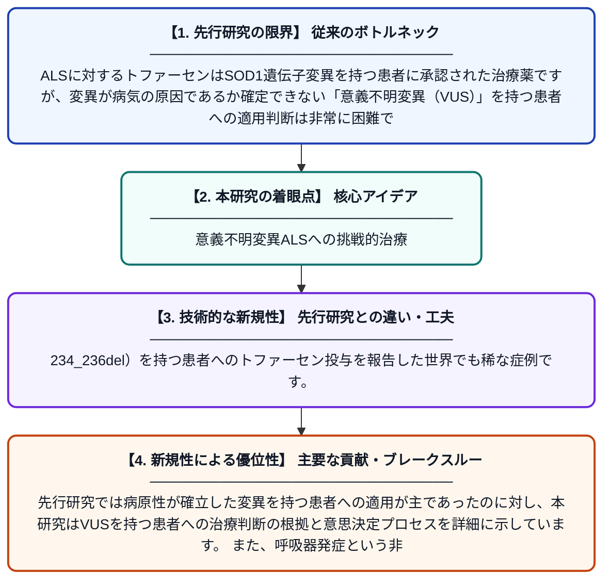

# SOD1遺伝子における意義不明変異を伴う呼吸器発症型ALSに対するトファーセン治療：症例報告

**Original Title**: *Tofersen treatment in respiratory onset amyotrophic lateral sclerosis and a variant of uncertain significance in SOD1; a case report*

> **💡 一言要約**: 意義不明変異ALSへの挑戦的治療

| 項目 | 内容 |
|---|---|
| **著者** | SW Willemse, KC Demaegd, W Koole, RPA van Eijk |
| **掲載誌** | European Journal of Human Genetics 2026 |
| **アラートキーワード** | ALS |
| **原文リンク** | [https://www.nature.com/articles/s41431-026-02208-5](https://www.nature.com/articles/s41431-026-02208-5) |
| **PDF版要約** | [README.pdf](./README.pdf) |

---

## 📊 新規性の図解（先行研究との違いと本研究のブレークスルー）

## 📝 要約

本論文は、SOD1遺伝子に新規の意義不明変異（c.234_236del p.(Glu79del)）を持つ呼吸器発症型ALS患者に対して、アンチセンスオリゴヌクレオチド薬トファーセンを投与した症例を報告したものです。意義不明変異（VUS）を有する患者への治療適用という倫理的・臨床的に難しい判断のプロセスが詳述されています。この症例は、VUSを持つ患者に対する遺伝子標的治療の可能性と課題を示す重要な先例となります。

## ❓ どんな問題に取り組んだか

ALSに対するトファーセンはSOD1遺伝子変異を持つ患者に承認された治療薬ですが、変異が病気の原因であるか確定できない「意義不明変異（VUS）」を持つ患者への適用判断は非常に困難です。特に呼吸器から発症するという珍しい病型に加え、VUSという不確実性が重なることで、治療開始の根拠をどう確立するかが大きな臨床課題となっています。

## ✨ 何が新しい？何がすごい？（新規性）

本論文は、SOD1遺伝子における新規VUS（c.234_236del）を持つ患者へのトファーセン投与を報告した世界でも稀な症例です。先行研究では病原性が確立した変異を持つ患者への適用が主であったのに対し、本研究はVUSを持つ患者への治療判断の根拠と意思決定プロセスを詳細に示しています。また、呼吸器発症という非典型的な病型との組み合わせを記録した点でも新規性があります。この症例はVUS保有患者への遺伝子標的治療の臨床的・倫理的枠組みを構築するうえで重要な貢献をしています。

## 🎓 大学1年生向けの解説

ALS（筋萎縮性側索硬化症）は全身の筋肉が動かせなくなる重篤な病気で、現在も有効な治療法が限られています。最近、SOD1という遺伝子に異常がある場合に効く「トファーセン」という薬が登場しました。しかし、遺伝子の変異が本当に病気の原因かどうかわからない「意義不明変異」を持つ患者に、この薬を使っていいかどうかは非常に難しい問題です。この論文は、そのような不確かな状況でも医師がどのように判断して治療を行ったかを報告した実際の事例であり、今後の同様な患者の治療指針を作るうえで大切な参考になります。
