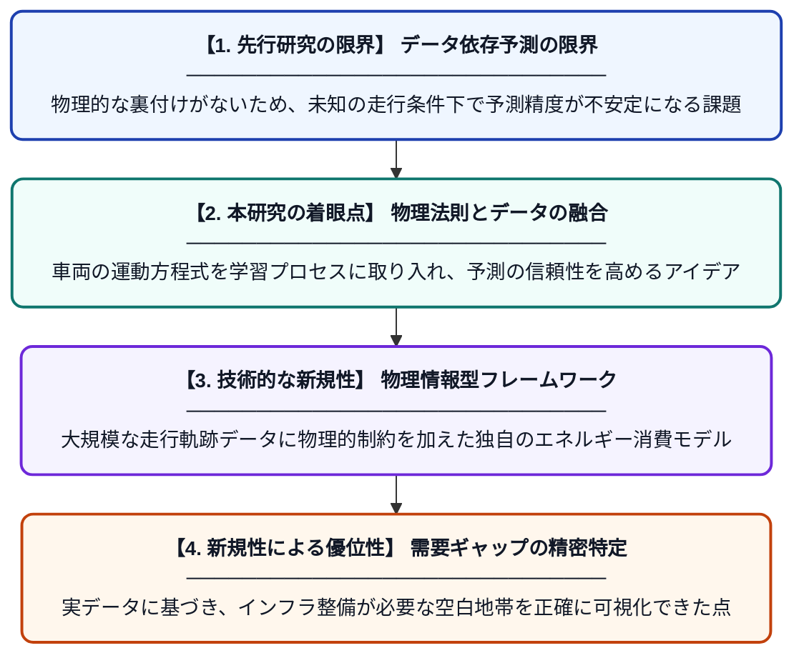

# 物流用電気自動車の物理学に基づくエネルギー消費予測と充電需要ギャップの特定

**Original Title**: *Physics-informed energy-consumption prediction and charging-demand gap identification for logistics electric vehicles*

> **💡 一言要約**: 物理学で物流EVの電費と充電不足を可視化

| 項目 | 内容 |
|---|---|
| **著者** | MA Ayaz, I Ullah, Q Yuan, C Yang, W Zhao, A Alhawiti |
| **掲載誌** | Transportation Research Part … 2027 |
| **アラートキーワード** | logistics |
| **原文リンク** | [https://www.sciencedirect.com/science/article/pii/S136192092600516X](https://www.sciencedirect.com/science/article/pii/S136192092600516X) |
| **PDF版要約** | [README.pdf](./README.pdf) |

---

## 📊 新規性の図解（先行研究との違いと本研究のブレークスルー）

## 📝 要約

上海の物流用電気自動車（LEV）から得られた約86万件の膨大な走行データを活用し、物理法則を組み込んだエネルギー消費予測モデルを構築しました。このモデルを用いて、実際の車両運行から生じる充電需要と既存インフラの供給能力の差（ギャップ）を地理的に特定しています。

## ❓ どんな問題に取り組んだか

従来のエネルギー消費予測は、データに依存しすぎるAIモデルか、現実の走行環境を反映しきれない理論式のいずれかに偏っていました。特に物流車両は荷重やルートが多様なため、精度高く消費電力を予測し、不足している充電設備を特定することが困難でした。

## ✨ 何が新しい？何がすごい？（新規性）

本研究は、車両の運動方程式という物理的な制約を機械学習モデルに組み込んだ「物理情報型（Physics-informed）」フレームワークを開発しました。上海の約85万件に及ぶ大規模な実走行データを用いて、単なる予測に留まらず、走行ルート上のどの地点で充電需要が満たされていないかを定量的に評価する手法を確立しました。これにより、物理的な妥当性とデータによる高精度な予測の両立を実現しています。

## 🎓 大学1年生向けの解説

電気で動く物流トラックは、重い荷物を運んだり坂道を登ったりするときに電池を多く使いますが、その減り方を正確に知るのは難しい課題でした。この研究では、物理の授業で習うような「運動の法則」と最新のAI技術を組み合わせることで、いつどこで電気がなくなるかを正確に当てる仕組みを作りました。さらに、上海の実際の走行データを使って、今の街のどこに充電器が足りないかを地図上で明らかにしました。これを使えば、効率的に充電器を増やす計画を立てることができます。
