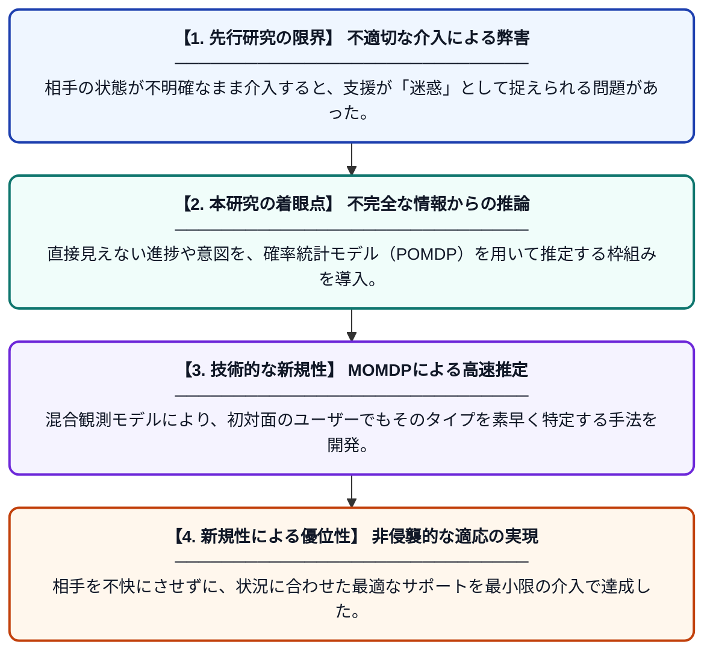

# 迷惑をかけずに人間に適応するロボット：進捗が直接見えない状況下でのユーザー推定

**Original Title**: *Robots Adapting to People Without Becoming a Nuisance*

> **💡 一言要約**: 空気を読んで邪魔せず助ける、賢い適応型ロボット

| 項目 | 内容 |
|---|---|
| **著者** | D Ghose |
| **掲載誌** | 2026 |
| **アラートキーワード** | MRFs Markov |
| **原文リンク** | [https://search.proquest.com/openview/57401b86cb99b3c2a8e49bef6c9230b7/1?pq-origsite=gscholar&cbl=18750&diss=y](https://search.proquest.com/openview/57401b86cb99b3c2a8e49bef6c9230b7/1?pq-origsite=gscholar&cbl=18750&diss=y) |
| **PDF版要約** | [README.pdf](./README.pdf) |

---

## 📊 新規性の図解（先行研究との違いと本研究のブレークスルー）

## 📝 要約

ロボットが人間の作業を支援する際、進捗を直接観察できない状況でも部分観測マルコフ決定過程（POMDP）を用いてユーザーの特性を推定する手法を提案しています。混合観測マルコフ決定過程（MOMDP）を活用することで、新しいユーザーのタイプを効率的に学習し、相手の不快感（迷惑）を最小限に抑えながら適切なタイミングで適応行動をとることが可能です。

## ❓ どんな問題に取り組んだか

ロボットが人間に協力する際、相手の意図や作業の進捗が完全には見えないことが多く、不適切なタイミングでの介入が「おせっかい」や「邪魔（nuisance）」になってしまう課題がありました。特に、初対面のユーザーがどのような支援を好むのかを素早く正確に判断し、適切な距離感を保つ仕組みが必要とされていました。

## ✨ 何が新しい？何がすごい？（新規性）

進捗を直接観測できない環境を対象に、POMDPを拡張して未知のユーザーのタイプを推論する新しい学習パラダイムを提示した点が画期的です。混合観測マルコフ決定過程（MOMDP）を統合することで、限定的な情報からユーザーの特性を効率的に推定し、介入の要否を動的に最適化しています。これにより、単なるタスク効率の向上だけでなく、心理的負担を抑えた人間中心の適応を実現しました。

## 🎓 大学1年生向けの解説

ロボットが家事などを手伝うとき、やりすぎると「おせっかい」になり、何もしないと「役に立たない」と思われてしまいます。この研究では、ロボットが人間の様子を少しずつ観察しながら、「この人は今、本当に助けが必要かな？」というのを数学的なモデルを使って予測する仕組みを作りました。相手が何をしているか完璧には見えなくても、わずかな手がかりから相手の性格や好みを当てるのが得意なロボットです。これにより、人間にストレスを与えず、必要なときだけスマートに助けてくれるようになります。
