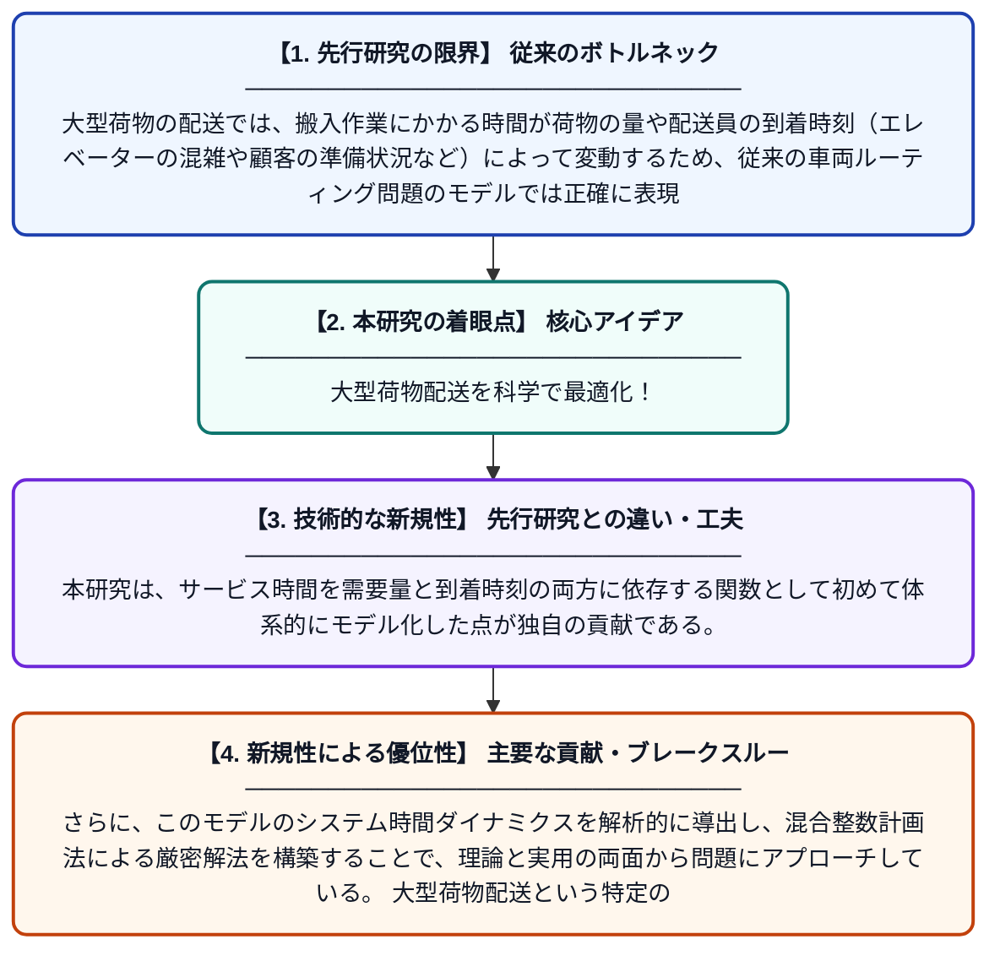

# 大型荷物配送における時間枠付き・到着時刻依存サービス時間を考慮した車両ルーティング問題

**Original Title**: *Vehicle routing problem with time windows and arrival-dependent service times for bulky item delivery*

> **💡 一言要約**: 大型荷物配送を科学で最適化！

| 項目 | 内容 |
|---|---|
| **著者** | S Huang |
| **掲載誌** | 2026 |
| **アラートキーワード** | VRP |
| **PDF** | [https://repositories.lib.utexas.edu/server/api/core/bitstreams/b48ff602-11e3-4255-83e7-478ed5e7a42c/content](https://repositories.lib.utexas.edu/server/api/core/bitstreams/b48ff602-11e3-4255-83e7-478ed5e7a42c/content) |
| **原文リンク** | [https://repositories.lib.utexas.edu/bitstreams/b48ff602-11e3-4255-83e7-478ed5e7a42c/download](https://repositories.lib.utexas.edu/bitstreams/b48ff602-11e3-4255-83e7-478ed5e7a42c/download) |
| **PDF版要約** | [README.pdf](./README.pdf) |

---

## 📊 新規性の図解（先行研究との違いと本研究のブレークスルー）

## 📝 要約

本論文は、大型荷物（家具や家電など）の配送に特化した車両ルーティング問題の拡張版を提案し、需要量と到着時刻に依存するサービス時間をモデル化している。システムの時間的ダイナミクスを数理的に定式化し、混合整数計画法（MIP）を用いた解法を開発している。時間枠制約と現実的なサービス時間のモデリングを組み合わせることで、実務的な大型荷物配送の最適化に貢献している。

## ❓ どんな問題に取り組んだか

大型荷物の配送では、搬入作業にかかる時間が荷物の量や配送員の到着時刻（エレベーターの混雑や顧客の準備状況など）によって変動するため、従来の車両ルーティング問題のモデルでは正確に表現できなかった。また、配送時間枠（顧客が指定する受取可能時間帯）も同時に考慮する必要があり、問題の複雑さが大幅に増す。こうした現実的な制約を無視すると、計画通りに配送が完了しないリスクが高まる。

## ✨ 何が新しい？何がすごい？（新規性）

従来の時間枠付き車両ルーティング問題では、サービス時間（荷物の積み下ろし時間）は固定値として扱われることがほとんどであった。本研究は、サービス時間を需要量と到着時刻の両方に依存する関数として初めて体系的にモデル化した点が独自の貢献である。さらに、このモデルのシステム時間ダイナミクスを解析的に導出し、混合整数計画法による厳密解法を構築することで、理論と実用の両面から問題にアプローチしている。大型荷物配送という特定のドメインに特化した現実的なモデリングにより、実際の物流業務への直接的な応用可能性を高めている。

## 🎓 大学1年生向けの解説

宅配便で冷蔵庫やソファのような大きな荷物を届けるとき、どのトラックがどの順番でどこに行けば一番効率的かを考える問題です。大きな荷物は運び込むのに時間がかかりますが、その時間は荷物の量や到着した時刻によっても変わります（例えば混雑時間帯はエレベーターを待つなど）。この論文では、そういった現実に近い複雑な条件を数式で表し、コンピュータで最良の配送ルートを計算する方法を開発しました。これにより、配送会社はコストを減らしながら、お客さんが指定した時間帯にきちんと届けられるようになります。
