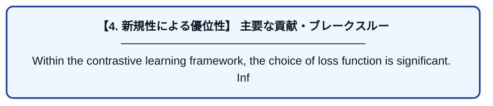

# SCARF: SELF-SUPERVISED CONTRASTIVE LEARNING USING RANDOM FEATURE CORRUPTION

| 項目 | 内容 |
|---|---|
| **PDF版要約** | [README.pdf](./README.pdf) |

---

## 📊 新規性の図解（先行研究との違いと本研究のブレークスルー）

## 📝 要約

Within the contrastive learning framework, the choice of loss function is significant. InfoNCE (Gutmann & Hyvärinen, 2010; Oord et al., 2018), which can be interpreted as a non-parametric estimation
of the entropy of the representation (Wang & Isola, 2020), is a popular choice. Since then there have
been a number of proposals (Zbontar et al., 2021; Grill et al., 2020; Hjelm et al., 2018); however, we
show that InfoNCE is effective for our framework.
