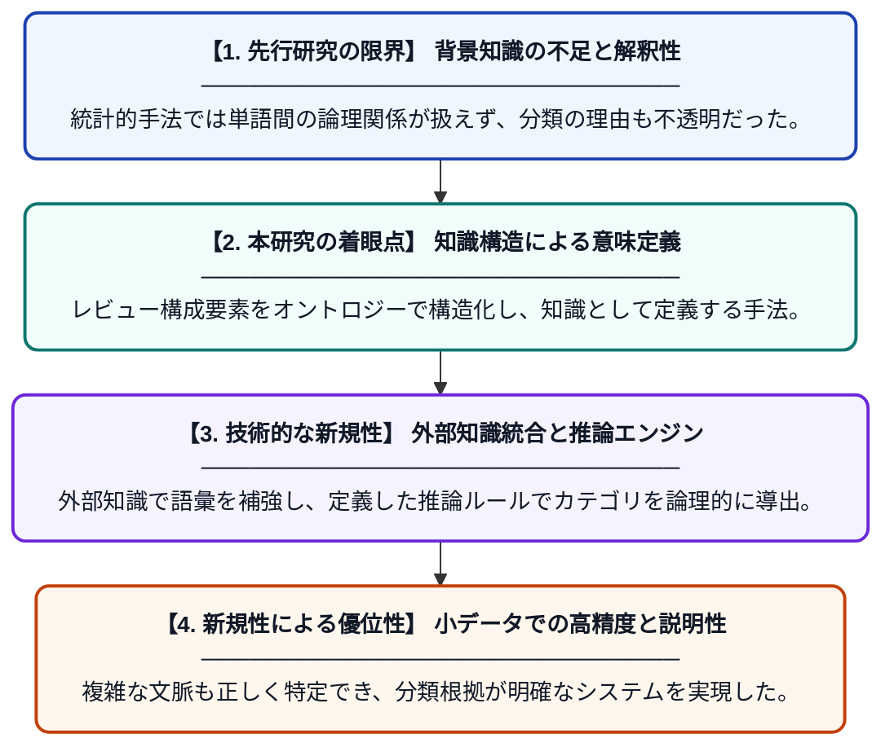

# OntoACD: 意味推論と外部知識統合によるオントロジー駆動型アスペクトカテゴリ検出

**Original Title**: *OntoACD: Ontology-Driven Aspect Category Detection with Semantic Inference and External Knowledge Integration*

> **💡 一言要約**: 知識の地図と推論で、レビューの真意を読み解く

| 項目 | 内容 |
|---|---|
| **著者** | W Suwanpipob, W Wunnasri, J Kaewyotha, M Wattana… |
| **掲載誌** | IEEE Access 2026 |
| **アラートキーワード** | Ontology |
| **PDF** | [https://ieeexplore.ieee.org/iel8/6287639/6514899/11769952.pdf](https://ieeexplore.ieee.org/iel8/6287639/6514899/11769952.pdf) |
| **原文リンク** | [https://ieeexplore.ieee.org/iel8/6287639/6514899/11769952.pdf](https://ieeexplore.ieee.org/iel8/6287639/6514899/11769952.pdf) |
| **PDF版要約** | [README.pdf](./README.pdf) |

---

## 📊 新規性の図解（先行研究との違いと本研究のブレークスルー）

## 📝 要約

商品レビューから「味」や「接客」などのカテゴリを特定するアスペクトカテゴリ検出（ACD）において、知識体系（オントロジー）を活用した新しいフレームワークを提案しました。オントロジーの構築、意味情報の強化、ルールベースの推論を統合することで、単語間の複雑な関係性を捉えた高精度な分類を実現しています。

## ❓ どんな問題に取り組んだか

従来の機械学習手法では、特定のドメインに関する背景知識や、単語間の論理的なつながりを十分に考慮できないという課題がありました。特に、カテゴリを示す単語が直接含まれない場合や、文脈が複雑な場合に、正しいアスペクトを特定することが困難でした。

## ✨ 何が新しい？何がすごい？（新規性）

本研究の最大の特徴は、レビュー、感情語、アスペクト語などを統合した独自のオントロジーを定義し、外部知識を用いた「意味的強化」と「ルールベース推論」を組み合わせた点にあります。単なる統計的なパターンマッチングではなく、定義されたルールに基づき論理的にカテゴリを導き出すため、少ないデータでも高い精度を発揮します。また、推論プロセスが明確であるため、なぜそのカテゴリに分類されたのかという解釈性が従来手法よりも格段に向上しています。

## 🎓 大学1年生向けの解説

ネット上のレビューをコンピュータに整理させるのは意外と大変です。例えば「店員が笑顔だった」という文から、これが「接客」に関する評価だと教え込む必要があります。この研究では、人間が持つ「知識の地図」のようなものをコンピュータに持たせ、さらに「この言葉が出たらこう考える」というルールを教えました。これにより、コンピュータが人間のように背景知識を使って、レビューの内容を正しく分類できるようになりました。
