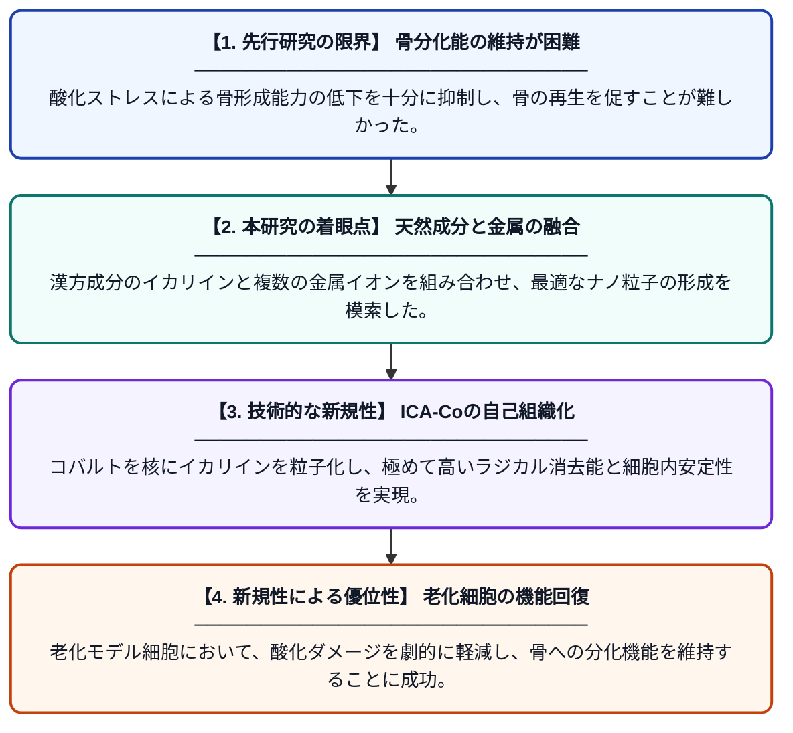

# イカリイン・コバルトナノ粒子による抗酸化保護と骨分化能の維持

**Original Title**: *Icariin–Cobalt Nanoparticles for Antioxidant Protection and Preservation of Osteogenic Differentiation*

> **💡 一言要約**: イカリインとコバルトで骨の老化を防ぐ新粒子

| 項目 | 内容 |
|---|---|
| **著者** | C Qiu, C Wang, Y Zhang, D Jiang, C Xu, Z Zhang… |
| **掲載誌** | Frontiers in Bioengineering and … |
| **アラートキーワード** | ICA |
| **原文リンク** | [https://www.frontiersin.org/journals/bioengineering-and-biotechnology/articles/10.3389/fbioe.2026.2053250/full](https://www.frontiersin.org/journals/bioengineering-and-biotechnology/articles/10.3389/fbioe.2026.2053250/full) |
| **PDF版要約** | [README.pdf](./README.pdf) |

---

## 📊 新規性の図解（先行研究との違いと本研究のブレークスルー）

## 📝 要約

天然由来の成分であるイカリインとコバルトイオンを自己組織化させ、新しいナノ粒子（ICA-Co）を開発しました。このナノ粒子は優れた活性酸素除去能力を持ち、老化モデル細胞において酸化ストレスから保護しつつ、骨を作る能力（骨分化能）を維持・促進する効果が確認されました。

## ❓ どんな問題に取り組んだか

加齢や酸化ストレスは細胞の機能を低下させ、骨を形成する「骨芽細胞」の分化を妨げるため、骨粗鬆症などの原因となります。従来の抗酸化剤では、安定性や骨形成を促進する効果が不十分であり、効果的に老化を抑制しつつ骨再生を促す新しいアプローチが求められていました。

## ✨ 何が新しい？何がすごい？（新規性）

漢方薬成分であるイカリイン（ICA）を、カルシウム、マグネシウム、亜鉛、コバルトといった様々な金属イオンと反応させ、最適な組み合わせを探索しました。その結果、コバルトとの組み合わせ（ICA-Co）が最も高いラジカル消去能を持つことを突き止めました。この粒子は単なる抗酸化剤としてだけでなく、老化モデル（D-ガラクトース誘発）における骨分化機能の減衰を劇的に防ぐという二重の機能を実現した点が革新的です。

## 🎓 大学1年生向けの解説

骨を作る細胞は、体が「サビる」原因となる酸化ストレスに弱く、年を取ると骨を作る力が弱まってしまいます。この研究では、植物由来の成分とコバルトという金属を混ぜ合わせることで、サビを効率よく取り除く特殊なナノサイズの粒子を作りました。この粒子を細胞に使うと、細胞のサビが取れるだけでなく、骨への成長を助けるスイッチが再び入ることが分かりました。将来、加齢による骨の弱まりを防ぐための新しい治療薬になる可能性があります。
