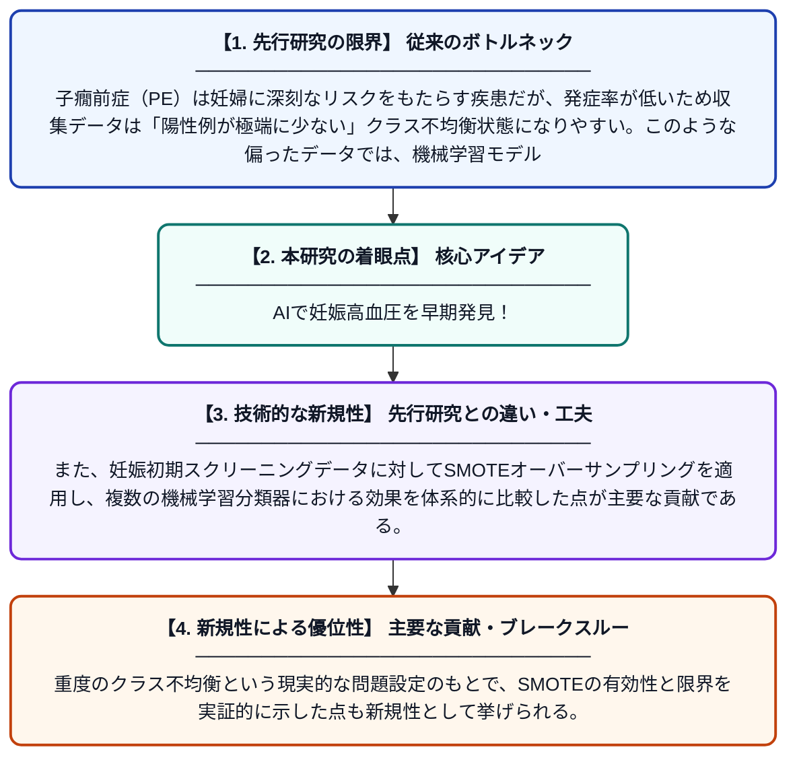

# 重度クラス不均衡下における子癇前症予測のためのSMOTEオーバーサンプリングが機械学習分類器に与える影響：ブルガリアスクリーニングコホートからの証拠

**Original Title**: *Impact of SMOTE Oversampling on Machine Learning Classifiers for Preeclampsia Prediction Under Severe Class Imbalance: Evidence from a Bulgarian Screening Cohort*

> **💡 一言要約**: AIで妊娠高血圧を早期発見！

| 項目 | 内容 |
|---|---|
| **著者** | V Derimanov, B Stoilov, M Shopov |
| **掲載誌** | Engineering Proceedings 2026 |
| **アラートキーワード** | SMOTE |
| **原文リンク** | [https://www.mdpi.com/2673-4591/150/1/84](https://www.mdpi.com/2673-4591/150/1/84) |
| **PDF版要約** | [README.pdf](./README.pdf) |

---

## 📊 新規性の図解（先行研究との違いと本研究のブレークスルー）

## 📝 要約

本論文は、ブルガリアのプロヴディフで収集された妊娠初期スクリーニングデータ（1383名）を用いて、子癇前症および妊娠高血圧症候群の予測に機械学習を適用した研究である。ロジスティック回帰など3種類の分類器を比較し、データの著しいクラス不均衡に対処するためSMOTEオーバーサンプリング技術の効果を検証した。クラス不均衡という実臨床データ特有の課題に対し、SMOTEが予測性能に与える影響を定量的に評価している。

## ❓ どんな問題に取り組んだか

子癇前症（PE）は妊婦に深刻なリスクをもたらす疾患だが、発症率が低いため収集データは「陽性例が極端に少ない」クラス不均衡状態になりやすい。このような偏ったデータでは、機械学習モデルが多数派クラス（正常妊婦）ばかりを予測するよう学習してしまい、実際に重要な少数派（発症例）の予測精度が著しく低下するという課題がある。

## ✨ 何が新しい？何がすごい？（新規性）

先行研究の多くは欧米や東アジアのコホートを対象としていたが、本研究はブルガリア（東欧）の実臨床データという地域的に新しいコホートを用いた点が特徴的である。また、妊娠初期スクリーニングデータに対してSMOTEオーバーサンプリングを適用し、複数の機械学習分類器における効果を体系的に比較した点が主要な貢献である。重度のクラス不均衡という現実的な問題設定のもとで、SMOTEの有効性と限界を実証的に示した点も新規性として挙げられる。

## 🎓 大学1年生向けの解説

子癇前症とは妊婦に起こる血圧が急上昇する病気で、放置すると母子ともに命に関わります。AIに妊娠初期の検査データを学ばせて、この病気を早期に予測しようとするのがこの研究です。しかし病気になる人は全体のごく一部なので、AIは『みんな正常』と予測するズルをしてしまいがちです。そこで「SMOTE」という技術で病気のデータを人工的に増やして、AIがちゃんと病気を見分けられるよう工夫しました。この研究はその工夫がどれだけ効果的かを、実際のブルガリアの病院データで検証したものです。
