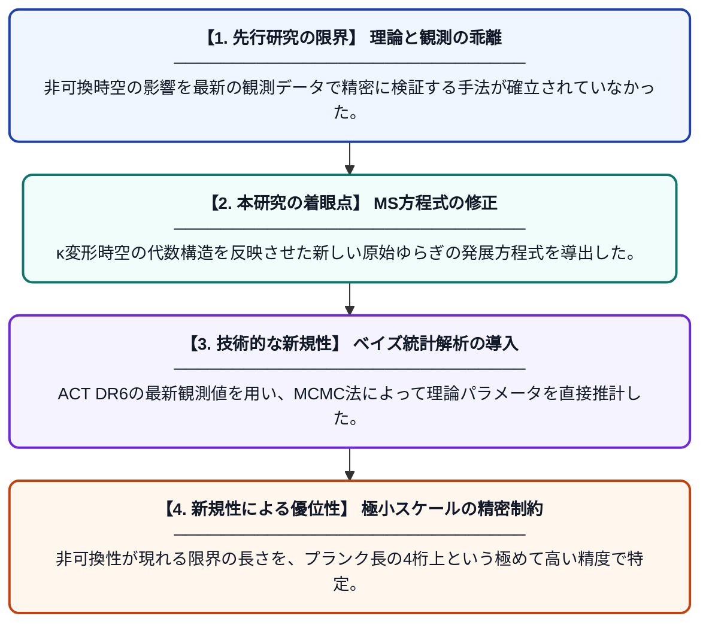

# κ変形された非可換時空における修正ムカノフ・ササキ方程式と原始ゆらぎ

**Original Title**: *Modified Mukhanov-Sasaki equation and primordial perturbations... ß in $\\kappa $-deformed non-commutative space-time*

> **💡 一言要約**: 宇宙観測から量子重力の「時空の粗さ」を精密に制限

| 項目 | 内容 |
|---|---|
| **著者** | L Yang, V Rajagopal, P Wu |
| **掲載誌** | Physics Letters B 2026 |
| **アラートキーワード** | MCMC |
| **原文リンク** | [https://www.sciencedirect.com/science/article/pii/S0370269326009925](https://www.sciencedirect.com/science/article/pii/S0370269326009925) |
| **PDF版要約** | [README.pdf](./README.pdf) |

---

## 📊 新規性の図解（先行研究との違いと本研究のブレークスルー）

## 📝 要約

量子重力理論の候補であるκ変形非可換時空において、宇宙初期の揺らぎを記述する修正ムカノフ・ササキ方程式を導出しました。最新のACT DR6観測データを用いたベイズ解析により、非可換性のスケールに対してプランク長の約4桁上という、これまでで最も厳しい制約の一つを課すことに成功しました。

## ❓ どんな問題に取り組んだか

量子力学と一般相対性理論を統合する量子重力理論では、時空が連続的ではなく「非可換」な性質を持つことが示唆されています。しかし、この非可換性が宇宙初期の原始ゆらぎに具体的にどのような影響を与え、実際の観測データとどう矛盾しないかを検証するための理論的な枠組みと精密な定量的評価が不足していました。

## ✨ 何が新しい？何がすごい？（新規性）

本研究は、κ変形時空におけるインフレーション理論の根幹となるムカノフ・ササキ方程式を修正し、観測可能な宇宙背景放射のゆらぎへの影響を定量化しました。特筆すべきは、最新の宇宙マイクロ波背景放射データ（ACT DR6）を用いたMCMC解析により、非可換スケールの長さλを約1.93×10^-29メートル以下に制約した点です。これはプランクスケールの約1万倍に相当し、先行研究よりも遥かに高精度に理論のパラメータ空間を絞り込んでいます。

## 🎓 大学1年生向けの解説

私たちが住む世界を極限まで拡大すると、座標の順番を入れ替えられない「非可換時空」という特殊な構造をしているかもしれません。この研究は、その不思議な時空で宇宙の始まりの「揺らぎ」がどう変化するかを数式で明らかにしました。そして、実際の宇宙観測データと照らし合わせることで、時空の網目のような構造がどれほど細かいかという限界値を導き出しました。これは、宇宙の誕生の謎を解く「量子重力」という究極の理論に一歩近づく成果です。
