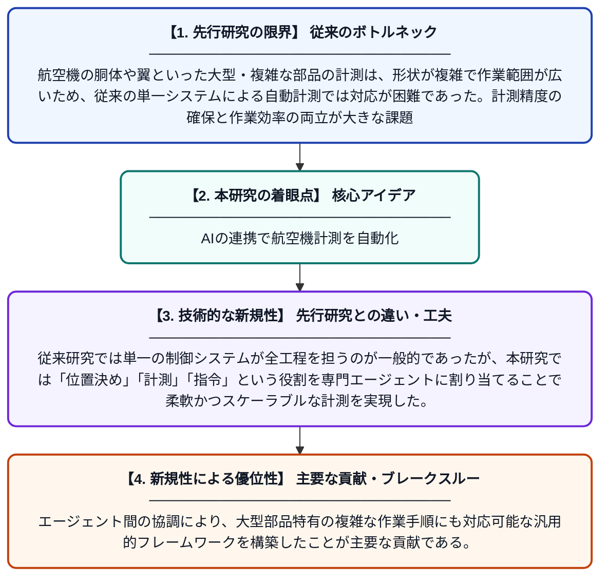

# 大型・複雑な航空機部品のためのマルチエージェント協調型計測フレームワーク

**Original Title**: *A multi-agent collaboration-based measurement framework for large and complex aircraft components*

> **💡 一言要約**: AIの連携で航空機計測を自動化

| 項目 | 内容 |
|---|---|
| **著者** | Z Chen, Y Zeng, S Yuan, B Shen, H Cai |
| **掲載誌** | Future Generation Computer Systems 2026 |
| **アラートキーワード** | multi agent |
| **原文リンク** | [https://www.sciencedirect.com/science/article/pii/S0167739X2600350X](https://www.sciencedirect.com/science/article/pii/S0167739X2600350X) |
| **PDF版要約** | [README.pdf](./README.pdf) |

---

## 📊 新規性の図解（先行研究との違いと本研究のブレークスルー）

## 📝 要約

本論文では、大型かつ複雑な航空機部品の計測作業を効率化するために、複数のAIエージェントが協調して動作するフレームワークを提案している。位置決め・計測・指令といった役割を異なるエージェントに分担させることで、複雑な計測タスクを体系的に分解・処理する。このアプローチにより、従来の単一システムでは困難だった大規模部品の精密計測の自動化を実現している。

## ❓ どんな問題に取り組んだか

航空機の胴体や翼といった大型・複雑な部品の計測は、形状が複雑で作業範囲が広いため、従来の単一システムによる自動計測では対応が困難であった。計測精度の確保と作業効率の両立が大きな課題となっており、人手に頼る部分も多く時間とコストがかかっていた。

## ✨ 何が新しい？何がすごい？（新規性）

本研究の新規性は、計測タスクをマルチエージェント方式で分解・分担するというアーキテクチャの設計にある。従来研究では単一の制御システムが全工程を担うのが一般的であったが、本研究では「位置決め」「計測」「指令」という役割を専門エージェントに割り当てることで柔軟かつスケーラブルな計測を実現した。エージェント間の協調により、大型部品特有の複雑な作業手順にも対応可能な汎用的フレームワークを構築したことが主要な貢献である。

## 🎓 大学1年生向けの解説

飛行機の部品はとても大きくて形が複雑なので、寸法を正確に測るのがとても難しいです。この研究では、複数のAI（エージェント）にそれぞれ「場所を決める係」「実際に測る係」「指示を出す係」といった役割を与え、チームワークで計測を行う仕組みを作りました。これはちょうど、工場の作業員がそれぞれの専門作業を分担して協力するようなイメージです。こうすることで、一つのAIでは手に負えなかった複雑な計測作業も効率よく自動でこなせるようになります。
