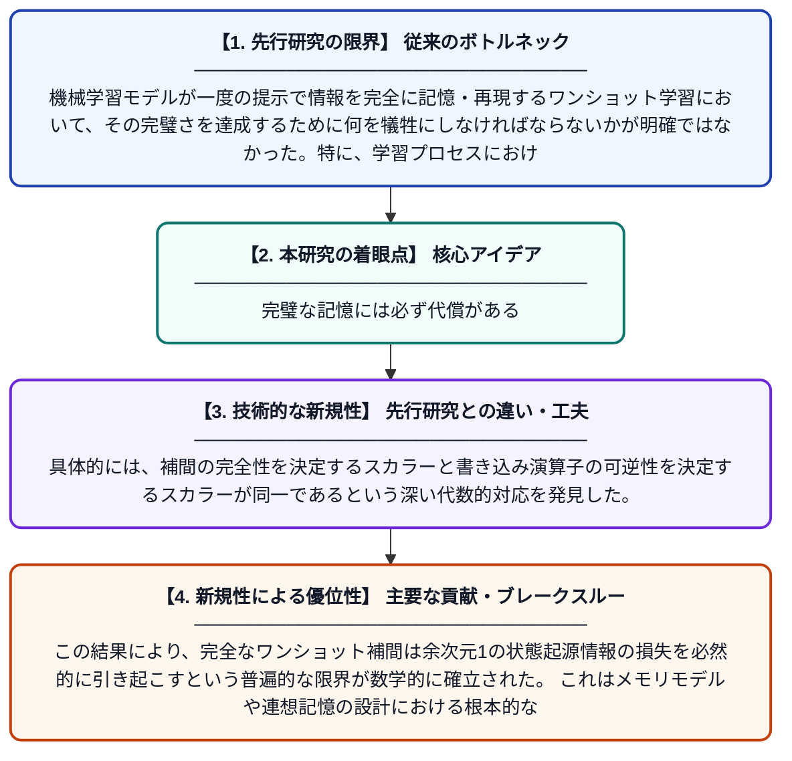

# 完全ワンショット学習の代償

**Original Title**: *The Price of Perfect One-Shot Learning*

> **💡 一言要約**: 完璧な記憶には必ず代償がある

| 項目 | 内容 |
|---|---|
| **著者** | DP Ghosh |
| **掲載誌** | 2026 |
| **アラートキーワード** | one shot |
| **PDF** | [https://www.researchgate.net/profile/Debi-Prasad-Ghosh/publication/410745715_The_Price_of_Perfect_One-Shot_Learning_Why_the_Interpolating_Delta_Step_Is_Exactly_the_Irreversible_One/links/6a6245a54baba3285428e626/The-Price-of-Perfect-One-Shot-Learning-Why-the-Interpolating-Delta-Step-Is-Exactly-the-Irreversible-One.pdf](https://www.researchgate.net/profile/Debi-Prasad-Ghosh/publication/410745715_The_Price_of_Perfect_One-Shot_Learning_Why_the_Interpolating_Delta_Step_Is_Exactly_the_Irreversible_One/links/6a6245a54baba3285428e626/The-Price-of-Perfect-One-Shot-Learning-Why-the-Interpolating-Delta-Step-Is-Exactly-the-Irreversible-One.pdf) |
| **原文リンク** | [https://www.researchgate.net/profile/Debi-Prasad-Ghosh/publication/410745715_The_Price_of_Perfect_One-Shot_Learning_Why_the_Interpolating_Delta_Step_Is_Exactly_the_Irreversible_One/links/6a6245a54baba3285428e626/The-Price-of-Perfect-One-Shot-Learning-Why-the-Interpolating-Delta-Step-Is-Exactly-the-Irreversible-One.pdf](https://www.researchgate.net/profile/Debi-Prasad-Ghosh/publication/410745715_The_Price_of_Perfect_One-Shot_Learning_Why_the_Interpolating_Delta_Step_Is_Exactly_the_Irreversible_One/links/6a6245a54baba3285428e626/The-Price-of-Perfect-One-Shot-Learning-Why-the-Interpolating-Delta-Step-Is-Exactly-the-Irreversible-One.pdf) |
| **PDF版要約** | [README.pdf](./README.pdf) |

---

## 📊 新規性の図解（先行研究との違いと本研究のブレークスルー）

## 📝 要約

この論文は、完全なワンショット補間（一度の学習で完璧に記憶する能力）を支配するスカラー値が、書き込み演算子の可逆性を支配するスカラー値と正確に一致することを証明した。この対応関係により、完全なワンショット補間は状態の起源（どの入力がどの状態を生んだか）に関して余次元1の情報損失を必然的に伴うことが示された。つまり、完璧な記憶には構造的なトレードオフが存在することを数学的に明らかにした。

## ❓ どんな問題に取り組んだか

機械学習モデルが一度の提示で情報を完全に記憶・再現するワンショット学習において、その完璧さを達成するために何を犠牲にしなければならないかが明確ではなかった。特に、学習プロセスにおける状態の追跡可能性（どの入力がどの内部状態を引き起こしたか）の損失が定量的に理解されていなかった。

## ✨ 何が新しい？何がすごい？（新規性）

先行研究ではワンショット学習の性能向上に焦点が当てられていたが、本研究はその完璧な実現に伴う構造的コストを初めて厳密に証明した。具体的には、補間の完全性を決定するスカラーと書き込み演算子の可逆性を決定するスカラーが同一であるという深い代数的対応を発見した。この結果により、完全なワンショット補間は余次元1の状態起源情報の損失を必然的に引き起こすという普遍的な限界が数学的に確立された。これはメモリモデルや連想記憶の設計における根本的なトレードオフを明示する理論的貢献である。

## 🎓 大学1年生向けの解説

「ワンショット学習」とは、一度見ただけで完璧に覚えることを目指すAIの学習方法です。この研究は、そのような完璧な記憶を実現しようとすると、必ず「どの情報がどこから来たか」という追跡情報の一部が失われることを数学的に証明しました。たとえると、写真をぴったり収まるよう額縁に入れると、額縁の裏側が見えなくなるようなものです。完璧に情報を保存しようとすると、その情報の由来を知る手がかりが一次元分だけ消えてしまうのです。これは「完璧な記憶には必ず代償がある」という普遍的な法則を示しています。
