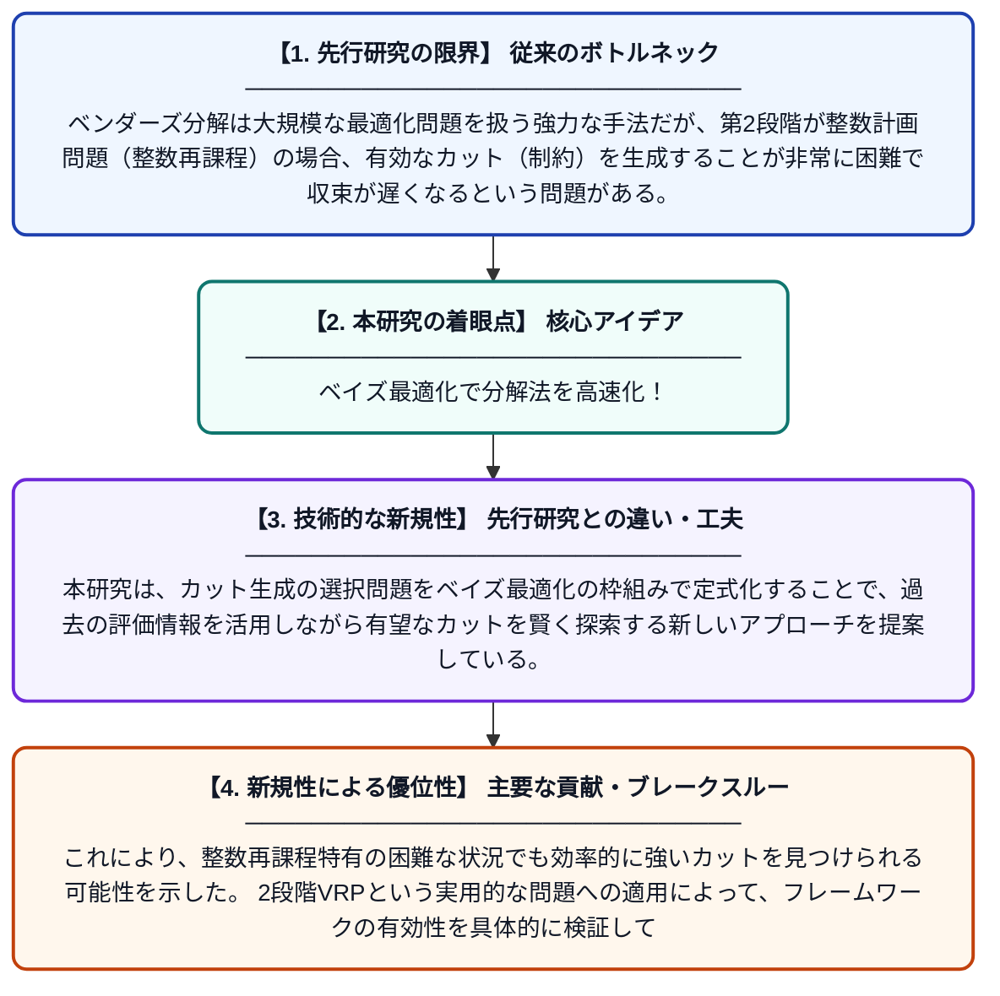

# 整数再課程を伴うベンダーズ分解におけるカット生成のベイズ最適化

**Original Title**: *Bayesian Optimization for Cut Generation in Benders Decomposition with Integer Recourse*

> **💡 一言要約**: ベイズ最適化で分解法を高速化！

| 項目 | 内容 |
|---|---|
| **著者** | Z Liu |
| **アラートキーワード** | VRP |
| **PDF** | [https://www.researchgate.net/profile/Zeyu-Liu-18/publication/410655881_Bayesian_Optimization_for_Cut_Generation_in_Benders_Decomposition_with_Integer_Recourse/links/6a5f9316f8eec13a96bcc517/Bayesian-Optimization-for-Cut-Generation-in-Benders-Decomposition-with-Integer-Recourse.pdf](https://www.researchgate.net/profile/Zeyu-Liu-18/publication/410655881_Bayesian_Optimization_for_Cut_Generation_in_Benders_Decomposition_with_Integer_Recourse/links/6a5f9316f8eec13a96bcc517/Bayesian-Optimization-for-Cut-Generation-in-Benders-Decomposition-with-Integer-Recourse.pdf) |
| **原文リンク** | [https://www.researchgate.net/profile/Zeyu-Liu-18/publication/410655881_Bayesian_Optimization_for_Cut_Generation_in_Benders_Decomposition_with_Integer_Recourse/links/6a5f9316f8eec13a96bcc517/Bayesian-Optimization-for-Cut-Generation-in-Benders-Decomposition-with-Integer-Recourse.pdf](https://www.researchgate.net/profile/Zeyu-Liu-18/publication/410655881_Bayesian_Optimization_for_Cut_Generation_in_Benders_Decomposition_with_Integer_Recourse/links/6a5f9316f8eec13a96bcc517/Bayesian-Optimization-for-Cut-Generation-in-Benders-Decomposition-with-Integer-Recourse.pdf) |
| **PDF版要約** | [README.pdf](./README.pdf) |

---

## 📊 新規性の図解（先行研究との違いと本研究のブレークスルー）

## 📝 要約

本論文では、整数再課程（第2段階が整数計画問題）を持つベンダーズ分解において、カット生成をベイズ最適化によって効率化するフレームワークを提案している。このフレームワークを、顧客をハブに割り当てる第1段階（整数計画）と各ハブが巡回セールスマン問題を解く第2段階（整数計画）からなる2段階車両経路問題に適用している。整数再課程における収束の遅さという課題に対し、ベイズ最適化を活用することで有効なカットを効率的に生成する手法を実証している。

## ❓ どんな問題に取り組んだか

ベンダーズ分解は大規模な最適化問題を扱う強力な手法だが、第2段階が整数計画問題（整数再課程）の場合、有効なカット（制約）を生成することが非常に困難で収束が遅くなるという問題がある。特に車両経路問題のような組合せ最適化への適用では、この課題が顕著に現れる。

## ✨ 何が新しい？何がすごい？（新規性）

従来の整数再課程を伴うベンダーズ分解では、カット生成が試行錯誤的であり効率的な探索が難しかった。本研究は、カット生成の選択問題をベイズ最適化の枠組みで定式化することで、過去の評価情報を活用しながら有望なカットを賢く探索する新しいアプローチを提案している。これにより、整数再課程特有の困難な状況でも効率的に強いカットを見つけられる可能性を示した。2段階VRPという実用的な問題への適用によって、フレームワークの有効性を具体的に検証している点も貢献である。

## 🎓 大学1年生向けの解説

大きな問題を小さな問題に分けて解く「ベンダーズ分解」という方法があります。しかし、分けた問題同士をうまくつなぐための「カット」と呼ばれるルールを見つけるのが難しいという欠点があります。この論文では、AIの学習技術の一つである「ベイズ最適化」を使って、良いカットを賢く自動で探す方法を考えました。例として、お客さんを各配送拠点に振り分け、そこから最短で回る配達ルートを決める問題に適用して有効性を確認しました。まるで試験勉強で過去問を参考にしながら効率よく対策するように、過去の情報を活かして賢く問題を解くイメージです。
