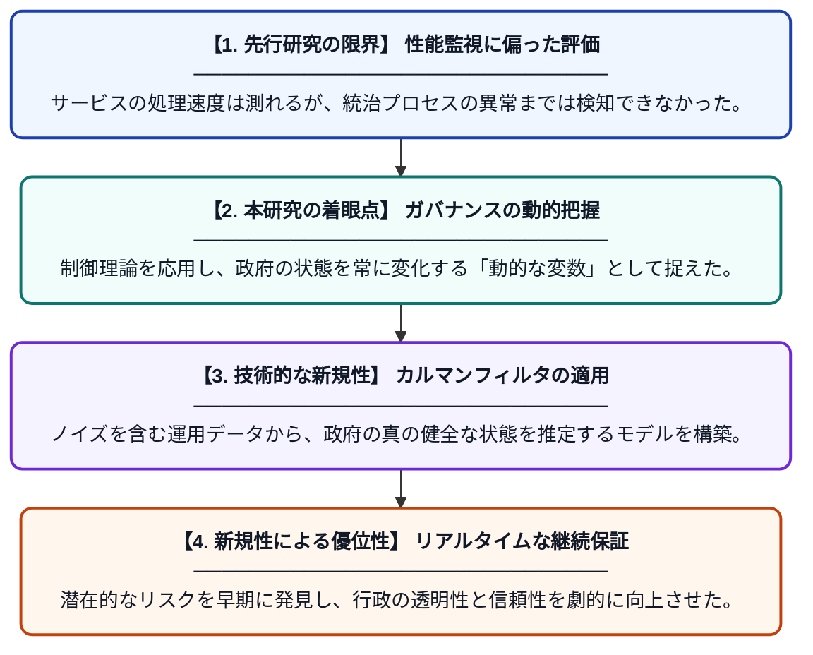

# スマート政府システムにおける継続的保証のためのガバナンス状態空間モデリングとカルマンフィルタリング

**Original Title**: *Governance State-Space Modeling and Kalman Filtering for Continuous Assurance in Smart Government Systems*

> **💡 一言要約**: カルマンフィルタで政府の健全性をリアルタイム監視

| 項目 | 内容 |
|---|---|
| **著者** | YH Putra, HP Ginanjar, M Ferinando, WFA Rahman… |
| **アラートキーワード** | kalman filter  "anomaly ... |
| **PDF** | [https://www.researchgate.net/profile/Yeffry-Handoko-Putra-2/publication/417941065_Governance_State-Space_Modeling_and_Kalman_Filtering_for_Continuous_Assurance_in_Smart_Government_Systems/links/6afac0dedc41aa6ac311bb2c/Governance-State-Space-Modeling-and-Kalman-Filtering-for-Continuous-Assurance-in-Smart-Government-Systems.pdf](https://www.researchgate.net/profile/Yeffry-Handoko-Putra-2/publication/417941065_Governance_State-Space_Modeling_and_Kalman_Filtering_for_Continuous_Assurance_in_Smart_Government_Systems/links/6afac0dedc41aa6ac311bb2c/Governance-State-Space-Modeling-and-Kalman-Filtering-for-Continuous-Assurance-in-Smart-Government-Systems.pdf) |
| **原文リンク** | [https://www.researchgate.net/profile/Yeffry-Handoko-Putra-2/publication/417941065_Governance_State-Space_Modeling_and_Kalman_Filtering_for_Continuous_Assurance_in_Smart_Government_Systems/links/6afac0dedc41aa6ac311bb2c/Governance-State-Space-Modeling-and-Kalman-Filtering-for-Continuous-Assurance-in-Smart-Government-Systems.pdf](https://www.researchgate.net/profile/Yeffry-Handoko-Putra-2/publication/417941065_Governance_State-Space_Modeling_and_Kalman_Filtering_for_Continuous_Assurance_in_Smart_Government_Systems/links/6afac0dedc41aa6ac311bb2c/Governance-State-Space-Modeling-and-Kalman-Filtering-for-Continuous-Assurance-in-Smart-Government-Systems.pdf) |
| **PDF版要約** | [README.pdf](./README.pdf) |

---

## 📊 新規性の図解（先行研究との違いと本研究のブレークスルー）

## 📝 要約

スマート政府の健全性を維持するために、制御理論で使われるカルマンフィルタをガバナンスの監視に応用した研究です。サービスのパフォーマンス評価だけでなく、行政プロセスの異常検知や継続的な信頼性保証を動的に行う新しいフレームワークを提案しています。

## ❓ どんな問題に取り組んだか

従来の監視フレームワークは、サービスの処理速度などのパフォーマンス測定に偏っており、統治（ガバナンス）そのものの妥当性を評価できていませんでした。また、静的な分析手法では、複雑に変化するデジタル行政プロセスの異常をリアルタイムに捉えることが困難でした。

## ✨ 何が新しい？何がすごい？（新規性）

本研究は、工学分野で位置推定などに使われる「カルマンフィルタ」と「状態空間モデル」を、政府ガバナンスの監視に導入した点が画期的です。先行研究が結果の出力のみを追っていたのに対し、本手法はガバナンスの内部状態を動的な変数として扱い、ノイズの多い運用データからでも真の健全性を推定できます。これにより、行政の透明性と信頼性を担保する「継続的保証」の技術的基盤を構築しました。

## 🎓 大学1年生向けの解説

「スマート政府」とはITを駆使した便利な役所のことですが、その仕組みが正しく動いているかを常にチェックするのは難しい仕事です。この論文では、飛行機やロボットの動きを予測するのに使われる数学的なテクニックを、政府の運営チェックに応用しました。これを使うと、たとえデータが不完全であっても、政府がルール通りに運営されているかをリアルタイムで見守ることができます。つまり、デジタルの力で「隠れたミスや不正」を素早く見つけ、より信頼できる社会を作るための研究です。
