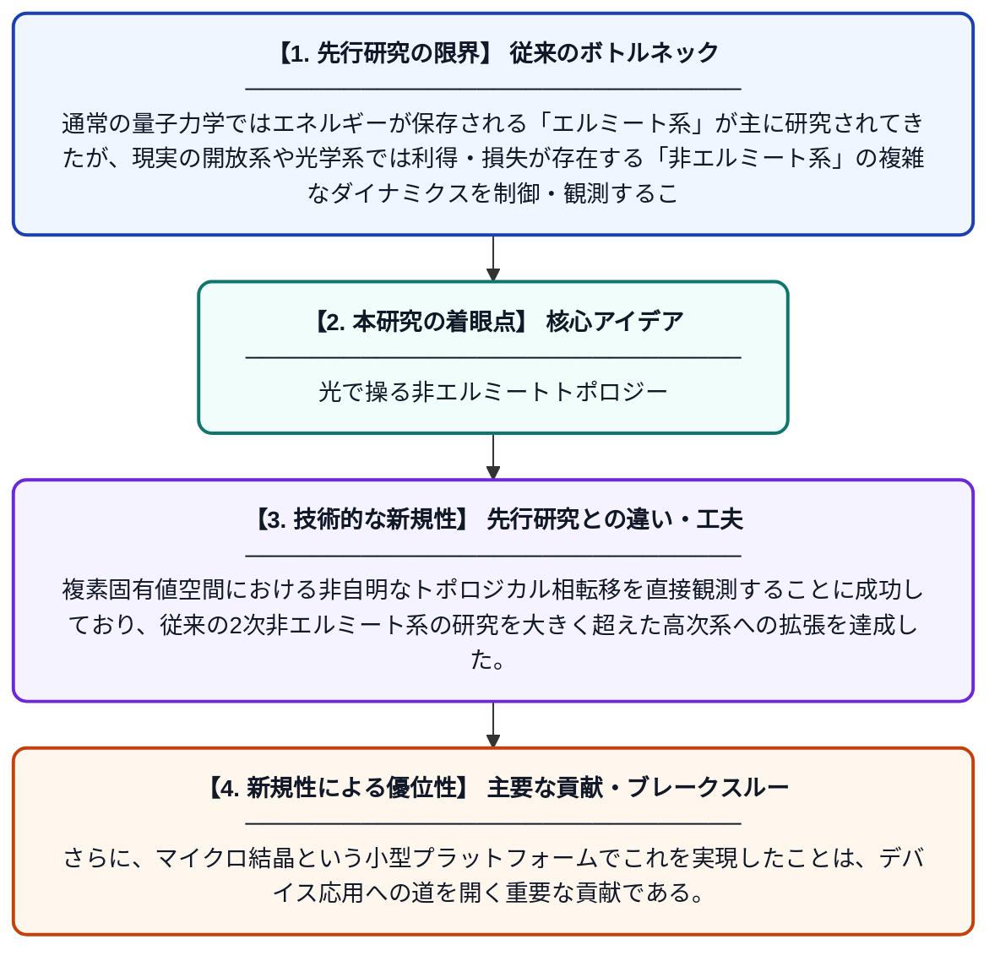

# 位相制御ループと四波混合を用いた希土類イオンドープマイクロ結晶における4次非エルミートダイナミクス

**Original Title**: *OP I ICA*

> **💡 一言要約**: 光で操る非エルミートトポロジー

| 項目 | 内容 |
|---|---|
| **著者** | K Zaman, Z Mujahid, MA Iqbal, M Usman, Q Chen, C Li |
| **掲載誌** | 2026 |
| **アラートキーワード** | ICA |
| **原文リンク** | [https://opg.optica.org/josab/upcoming_pdf.cfm?id=603574](https://opg.optica.org/josab/upcoming_pdf.cfm?id=603574) |
| **PDF版要約** | [README.pdf](./README.pdf) |

---

## 📊 新規性の図解（先行研究との違いと本研究のブレークスルー）

## 📝 要約

本研究では、希土類イオンがドープされたマイクロ結晶において、位相制御ループと四波混合を活用して4次非エルミート系のダイナミクスを実験的に調査した。複素固有値空間を利用することで、非自明なトポロジカル相転移を実現できることを示した。この成果は、非エルミート物理学とトポロジカル量子光学の融合という新たな研究領域を開拓するものである。

## ❓ どんな問題に取り組んだか

通常の量子力学ではエネルギーが保存される「エルミート系」が主に研究されてきたが、現実の開放系や光学系では利得・損失が存在する「非エルミート系」の複雑なダイナミクスを制御・観測することが大きな課題であった。特に4次（高次）の非エルミート系では、理論的予測はあるものの実験的な実証が乏しかった。

## ✨ 何が新しい？何がすごい？（新規性）

本研究は、希土類イオンドープマイクロ結晶という固体光学系において、四波混合と位相制御ループを組み合わせることで4次非エルミート系を実験的に実現した点が新しい。複素固有値空間における非自明なトポロジカル相転移を直接観測することに成功しており、従来の2次非エルミート系の研究を大きく超えた高次系への拡張を達成した。さらに、マイクロ結晶という小型プラットフォームでこれを実現したことは、デバイス応用への道を開く重要な貢献である。

## 🎓 大学1年生向けの解説

普通の量子力学では「エネルギーが逃げない理想的なシステム」を扱いますが、現実のレーザーや光学デバイスではエネルギーの出入りがあります。本研究では、特殊な結晶に希土類元素を混ぜたマイクロサイズの物質を使い、光（四波混合という現象）でそのような「エネルギーが出入りするシステム」を精密に制御しました。すると、物質の性質がガラッと変わる「トポロジカル相転移」という不思議な現象を光で操れることがわかりました。これは、将来の量子コンピュータや超高感度センサーの実現につながる可能性を秘めた発見です。
