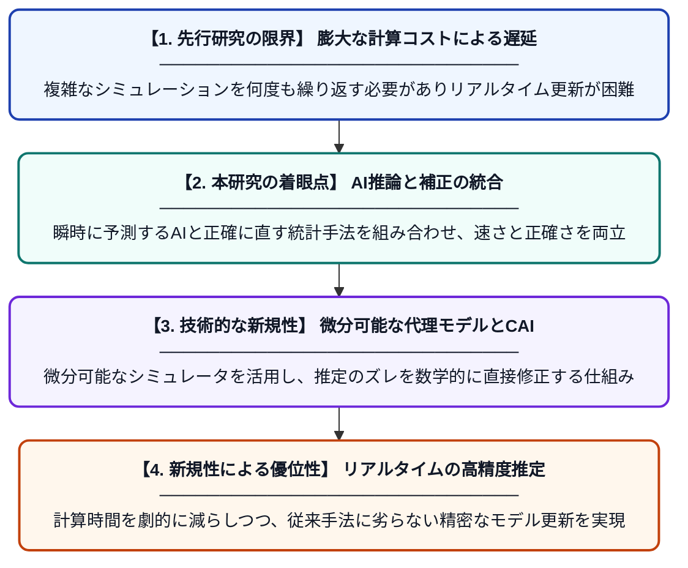

# MCMC補正を用いたリアルタイム構造モデル更新のためのデュアルモード償却ベイズフレームワーク

**Original Title**: *A dual-mode amortized Bayesian framework for real-time structural model updating with MCMC correction*

> **💡 一言要約**: 爆速かつ正確に建物の「健康診断」を行う新技術

| 項目 | 内容 |
|---|---|
| **著者** | J Hu, H Lam |
| **掲載誌** | Engineering Structures 2027 |
| **アラートキーワード** | MCMC |
| **原文リンク** | [https://www.sciencedirect.com/science/article/pii/S0141029626020328](https://www.sciencedirect.com/science/article/pii/S0141029626020328) |
| **PDF版要約** | [README.pdf](./README.pdf) |

---

## 📊 新規性の図解（先行研究との違いと本研究のブレークスルー）

## 📝 要約

構造物の状態をリアルタイムで更新するために、計算負荷の高い有限要素法を高速な代理モデルで置き換え、さらにMCMC法で精度を補正する「CAI（補正済み償却推論）」を提案しました。これにより、ベイズ推論に伴う膨大な計算コストを大幅に削減しつつ、従来手法と同等の高い推定精度を維持することに成功しています。

## ❓ どんな問題に取り組んだか

建物や橋梁の状態を推定する際、複雑なシミュレーション（有限要素法）を何度も繰り返す必要があり、計算に時間がかかりすぎるためリアルタイムの監視が困難でした。また、計算を簡略化しすぎると推定結果の信頼性が損なわれるという課題がありました。

## ✨ 何が新しい？何がすごい？（新規性）

訓練済みのニューラルネットワークを用いて瞬時に統計的な答えを出す「償却推論（Amortized Inference）」と、厳密な精度を保証する「MCMC法」を統合した点が最大の特徴です。微分可能な代理モデルを介して誤差を高速に修正できる「CAIフレームワーク」を構築したことで、先行研究では両立が難しかった「リアルタイム性」と「統計的厳密さ」を同時に達成しました。

## 🎓 大学1年生向けの解説

建物が地震などで壊れていないか調べるには、コンピュータで複雑なシミュレーションをする必要がありますが、これには通常とても長い時間がかかります。この研究では、AIにシミュレーションのコツをあらかじめ学習させておくことで、計算時間を一瞬に短縮しました。ただ速いだけでなく、計算結果が間違っていないか後からチェックして直す仕組みも備えています。これにより、建物の異常をその場ですぐに見つけられるようになります。
