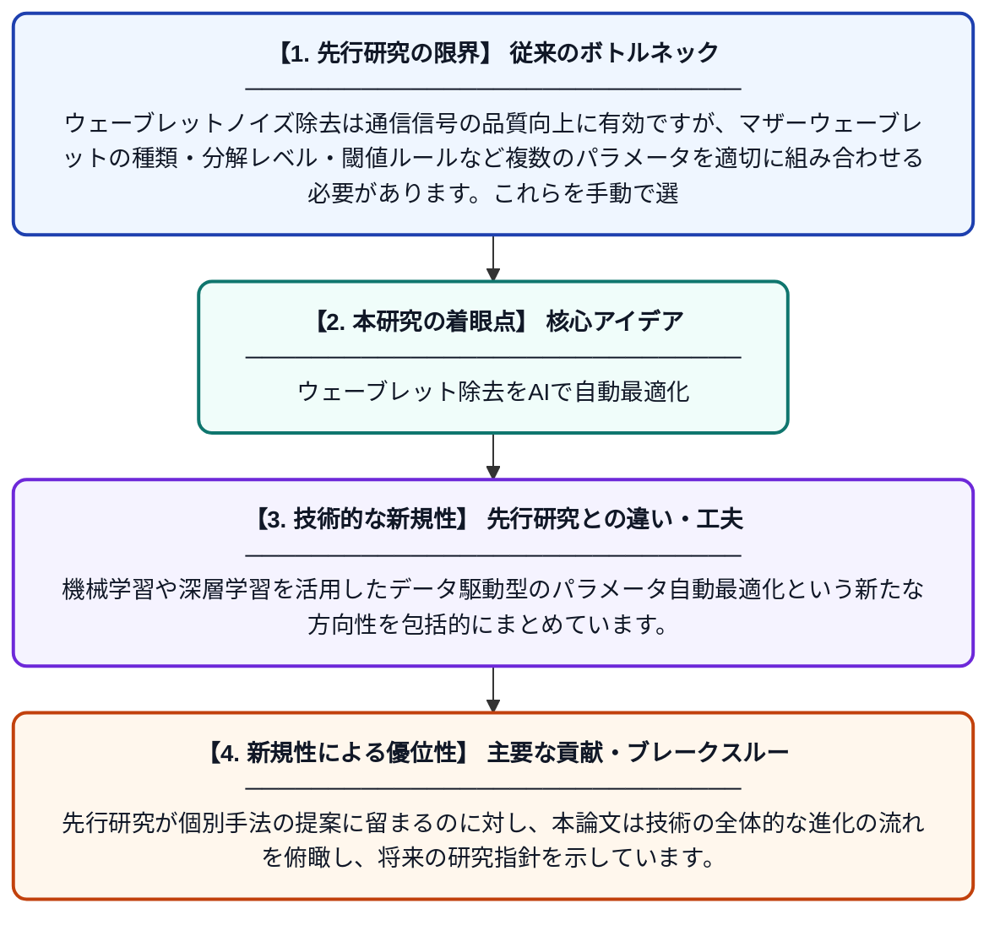

# 通信信号におけるウェーブレットノイズ除去の進展：パラメータ選択からデータ駆動型最適化へ

**Original Title**: *Advances in Wavelet Denoising for Communication Signals: From Parameter Selection Toward Data-Driven Optimization*

> **💡 一言要約**: ウェーブレット除去をAIで自動最適化

| 項目 | 内容 |
|---|---|
| **著者** | P Sheela, I Dey |
| **掲載誌** | arXiv preprint arXiv:2607.21825 2026 |
| **アラートキーワード** | sparse coding |
| **PDF** | [https://arxiv.org/pdf/2607.21825](https://arxiv.org/pdf/2607.21825) |
| **原文リンク** | [https://arxiv.org/pdf/2607.21825](https://arxiv.org/pdf/2607.21825) |
| **PDF版要約** | [README.pdf](./README.pdf) |

---

## 📊 新規性の図解（先行研究との違いと本研究のブレークスルー）

## 📝 要約

本論文は、通信信号に含まれる非定常・衝撃性ノイズや干渉を除去するウェーブレットノイズ除去技術を包括的にレビューしたものです。ウェーブレット変換族、マザーウェーブレット、分解レベル、閾値処理ルールなどのパラメータ選択が性能に大きく影響することを示し、従来の手動設計からデータ駆動型の自動最適化手法への進展を整理しています。

## ❓ どんな問題に取り組んだか

ウェーブレットノイズ除去は通信信号の品質向上に有効ですが、マザーウェーブレットの種類・分解レベル・閾値ルールなど複数のパラメータを適切に組み合わせる必要があります。これらを手動で選択することは専門知識を要し、信号の種類や環境が変わるたびに再調整が必要となる課題がありました。

## ✨ 何が新しい？何がすごい？（新規性）

本研究は、ウェーブレットノイズ除去に関する既存手法を体系的に整理し、従来のヒューリスティックなパラメータ選択の限界を明確化した点が新しいです。機械学習や深層学習を活用したデータ駆動型のパラメータ自動最適化という新たな方向性を包括的にまとめています。先行研究が個別手法の提案に留まるのに対し、本論文は技術の全体的な進化の流れを俯瞰し、将来の研究指針を示しています。

## 🎓 大学1年生向けの解説

スマートフォンや無線通信では、送受信する信号に「ノイズ」と呼ばれる雑音が混じることがあります。ウェーブレットという数学的な道具を使うとこのノイズをうまく取り除けますが、道具の使い方（パラメータ）を正しく設定しないと効果が出ません。この論文は、そのパラメータをAIや機械学習を使って自動的に最適化する方法について、これまでの研究をまとめて整理したものです。まるで料理のレシピを自動で最適化するようなイメージで、人が手動で調整しなくても最良の結果が得られるようにする研究です。
