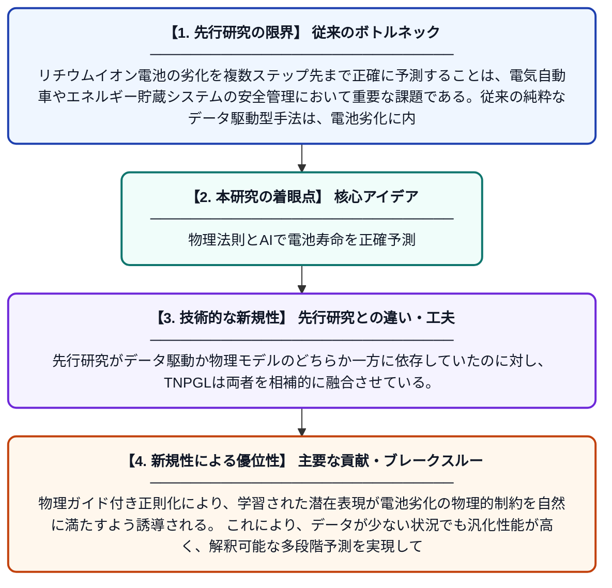

# TNPGL：マルチステップリチウムイオン電池劣化予測のための物理ガイド付き時系列潜在表現学習

**Original Title**: *TNPGL: Physics-guided temporal latent representation learning for multi-step lithium-ion battery degradation prediction*

> **💡 一言要約**: 物理法則とAIで電池寿命を正確予測

| 項目 | 内容 |
|---|---|
| **著者** | Y Ding, T Su, B Liu, J Zhu, Z Zhao, Y Liu, BW Schuller |
| **掲載誌** | Applied Soft Computing 2026 |
| **アラートキーワード** | representation learning |
| **原文リンク** | [https://www.sciencedirect.com/science/article/pii/S1568494626015115](https://www.sciencedirect.com/science/article/pii/S1568494626015115) |
| **PDF版要約** | [README.pdf](./README.pdf) |

---

## 📊 新規性の図解（先行研究との違いと本研究のブレークスルー）

## 📝 要約

本論文は、リチウムイオン電池の複数ステップ先の劣化予測精度向上を目的とした「TNPGL」フレームワークを提案している。時系列ニューラルネットワークによる表現学習と、物理法則に基づく正則化を組み合わせた時系列・物理協調アーキテクチャを採用している。これにより、データ駆動型アプローチだけでは捉えきれなかった電池劣化の物理的メカニズムを学習に組み込み、より精度の高い予測を実現する。

## ❓ どんな問題に取り組んだか

リチウムイオン電池の劣化を複数ステップ先まで正確に予測することは、電気自動車やエネルギー貯蔵システムの安全管理において重要な課題である。従来の純粋なデータ駆動型手法は、電池劣化に内在する物理的メカニズムを十分に考慮できず、長期予測における精度低下や解釈性の欠如という問題があった。また、電池の非線形な劣化挙動を時系列として捉える際の表現学習の限界も課題となっていた。

## ✨ 何が新しい？何がすごい？（新規性）

本研究の主な新規性は、時系列ニューラルネットワークによる潜在表現学習と、電池劣化の物理モデルに基づく正則化を統合した「時系列・物理協調フレームワーク」を構築した点にある。先行研究がデータ駆動か物理モデルのどちらか一方に依存していたのに対し、TNPGLは両者を相補的に融合させている。物理ガイド付き正則化により、学習された潜在表現が電池劣化の物理的制約を自然に満たすよう誘導される。これにより、データが少ない状況でも汎化性能が高く、解釈可能な多段階予測を実現している。

## 🎓 大学1年生向けの解説

スマートフォンや電気自動車に使われるリチウムイオン電池は、使い続けるとだんだん劣化して長持ちしなくなります。この論文では、「電池があと何回充電できるか」を人工知能で予測する新しい方法を提案しています。ポイントは、AIに電池の物理的な老化ルール（化学・物理の知識）も一緒に教えることで、データだけで学ぶよりずっと正確な予測ができるようにした点です。たとえるなら、試験の過去問（データ）だけでなく、教科書の理論（物理法則）も合わせて勉強するようなイメージです。これにより、電池の寿命を事前に正確に知ることができ、突然の電池切れや事故を防ぐことにつながります。
