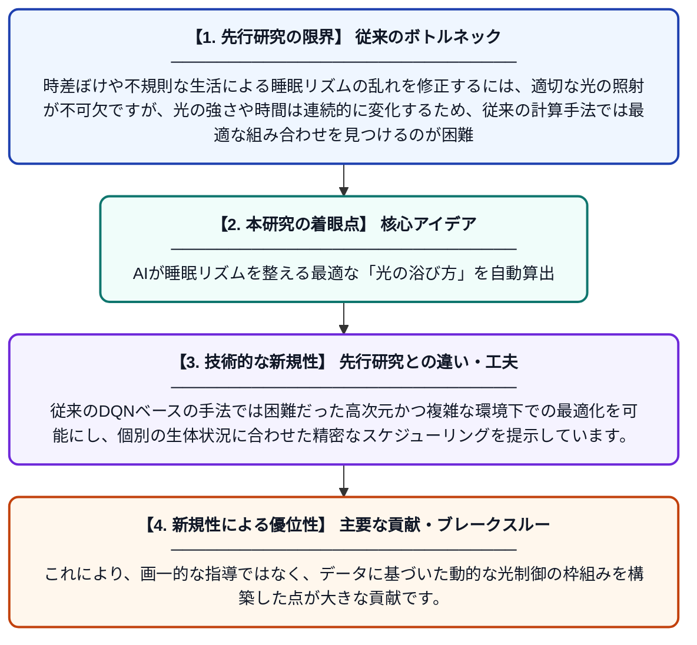

# 睡眠・覚醒調整のためのシミュレーション光スケジュール：強化学習導入の探求

**Original Title**: *Simulated Light Schedules for Sleep-Wake Adjustments: Exploring the Incorporation of Reinforcement Learning*

> **💡 一言要約**: AIが睡眠リズムを整える最適な「光の浴び方」を自動算出

| 項目 | 内容 |
|---|---|
| **著者** | M Seah, JMY Lim, SN Liang, Y Kumari, V Kalavally |
| **掲載誌** | 2026 |
| **アラートキーワード** | reinforcement |
| **PDF** | [https://assets-eu.researchsquare.com/files/rs-10233757/v1/ee8daa97-48fa-461a-8abe-37fdb143bf68.pdf?c=1793000911](https://assets-eu.researchsquare.com/files/rs-10233757/v1/ee8daa97-48fa-461a-8abe-37fdb143bf68.pdf?c=1793000911) |
| **原文リンク** | [https://www.researchsquare.com/article/rs-10233757/latest.pdf](https://www.researchsquare.com/article/rs-10233757/latest.pdf) |
| **PDF版要約** | [README.pdf](./README.pdf) |

---

## 📊 新規性の図解（先行研究との違いと本研究のブレークスルー）

## 📝 要約

深層決定論的ポリシー勾配（DDPG）という強化学習アルゴリズムを用い、個人の睡眠・覚醒リズムを最適化するための光照射スケジュールを提案した研究です。連続的な光の強さやタイミングを制御することで、時差ぼけや交代制勤務に伴うリズムの乱れを効率的に修正する手法をシミュレーションで示しました。

## ❓ どんな問題に取り組んだか

時差ぼけや不規則な生活による睡眠リズムの乱れを修正するには、適切な光の照射が不可欠ですが、光の強さや時間は連続的に変化するため、従来の計算手法では最適な組み合わせを見つけるのが困難でした。また、個人の生体リズムは複雑で考慮すべき変数が多いことも課題となっていました。

## ✨ 何が新しい？何がすごい？（新規性）

本研究は、連続的なアクションを扱えるDDPGという強化学習手法を採用することで、光の強さを滑らかに変化させる精細な制御を実現しました。従来のDQNベースの手法では困難だった高次元かつ複雑な環境下での最適化を可能にし、個別の生体状況に合わせた精密なスケジューリングを提示しています。これにより、画一的な指導ではなく、データに基づいた動的な光制御の枠組みを構築した点が大きな貢献です。

## 🎓 大学1年生向けの解説

私たちの体にある「体内時計」は、光を浴びるタイミングによって調節できます。この研究は、AI（強化学習）を使って、いつ・どのくらいの強さの光を浴びれば最も効率的に睡眠リズムを直せるかをシミュレーションしたものです。まるで自分専用の「光の処方箋」をAIが自動で作ってくれるような仕組みで、従来の単純なオン・オフの切り替えよりも、ずっと自然で効果的なリズム調整が期待できます。
