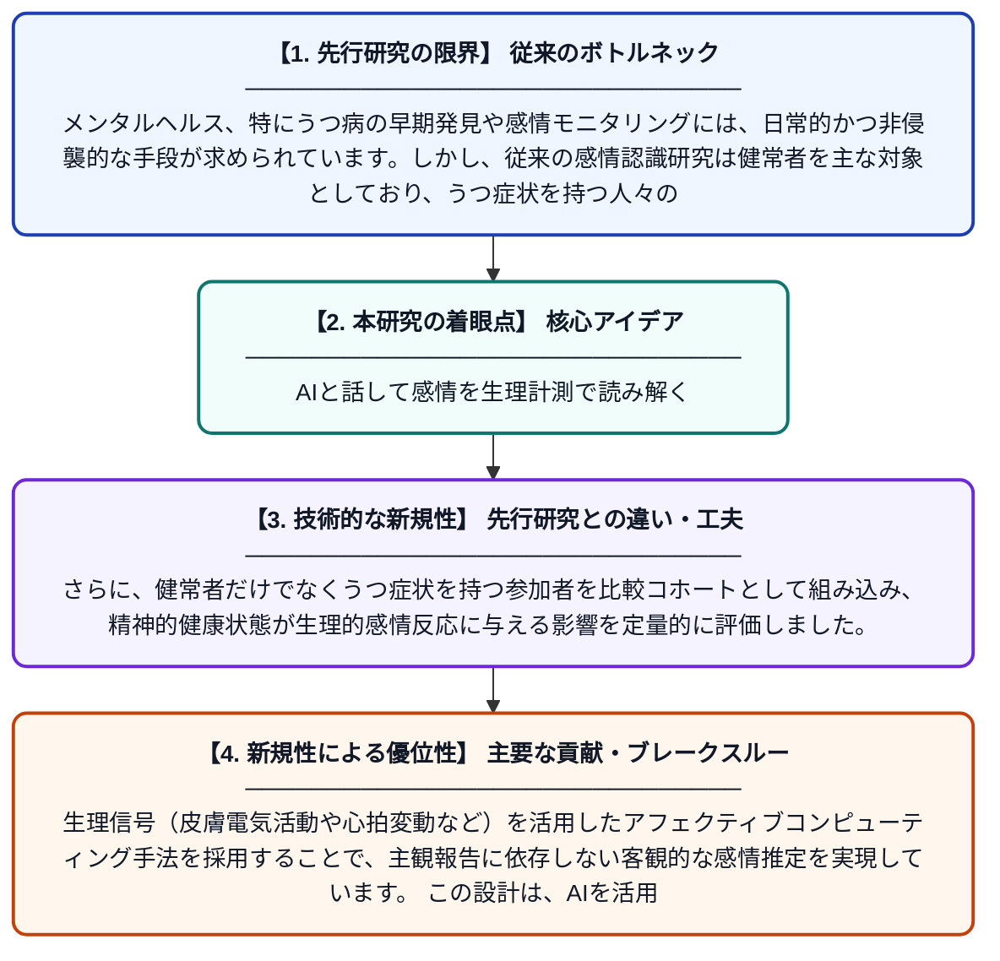

# バーチャルヒューマンとの会話における感情認識：健常者およびうつ症状コホートからの生理学的エビデンス

**Original Title**: *Emotion Recognition in Conversations With Virtual Humans: Physiological Evidence From Healthy and Depressive-Symptom Cohorts*

> **💡 一言要約**: AIと話して感情を生理計測で読み解く

| 項目 | 内容 |
|---|---|
| **著者** | J Marín-Morales, A Altozano, F Mura |
| **掲載誌** | IEEE Transactions on Affective Computing 2026 |
| **アラートキーワード** | affective computing |
| **PDF** | [https://ieeexplore.ieee.org/iel8/5165369/5520654/11622840.pdf](https://ieeexplore.ieee.org/iel8/5165369/5520654/11622840.pdf) |
| **原文リンク** | [https://ieeexplore.ieee.org/iel8/5165369/5520654/11622840.pdf](https://ieeexplore.ieee.org/iel8/5165369/5520654/11622840.pdf) |
| **PDF版要約** | [README.pdf](./README.pdf) |

---

## 📊 新規性の図解（先行研究との違いと本研究のブレークスルー）

## 📝 要約

本研究は、バーチャルヒューマン（AI仮想エージェント）との会話中における感情認識を、生理学的センサーデータを用いて解析したものです。健常者とうつ症状を持つ参加者の両コホートを対象に、感情状態の検出精度と特性を比較検討しました。感情コンピューティングの枠組みを活用し、精神的健康状態の違いが感情反応に与える影響を明らかにしています。

## ❓ どんな問題に取り組んだか

メンタルヘルス、特にうつ病の早期発見や感情モニタリングには、日常的かつ非侵襲的な手段が求められています。しかし、従来の感情認識研究は健常者を主な対象としており、うつ症状を持つ人々の感情生理反応との違いは十分に検討されていませんでした。また、実験的な刺激動画ではなく、会話というより自然な文脈での感情計測は課題として残っていました。

## ✨ 何が新しい？何がすごい？（新規性）

本研究の最大の新規性は、静的な映像刺激ではなくバーチャルヒューマンとのインタラクティブな「会話」という自然な状況下で感情認識を行った点です。さらに、健常者だけでなくうつ症状を持つ参加者を比較コホートとして組み込み、精神的健康状態が生理的感情反応に与える影響を定量的に評価しました。生理信号（皮膚電気活動や心拍変動など）を活用したアフェクティブコンピューティング手法を採用することで、主観報告に依存しない客観的な感情推定を実現しています。この設計は、AIを活用したメンタルヘルスモニタリングシステムの実現可能性を示す重要な一歩です。

## 🎓 大学1年生向けの解説

みなさんはAIと話したことがありますか？この研究では、コンピューターで作られた仮想の人間（バーチャルヒューマン）と会話しているときに、人が心の中でどんな感情を感じているかを体の反応（心拍数や汗など）から読み取ろうとしました。特に注目すべきは、普通に元気な人たちとうつっぽい症状のある人たちを比べた点です。体の反応は正直なので、「悲しい」「楽しい」などを言葉で言わなくても、センサーで感情を推測できる可能性があります。将来的には、AIがあなたの感情を自動で察して、心の病気を早めに見つけてくれるシステムにつながるかもしれません。
