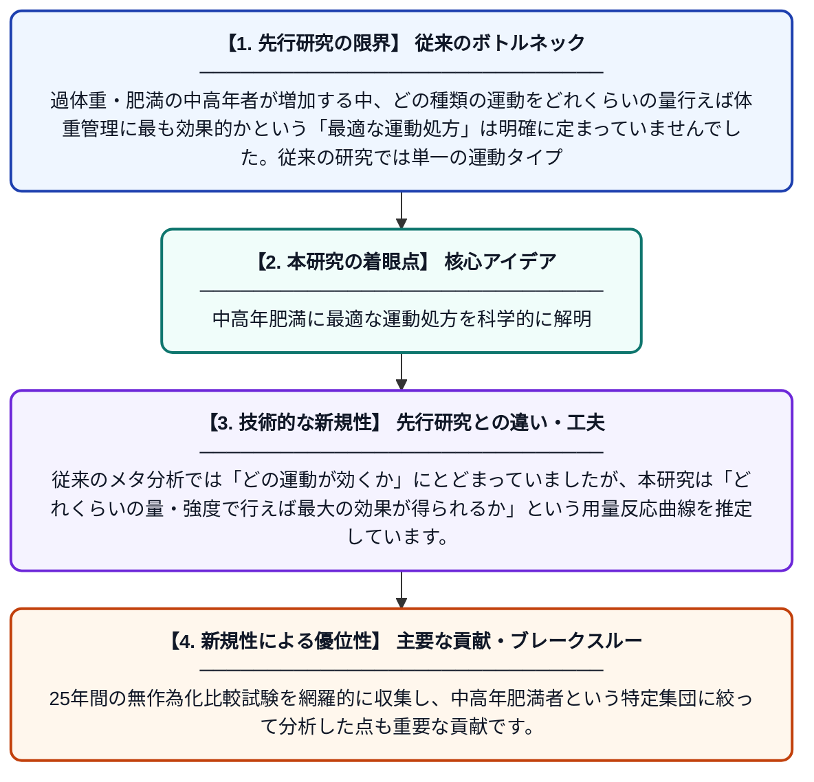

# 過体重または肥満の中高年者における体重管理のための運動介入と用量：用量反応ベイズネットワークメタ分析

**Original Title**: *Exercise interventions and dosage for weight management in overweight or obese middle-aged and older adults: A dose-response Bayesian network meta-analysis*

> **💡 一言要約**: 中高年肥満に最適な運動処方を科学的に解明

| 項目 | 内容 |
|---|---|
| **著者** | H Feng, YJ Li, ZW Xie, YB Wang, ZH Wang |
| **掲載誌** | Journal of Sports Sciences 2026 |
| **アラートキーワード** | bayesian network |
| **原文リンク** | [https://www.tandfonline.com/doi/abs/10.1080/02640414.2026.2705713](https://www.tandfonline.com/doi/abs/10.1080/02640414.2026.2705713) |
| **PDF版要約** | [README.pdf](./README.pdf) |

---

## 📊 新規性の図解（先行研究との違いと本研究のブレークスルー）

## 📝 要約

本研究は、過体重・肥満の中高年者を対象に、体重管理に最も効果的な運動の種類と量（用量）を明らかにすることを目的としています。2000年から2025年にかけて発表されたランダム化比較試験を複数のデータベースから収集し、ベイズネットワークメタ分析という統計手法を用いて解析しました。その結果、最適な運動の種類と推奨用量が具体的に示されました。

## ❓ どんな問題に取り組んだか

過体重・肥満の中高年者が増加する中、どの種類の運動をどれくらいの量行えば体重管理に最も効果的かという「最適な運動処方」は明確に定まっていませんでした。従来の研究では単一の運動タイプを比較するにとどまり、複数の運動タイプを同時に比較しながら用量との関係を定量的に評価することが困難でした。

## ✨ 何が新しい？何がすごい？（新規性）

本研究は、複数の運動介入タイプを同時に比較できるネットワークメタ分析に、用量反応関係の解析とベイズ統計を組み合わせた点が新しいアプローチです。従来のメタ分析では「どの運動が効くか」にとどまっていましたが、本研究は「どれくらいの量・強度で行えば最大の効果が得られるか」という用量反応曲線を推定しています。25年間の無作為化比較試験を網羅的に収集し、中高年肥満者という特定集団に絞って分析した点も重要な貢献です。

## 🎓 大学1年生向けの解説

太りすぎの中高年の人たちが健康的に体重を落とすには、どんな運動をどれくらいやればいいのかを科学的に調べた研究です。たくさんの実験データをまとめて「ベイズネットワークメタ分析」という高度な統計方法で解析しました。たとえば有酸素運動・筋トレ・その組み合わせなど複数の運動タイプを一度に比較し、さらに「量が増えるほど効果はどう変わるか」も調べています。薬の処方と同じように、運動にも「最適な量と種類」があることを明らかにしようとした研究です。
