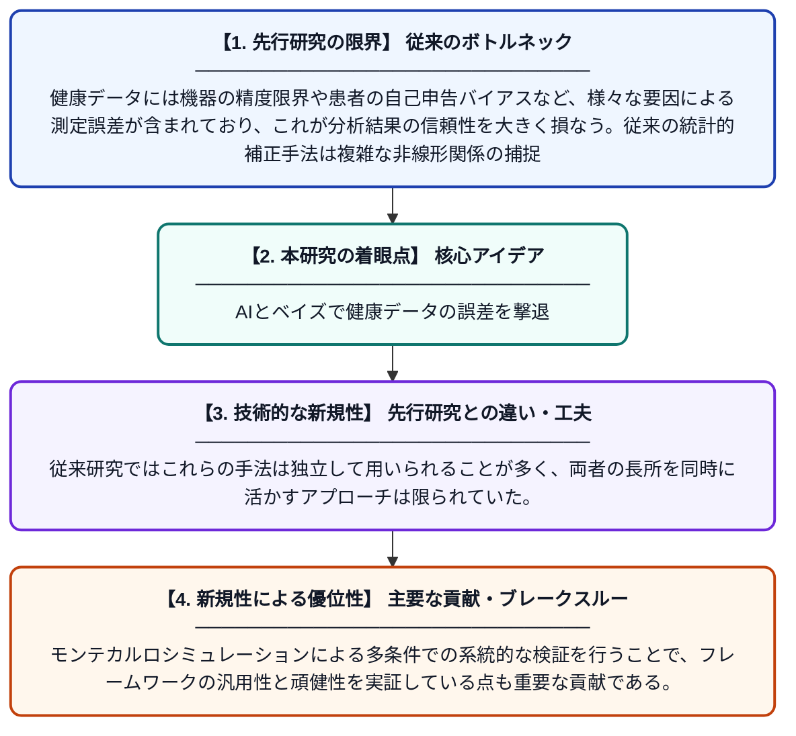

# 健康データにおける測定誤差を補正するハイブリッド機械学習・ベイズ統合フレームワーク

**Original Title**: *A Hybrid Machine Learning–Bayesian Framework for Correcting Measurement Error in Health Data*

> **💡 一言要約**: AIとベイズで健康データの誤差を撃退

| 項目 | 内容 |
|---|---|
| **著者** | BOYN RD |
| **掲載誌** | 2026 |
| **アラートキーワード** | Bayesian hierarchical ... |
| **原文リンク** | [https://europepmc.org/article/ppr/ppr1261508](https://europepmc.org/article/ppr/ppr1261508) |
| **PDF版要約** | [README.pdf](./README.pdf) |

---

## 📊 新規性の図解（先行研究との違いと本研究のブレークスルー）

## 📝 要約

本論文は、健康データに含まれる測定誤差を補正するために、機械学習アルゴリズムとベイズ階層補正技術を組み合わせたハイブリッドフレームワークを提案している。機械学習が複雑なパターンをモデル化し、ベイズ手法が不確実性を定量化することで、両手法の弱点を補い合う設計となっている。モンテカルロシミュレーションを用いた検証により、異なる測定誤差条件下でのフレームワークの有効性が確認された。

## ❓ どんな問題に取り組んだか

健康データには機器の精度限界や患者の自己申告バイアスなど、様々な要因による測定誤差が含まれており、これが分析結果の信頼性を大きく損なう。従来の統計的補正手法は複雑な非線形関係の捕捉が難しく、一方で機械学習単独では不確実性の適切な定量化が困難であった。

## ✨ 何が新しい？何がすごい？（新規性）

本研究の新規性は、機械学習の高い表現力とベイズ階層モデルの不確実性定量化能力を統合した点にある。従来研究ではこれらの手法は独立して用いられることが多く、両者の長所を同時に活かすアプローチは限られていた。モンテカルロシミュレーションによる多条件での系統的な検証を行うことで、フレームワークの汎用性と頑健性を実証している点も重要な貢献である。

## 🎓 大学1年生向けの解説

病院で測る血圧や体重などのデータには、機器のズレや記録ミスなど「測定誤差」が含まれることがあります。この誤差を放置すると、病気の研究や診断の精度が下がってしまいます。この論文では、AIの一種である機械学習と、確率を使って不確かさを表すベイズ統計学を組み合わせた新しい方法で、その誤差を自動的に修正しようとしています。コンピュータシミュレーションで何度も試した結果、この方法が様々な状況でうまく機能することが確認されました。
