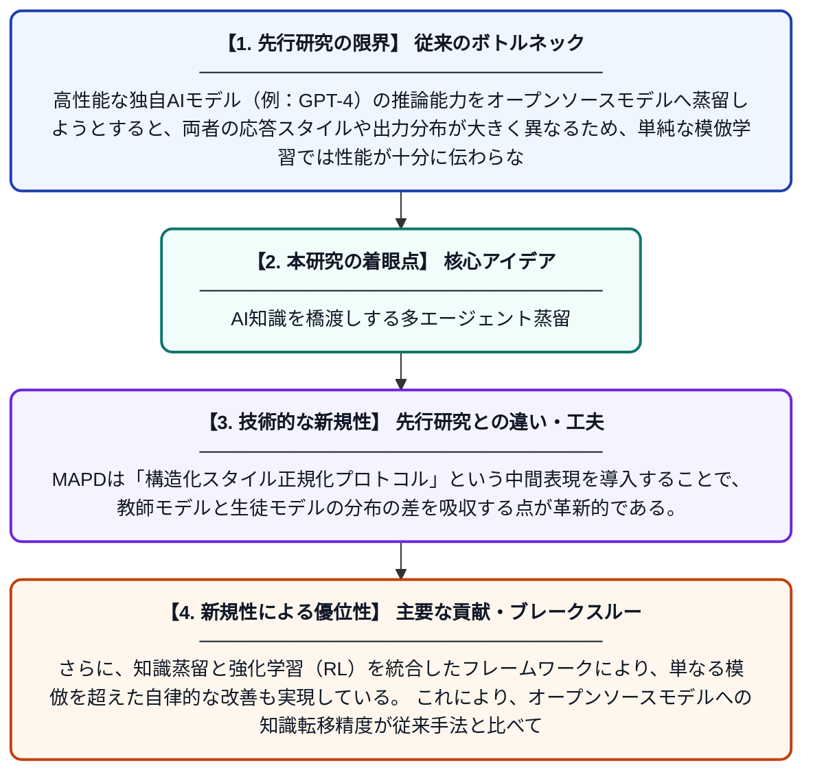

# 独自モデルからオープンソースへ：エージェント型検索における多エージェントプロトコル蒸留による分布ギャップの解消

**Original Title**: *From Proprietary to Open-Source: Bridging the Distribution Gap via Multi-Agent Protocol Distillation in Agentic Search*

> **💡 一言要約**: AI知識を橋渡しする多エージェント蒸留

| 項目 | 内容 |
|---|---|
| **著者** | J Liu, J Chen, Z Song, S Zhou, C Lv, H Wu, K Jiang |
| **掲載誌** | arXiv preprint arXiv:2607.24280 2026 |
| **アラートキーワード** | multi agent |
| **PDF** | [https://arxiv.org/pdf/2607.24280](https://arxiv.org/pdf/2607.24280) |
| **Git リポジトリ** | [https://github.com/AaronLiu0702/MAPD](https://github.com/AaronLiu0702/MAPD) |
| **原文リンク** | [https://arxiv.org/pdf/2607.24280](https://arxiv.org/pdf/2607.24280) |
| **PDF版要約** | [README.pdf](./README.pdf) |

---

## 📊 新規性の図解（先行研究との違いと本研究のブレークスルー）

## 📝 要約

本論文では、強力な独自AIモデル（GPTなど）の知識をオープンソースモデルへ転移する際に生じる「分布ギャップ」問題を解決するため、Multi-Agent Protocol Distillation（MAPD）という手法を提案する。MAPDは、構造化されたスタイル正規化プロトコルを中間媒介として用いることで、異質なモデル間でも効果的に知識蒸留と強化学習を組み合わせる。これにより、オープンソースモデルが複雑な情報検索タスクで独自モデルに匹敵する性能を発揮できるようになる。

## ❓ どんな問題に取り組んだか

高性能な独自AIモデル（例：GPT-4）の推論能力をオープンソースモデルへ蒸留しようとすると、両者の応答スタイルや出力分布が大きく異なるため、単純な模倣学習では性能が十分に伝わらない。特に、複数のエージェントが協調して情報を検索・統合するアgentic searchタスクでは、この「分布ギャップ」問題が深刻である。

## ✨ 何が新しい？何がすごい？（新規性）

先行研究では単一モデル間の蒸留が主流であり、複数エージェントが関与する異質な分布間の蒸留は未解決だった。MAPDは「構造化スタイル正規化プロトコル」という中間表現を導入することで、教師モデルと生徒モデルの分布の差を吸収する点が革新的である。さらに、知識蒸留と強化学習（RL）を統合したフレームワークにより、単なる模倣を超えた自律的な改善も実現している。これにより、オープンソースモデルへの知識転移精度が従来手法と比べて大幅に向上した。

## 🎓 大学1年生向けの解説

ChatGPTのような有料の高性能AIは誰でも使えるわけではありませんが、無料のオープンソースAIに同じ賢さを教えられれば理想的です。しかし、賢いAIと普通のAIでは「言葉の癖」が違いすぎて、そのまま真似させてもうまくいきません。この研究では、その「癖の違い」を吸収できる共通の言葉（プロトコル）を作り、複数のAIが協力しながら情報を調べるタスクで上手に知識を受け渡す仕組みを開発しました。例えるなら、英語の先生の教え方を日本語で学ぶ生徒に伝えるための「翻訳マニュアル」を作るようなものです。
