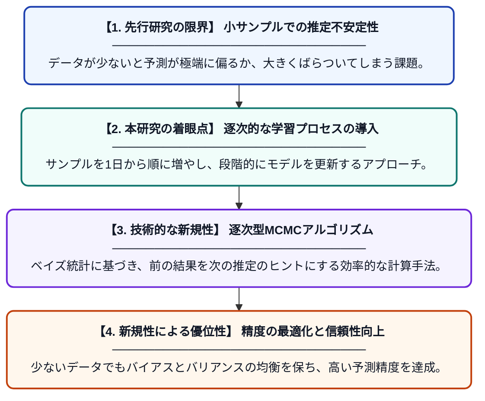

# 制約されたサンプルサイズを考慮した確率的速度・密度関係推定のためのバイアス・バリアンス・フレームワーク

**Original Title**: *A Bias-Variance Framework for Estimating Stochastic Speed-Density Relationship Considering Constrained Sample Size*

> **💡 一言要約**: 少ないデータで交通流を正確に予測する新手法

| 項目 | 内容 |
|---|---|
| **著者** | PS Prova, N Haque, MA Raihan, M Hadiuzzaman |
| **掲載誌** | arXiv preprint arXiv:2611.19147 2026 |
| **アラートキーワード** | MCMC |
| **PDF** | [https://arxiv.org/pdf/2611.19147](https://arxiv.org/pdf/2611.19147) |
| **原文リンク** | [https://arxiv.org/pdf/2611.19147](https://arxiv.org/pdf/2611.19147) |
| **PDF版要約** | [README.pdf](./README.pdf) |

---

## 📊 新規性の図解（先行研究との違いと本研究のブレークスルー）

## 📝 要約

交通流の基本特性である速度と密度の関係を、限られたデータ量でも精度良く推定する新しい枠組みを提案しています。逐次的なマルコフ連鎖モンテカルロ法（MCMC）を用いることで、データの増加に伴うモデルの不確実性をバイアスとバリアンスの観点から最適化しています。

## ❓ どんな問題に取り組んだか

交通工学において速度と密度の関係をモデル化する際、サンプルサイズが小さいと推定値が不安定になり、信頼性が低下するという課題がありました。特に、データの「偏り（バイアス）」と「ばらつき（バリアンス）」を考慮しながら、限られた観測データから真の交通状態をどう導き出すかが長年の課題でした。

## ✨ 何が新しい？何がすごい？（新規性）

本研究の核心は、逐次的なベイズ推定とMCMC（メトロポリス・ヘイスティングス法）を統合し、サンプルサイズを1日から段階的に増やしながら推定を更新するプロセスを導入した点にあります。従来の静的なモデルとは異なり、サンプル数に応じた推定精度の変化を定量的に追跡できるため、最小限のデータで許容可能な精度を得るための基準を明確にしました。このアプローチにより、計算負荷を抑えつつ、交通状態の確率的な変動をより正確に捉えることが可能になりました。

## 🎓 大学1年生向けの解説

道路がどれくらい混んでいるかと車のスピードの関係を計算する研究です。これまでは、データが少ないと計算結果がバラバラになってしまい、正確な予測が難しいという問題がありました。この論文では、少ないデータを賢く使い、少しずつ情報を追加して計算をアップデートしていく「逐次的な手法」を開発しました。これにより、少ないヒントからでも道路の混雑状況を正しく予測できるようになりました。
