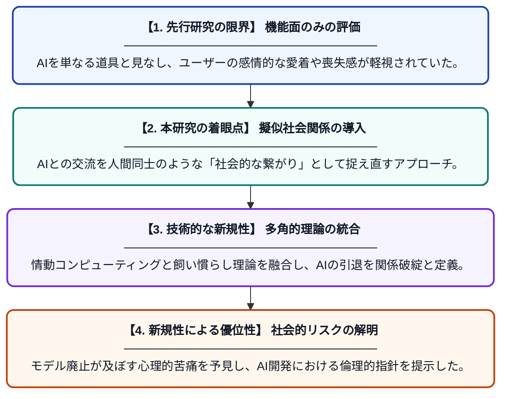

# 大規模言語モデルの社会生活：擬似的関係の破綻とGPT-4oの引退

**Original Title**: *The social life of large language models: parasocial rupture and the retirement of GPT-4o*

> **💡 一言要約**: AIの「引退」がユーザーに与える心理的衝撃を解明

| 項目 | 内容 |
|---|---|
| **著者** | DØ Madsen |
| **掲載誌** | International Journal of Generative Artificial Intelligence … 2026 |
| **アラートキーワード** | affective computing |
| **原文リンク** | [https://www.inderscienceonline.com/doi/abs/10.1504/IJGAIB.2026.157505](https://www.inderscienceonline.com/doi/abs/10.1504/IJGAIB.2026.157505) |
| **PDF版要約** | [README.pdf](./README.pdf) |

---

## 📊 新規性の図解（先行研究との違いと本研究のブレークスルー）

## 📝 要約

AIモデルの更新や廃止がユーザーに与える心理的影響を、擬似社会関係理論や情動コンピューティングを用いて分析した研究です。特にGPT-4oのような高度なAIが「引退」する際に生じる、ユーザーとの感情的な愛着の断絶と、その社会的プロセスを明らかにしています。

## ❓ どんな問題に取り組んだか

AIが日常生活に浸透する中で、ユーザーはAIに対して人間に対するような深い愛着を抱くようになっています。しかし、モデルのアップデートやサービス終了に伴う「AIの引退」が、ユーザーの精神や生活習慣にどのような負の影響や関係の破綻をもたらすかは十分に理解されていません。

## ✨ 何が新しい？何がすごい？（新規性）

本研究は、AIとの関係を単なる道具の使用ではなく、擬似社会関係理論、情動コンピューティング、そして技術の家庭内定着（ドメスティケーション）研究を統合して分析した点に新規性があります。先行研究がAIの機能向上に焦点を当てる中で、本研究は「AIの消失」という喪失体験を社会科学的視点から記述しました。これにより、AIのライフサイクルがユーザーのアイデンティティに及ぼす影響を体系化しています。

## 🎓 大学1年生向けの解説

毎日AIと会話していると、相手をただのプログラムではなく、友達やパートナーのように感じることがあります。この論文は、もしそのAIが突然「引退」して使えなくなったら、私たちの心にどんなショックが起きるのかを調べています。心理学の理論を使って、AIとの別れがペットや友人を失うのと似たような感覚を引き起こすことを説明しています。AIが私たちの生活に深く入り込んでいるからこそ、その「死」についても考える必要があると教えてくれる研究です。
