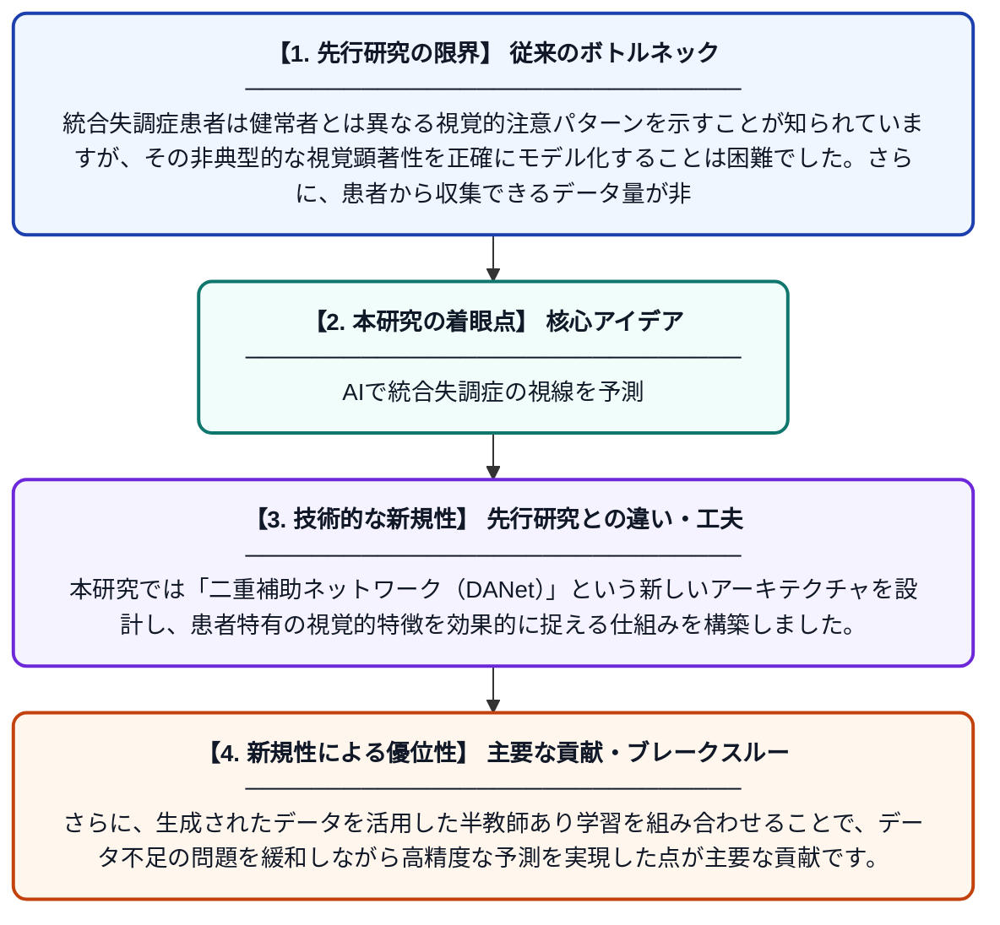

# 統合失調症患者の非典型的視覚顕著性予測のための半教師あり学習を用いた二重補助ネットワーク

**Original Title**: *Double assistant network with semi-supervised learning for schizophrenic atypical visual saliency prediction*

> **💡 一言要約**: AIで統合失調症の視線を予測

| 項目 | 内容 |
|---|---|
| **著者** | Z Wei, Y Song, Z Liu, L Xu, T Zhang, J Wang |
| **掲載誌** | Journal of Visual Communication and Image Representation 2026 |
| **アラートキーワード** | Semi supervise |
| **原文リンク** | [https://www.sciencedirect.com/science/article/pii/S1047320326002063](https://www.sciencedirect.com/science/article/pii/S1047320326002063) |
| **PDF版要約** | [README.pdf](./README.pdf) |

---

## 📊 新規性の図解（先行研究との違いと本研究のブレークスルー）

## 📝 要約

本論文では、統合失調症患者が画像を見るときの視線の動き（視覚顕著性）を予測するための「二重補助ネットワーク（DANet）」を提案しています。健常者と異なる患者特有の視覚パターンをAIで再現することを目指しています。また、医療データの不足という課題に対応するため、ラベルなしデータも活用できる半教師あり学習を導入しています。

## ❓ どんな問題に取り組んだか

統合失調症患者は健常者とは異なる視覚的注意パターンを示すことが知られていますが、その非典型的な視覚顕著性を正確にモデル化することは困難でした。さらに、患者から収集できるデータ量が非常に限られており、深層学習モデルの学習に必要な十分なラベル付きデータを確保することが大きな課題となっていました。

## ✨ 何が新しい？何がすごい？（新規性）

先行研究では健常者向けの視覚顕著性予測モデルが主流であり、統合失調症患者の非典型的パターンに特化したアプローチは少ない状況でした。本研究では「二重補助ネットワーク（DANet）」という新しいアーキテクチャを設計し、患者特有の視覚的特徴を効果的に捉える仕組みを構築しました。さらに、生成されたデータを活用した半教師あり学習を組み合わせることで、データ不足の問題を緩和しながら高精度な予測を実現した点が主要な貢献です。

## 🎓 大学1年生向けの解説

統合失調症という病気を持つ人は、絵や写真を見るとき、健康な人とは違うところに注目する傾向があります。この研究では、そのような「どこを見るか」のパターンをコンピュータに学習させて予測するAIを作りました。医療データは集めるのが難しく少ないため、ラベルのないデータも上手く使える「半教師あり学習」という工夫を取り入れています。こうした技術が進めば、統合失調症の診断や理解に役立てられる可能性があります。
