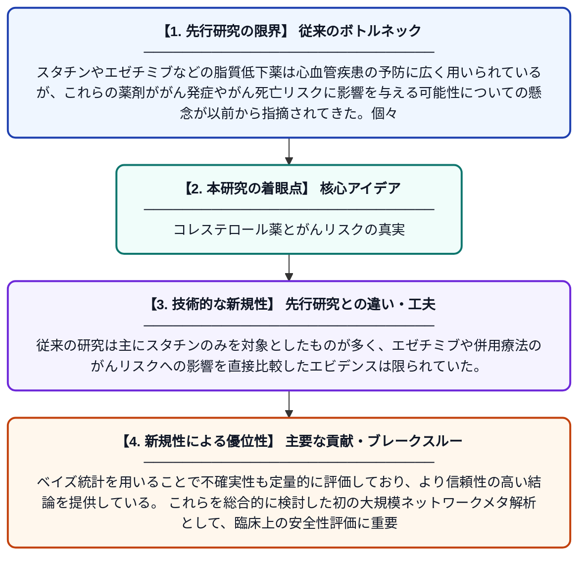

# スタチン療法、エゼチミブ、およびスタチン・エゼチミブ併用療法とがん発症・がん関連死亡率との関連——無作為化比較試験のシステマティックレビューおよびベイズ型ネットワークメタ解析

**Original Title**: *Association of Cancer Incidence and Cancer-Related Mortality with Statin Therapy, Ezetimibe, and Statin–Ezetimibe Combination-A Systematic Review and Bayesian Network Meta-analysis of Randomized …*

> **💡 一言要約**: コレステロール薬とがんリスクの真実

| 項目 | 内容 |
|---|---|
| **著者** | N Ghalib, M Tyagi, S Virani, K Maki, L Sperling |
| **掲載誌** | European Journal of Preventive Cardiology 2026 |
| **アラートキーワード** | bayesian network |
| **原文リンク** | [https://academic.oup.com/eurjpc/advance-article/doi/10.1093/eurjpc/zwag392/8746390](https://academic.oup.com/eurjpc/advance-article/doi/10.1093/eurjpc/zwag392/8746390) |
| **PDF版要約** | [README.pdf](./README.pdf) |

---

## 📊 新規性の図解（先行研究との違いと本研究のブレークスルー）

## 📝 要約

本研究は、スタチン単独療法・エゼチミブ単独療法・スタチンとエゼチミブの併用療法が、がん発症率およびがん関連死亡率に与える影響を評価するため、無作為化比較試験のシステマティックレビューとベイズ型ネットワークメタ解析を実施した。脂質低下療法を受けていない群を対照として、それぞれの治療法のがんリスクへの関与を包括的に比較検討している。これにより、コレステロール低下薬の安全性に関するエビデンスを高い精度で整理・評価することを目的としている。

## ❓ どんな問題に取り組んだか

スタチンやエゼチミブなどの脂質低下薬は心血管疾患の予防に広く用いられているが、これらの薬剤ががん発症やがん死亡リスクに影響を与える可能性についての懸念が以前から指摘されてきた。個々の臨床試験では結果が一致しておらず、特に複数の薬剤を比較した包括的なエビデンスが不足していた。

## ✨ 何が新しい？何がすごい？（新規性）

本研究は、スタチン単独・エゼチミブ単独・両者の併用という複数の治療法を同時に比較できるネットワークメタ解析という手法を採用した点が新しい。従来の研究は主にスタチンのみを対象としたものが多く、エゼチミブや併用療法のがんリスクへの影響を直接比較したエビデンスは限られていた。ベイズ統計を用いることで不確実性も定量的に評価しており、より信頼性の高い結論を提供している。これらを総合的に検討した初の大規模ネットワークメタ解析として、臨床上の安全性評価に重要な貢献をなす。

## 🎓 大学1年生向けの解説

スタチンやエゼチミブとは、血液中の悪玉コレステロールを下げるために使われる薬です。これらの薬ががんの発症や死亡リスクを上げるのか下げるのか、あるいは関係ないのかを調べた研究です。多くの臨床試験のデータをまとめて「ネットワークメタ解析」という手法で比較することで、一つの試験だけではわからない全体的な傾向を明らかにしています。コレステロールの薬を長期間飲み続けることへの不安を解消するための、大事な安全性の確認研究です。
