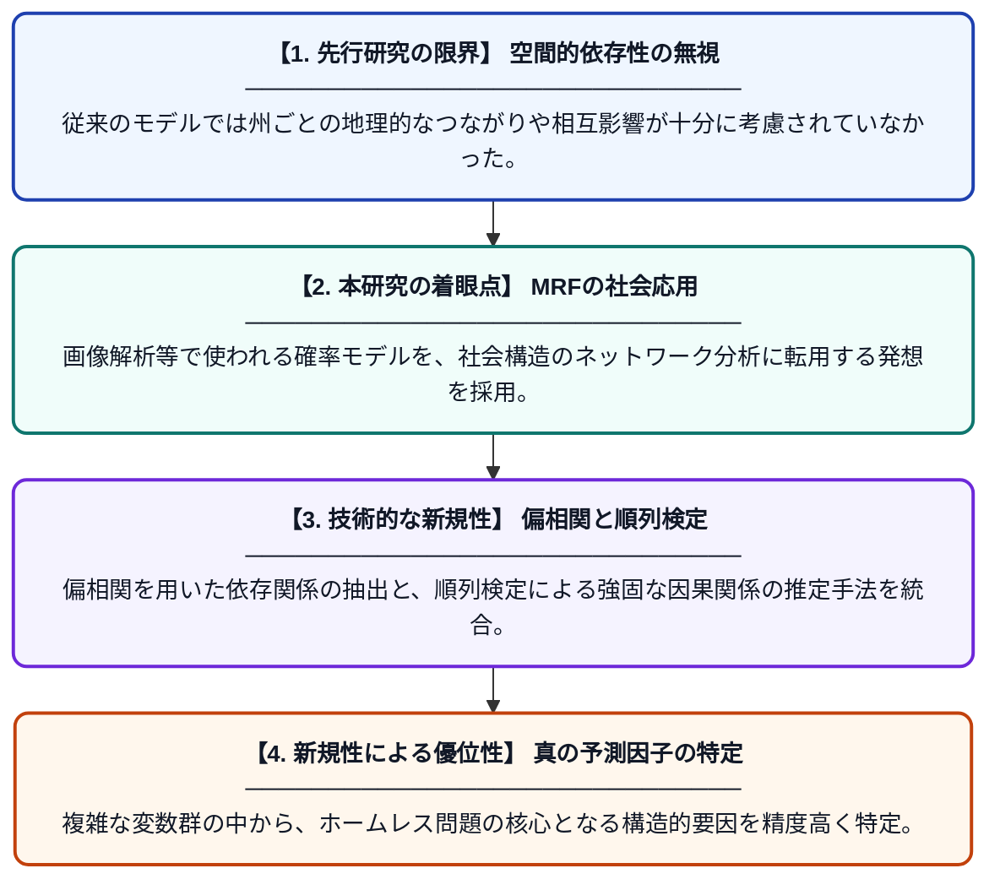

# マルコフ確率場を用いた米国ホームレス問題の構造分析：順列検定による予測因子と潜在的因果関係の特定

**Original Title**: *A structural analysis of US homelessness through Markov random fields: Identifying predictors and potential causal links through permutation tests*

> **💡 一言要約**: 数理モデルで解き明かす米国ホームレス問題の構造

| 項目 | 内容 |
|---|---|
| **著者** | C Smith, M Bhaduri |
| **掲載誌** | PLOS ONE 2026 |
| **アラートキーワード** | MRFs Markov |
| **原文リンク** | [https://journals.plos.org/plosone/article?id=10.1371/journal.pone.0343842](https://journals.plos.org/plosone/article?id=10.1371/journal.pone.0343842) |
| **PDF版要約** | [README.pdf](./README.pdf) |

---

## 📊 新規性の図解（先行研究との違いと本研究のブレークスルー）

## 📝 要約

2007年から2024年までの米国のデータを対象に、マルコフ確率場（MRF）を用いてホームレス問題に影響を与える構造的指標を分析した研究です。州レベルの地理的な相互作用や偏相関を調査し、ホームレス発生の予測因子と因果関係の解明を試みています。

## ❓ どんな問題に取り組んだか

従来のホームレス研究では、州ごとの地理的な依存関係や、多数の変数が複雑に絡み合う構造的なつながりを十分にモデル化できていませんでした。また、単なる相関を超えた、構造的指標間の因果的な示唆を特定することが困難でした。

## ✨ 何が新しい？何がすごい？（新規性）

本研究は、画像処理等で使われるマルコフ確率場（MRF）を社会問題の分析に導入し、20年近い長期データの空間的・構造的依存関係を可視化した点が画期的です。順列検定を用いることで、どの指標がホームレス発生に最も寄与するかを統計的に厳密に特定しました。地理的な「波及効果」をモデルに取り入れ、従来の回帰分析では捉えきれなかった変数間の複雑なネットワークを解明したことが主要な貢献です。

## 🎓 大学1年生向けの解説

この研究は、「なぜホームレスが生まれるのか」という複雑な問題を、数学的なネットワークの図を使って分析したものです。アメリカ全州のデータを使い、ある州の状況が隣の州にどう影響するかや、家賃・失業率がどう関係しているかを網羅的に調べました。難しい計算を使って、単なる「偶然」ではなく本当の原因に近い要素を突き止めています。社会の大きな仕組みが人々の生活にどう影響するかを科学的に証明する試みです。
