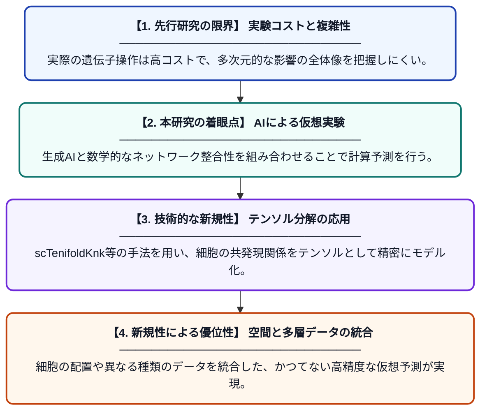

# 生成AI時代におけるバーチャルノックアウト：細胞内ネットワークから空間的・クロスモーダルな機能シミュレーションまで

**Original Title**: *Virtual Knockout in the Era of Generative AI: From Intracellular Networks to Spatial and Cross-Modal Functional Simulations*

> **💡 一言要約**: 生成AIで細胞の反応を「仮想実験」する新技術

| 項目 | 内容 |
|---|---|
| **著者** | Z Zuo, X Ma, W Shi, Y Sun |
| **掲載誌** | ACS Synthetic Biology |
| **アラートキーワード** | manifold learning |
| **原文リンク** | [https://pubs.acs.org/asbcd6/article-abstract/doi/10.1021/acssynbio.6c00191/5465182](https://pubs.acs.org/asbcd6/article-abstract/doi/10.1021/acssynbio.6c00191/5465182) |
| **PDF版要約** | [README.pdf](./README.pdf) |

---

## 📊 新規性の図解（先行研究との違いと本研究のブレークスルー）

## 📝 要約

生成AIと多様体学習を活用し、特定の遺伝子を仮想的に無効化（バーチャルノックアウト）して細胞の反応を予測する技術の進展を解説した論文です。単一細胞データの共発現ネットワークを構築し、テンソル分解などの数学的手法を用いることで、実験なしで細胞内の変化や空間的な影響を高精度にシミュレーションします。

## ❓ どんな問題に取り組んだか

実際の生物学的実験で特定の遺伝子を無効化（ノックアウト）するには、多大な時間、コスト、労力がかかります。また、単一の遺伝子操作が細胞全体の複雑なネットワークや空間的な配置にどのような影響を与えるかを網羅的に予測することは、従来の手法では困難でした。

## ✨ 何が新しい？何がすごい？（新規性）

本研究の核心は、生成AIと多様体学習を組み合わせることで、細胞内の動態だけでなく、空間情報や異なるデータ形式（クロスモーダル）を統合した仮想シミュレーションを実現した点にあります。特に、教師なし学習に基づくテンソル分解手法（scTenifoldKnkなど）を導入し、大規模な実験データがなくても精緻なネットワーク解析を可能にしました。これにより、実験前にコンピュータ上で高精度な予備検証を行うことが可能になり、研究の効率が飛躍的に向上しています。

## 🎓 大学1年生向けの解説

細胞の中では、数多くの遺伝子がパズルのように組み合わさって働いています。ある遺伝子を「オフ」にしたときに何が起きるかを知るには、これまでは実際に実験をしてみるしかありませんでした。この研究は、AIを使ってコンピュータの中でその実験を再現する「バーチャルノックアウト」という技術を紹介しています。これを使えば、パソコンの中で「もしこの遺伝子がなくなったら？」というシミュレーションが瞬時に行えるようになり、新しい薬の開発などがこれまでよりずっと早く進むようになります。
