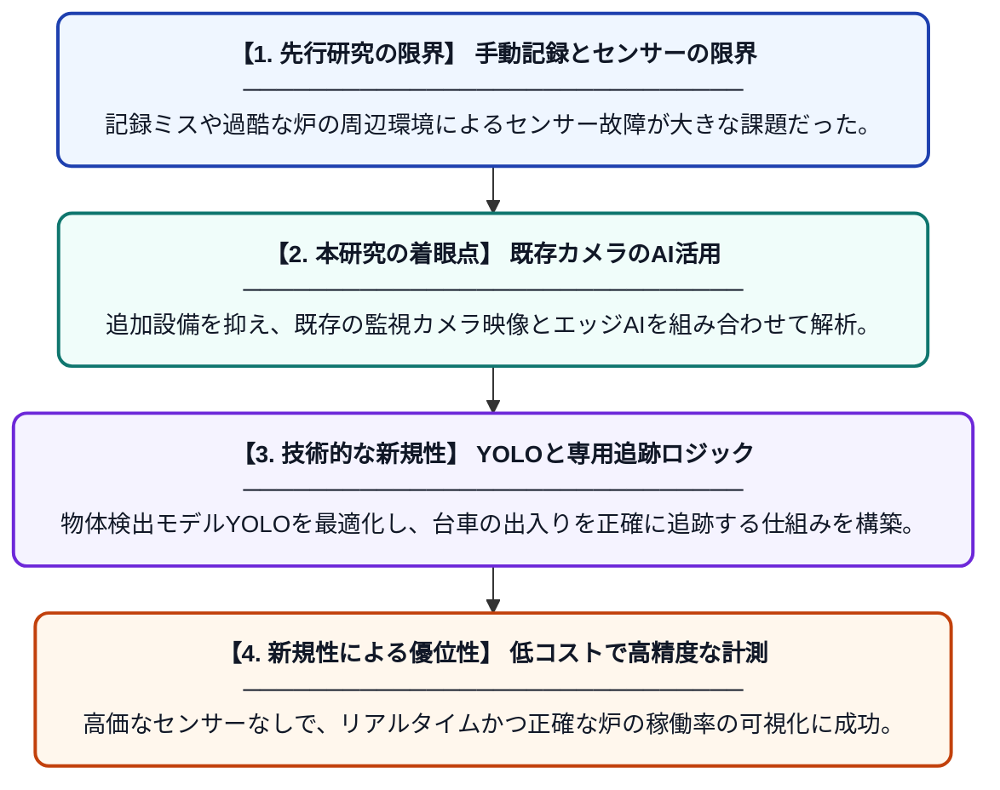

# 物体検出を用いた塗装乾燥炉の視覚ベース稼働状況モニタリング

**Original Title**: *Vision Based Utilization Monitoring for Paint Curing Oven via Object Detection*

> **💡 一言要約**: AIカメラで塗装炉の稼働を自動計測

| 項目 | 内容 |
|---|---|
| **著者** | AFM Firdaus, ASM Hisaburi, N Norhellme, SC Sekaran… |
| **掲載誌** | IEEE 14th Conference … 2026 |
| **アラートキーワード** | Multi Camera Tracking |
| **原文リンク** | [https://ieeexplore.ieee.org/abstract/document/11790369/](https://ieeexplore.ieee.org/abstract/document/11790369/) |
| **PDF版要約** | [README.pdf](./README.pdf) |

---

## 📊 新規性の図解（先行研究との違いと本研究のブレークスルー）

## 📝 要約

CCTVカメラとエッジコンピューティングを活用し、塗装乾燥炉を通過する生産台車をリアルタイムで追跡するシステムを提案しています。YOLOベースの物体検出モデルを採用することで、炉の稼働状況を自動的かつ正確に計測することを可能にしました。

## ❓ どんな問題に取り組んだか

従来の塗装工程では、稼働状況の記録を手動で行うか、高価で故障しやすいセンサーに頼る必要がありました。特に、高温や化学薬品が介在する乾燥炉周辺では、物理的なセンサーの維持管理が難しく、正確なデータ収集が困難という課題がありました。

## ✨ 何が新しい？何がすごい？（新規性）

本研究の核心は、既存の監視カメラ（CCTV）インフラをそのまま利用し、エッジデバイス上でYOLOアルゴリズムを動かすことで、低コストかつリアルタイムな監視を実現した点にあります。先行研究と異なり、乾燥炉の入り口に特化した追跡ロジックを組み込むことで、重なり合う台車や複雑な背景の中でも高い検出精度を維持しています。これにより、追加の設備投資を最小限に抑えつつ、工場の生産効率を最大化するための実用的なデータ提供を可能にしました。

## 🎓 大学1年生向けの解説

工場で部品を乾かすための巨大な「オーブン」が、どれくらい効率よく使われているかをAIで調べる研究です。監視カメラの映像をAIに読み込ませ、部品を運ぶ台車がいつ入っていつ出てきたかを自動的にカウントします。これまでは人間がメモしたり、壊れやすいセンサーを使ったりしていましたが、この方法ならカメラを置くだけで24時間正確にチェックできます。無駄な時間を減らして、もっと効率的に製品を作るために役立つ技術です。
