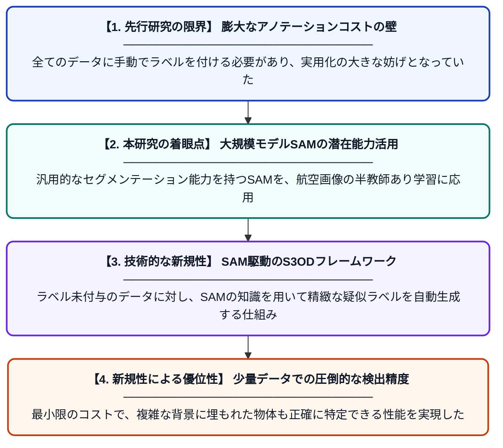

# S3OD：航空画像における顕著物体検出のためのSegment Anything Modelと半教師あり学習の統合

**Original Title**: *S3OD: Bridging Segment Anything Model and Semi-Supervised Learning for Salient Object Detection in Aerial Imagery*

> **💡 一言要約**: SAMと半教師あり学習で航空画像解析を低コスト化

| 項目 | 内容 |
|---|---|
| **著者** | Y Liu, X Chen, L Zhang |
| **掲載誌** | Proceedings of the 34th ACM International Conference … 2026 |
| **アラートキーワード** | Semi supervise |
| **原文リンク** | [https://dl.acm.org/doi/abs/10.1145/3767308.3836228](https://dl.acm.org/doi/abs/10.1145/3767308.3836228) |
| **PDF版要約** | [README.pdf](./README.pdf) |

---

## 📊 新規性の図解（先行研究との違いと本研究のブレークスルー）

## 📝 要約

航空画像の顕著物体検出において、膨大なアノテーションコストを削減するために開発された、SAM（Segment Anything Model）を活用した初の半教師あり学習フレームワークです。ラベル付きデータが少ない環境でも、SAMの強力なセグメンテーション能力を統合することで、高精度な物体抽出を実現しています。

## ❓ どんな問題に取り組んだか

航空画像から重要な物体を検出する顕著物体検出（SOD）において、従来手法は大量の手動ラベルを必要とし、その作成コストが極めて高いことが課題でした。特に、複雑な背景を持つ航空画像では、限られたデータだけで精度を維持することが非常に困難でした。

## ✨ 何が新しい？何がすごい？（新規性）

本研究は、航空画像のSODにおいて大規模モデルSAMと半教師あり学習を組み合わせた初の体系的な調査です。ラベルのないデータに対してSAMの知識を活用して高品質な疑似ラベルを生成し、学習を効率化する「S3OD」フレームワークを提案しました。これにより、少数のラベル付きデータのみで、従来の全教師あり学習に匹敵する、あるいは凌駕する頑健な検出性能を達成しています。

## 🎓 大学1年生向けの解説

上空から撮った写真の中から、建物や車両などの「目立つもの」を自動で見つける技術についての研究です。これまでは、AIに「これが正解だよ」と人間が一つずつ教える必要があり、その作業に膨大な時間がかかっていました。この研究では、もともと「何でも切り抜ける」能力を持った強力なAI（SAM）を先生役にすることで、少ないヒントからでもAIが自ら学習できるようにしました。結果として、手間をかけずに賢いAIを作ることが可能になりました。
