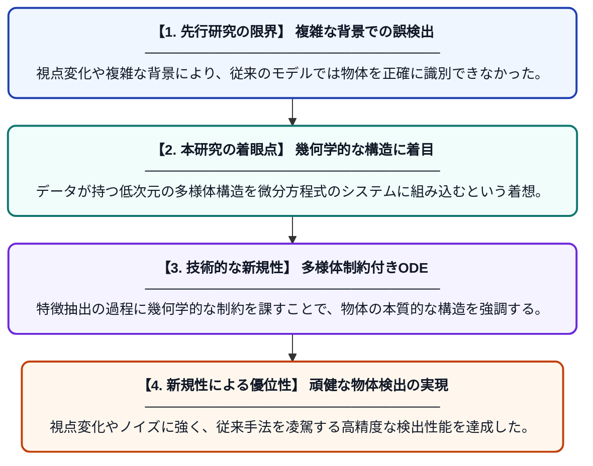

# 航空画像における物体検出のための多様体制約付きニューラル微分方程式ネットワーク

**Original Title**: *Manifold Constrained Neural Differential Equation Network For Object Detection In Aerial Imagery*

> **💡 一言要約**: 幾何学構造の制約で航空画像の物体検出を革新

| 項目 | 内容 |
|---|---|
| **著者** | J Yang, J Cai, X Wang |
| **掲載誌** | 23rd International Computer Conference on … 2026 |
| **アラートキーワード** | manifold learning |
| **原文リンク** | [https://ieeexplore.ieee.org/abstract/document/11769151/](https://ieeexplore.ieee.org/abstract/document/11769151/) |
| **PDF版要約** | [README.pdf](./README.pdf) |

---

## 📊 新規性の図解（先行研究との違いと本研究のブレークスルー）

## 📝 要約

航空画像からの物体検出精度を向上させるため、多様体学習とニューラル微分方程式（Neural ODEs）を統合した新しいネットワークを提案しています。データの幾何学的構造を抽出・保持することで、複雑な背景や視点変化に強い検出性能を実現しました。

## ❓ どんな問題に取り組んだか

航空画像は撮影高度や角度が多様であり、地表の複雑な背景に物体が紛れやすいため、従来の手法では物体の特徴を正確に捉え続けることが困難でした。また、高次元な画像データの中に潜む、本質的な低次元の幾何学的情報を有効に活用できていないという課題がありました。

## ✨ 何が新しい？何がすごい？（新規性）

ニューラル微分方程式（ODE）に対して「多様体制約」を導入し、データの連続的な変化を幾何学的に正しくモデル化できるようにした点が最大の貢献です。先行研究では微分方程式を単なる層の積み重ねとして扱っていましたが、本研究は多様体学習を組み合わせることで、特徴抽出プロセスにおける幾何学的構造の維持を強制しています。これにより、航空画像特有の歪みやノイズに対しても、極めて頑健な特徴表現を得ることに成功しました。

## 🎓 大学1年生向けの解説

ドローンや飛行機から撮った写真から車や建物を見つけるのは、影や角度のせいで意外と難しい問題です。この研究では、難しい数学（微分方程式と多様体）を使って、画像の中に隠れている「物体の本当の形」を数式で捉える工夫をしました。これにより、どんなに複雑な場所や角度から撮られた写真でも、AIが迷わずに正しく物体を見つけられるようになります。
