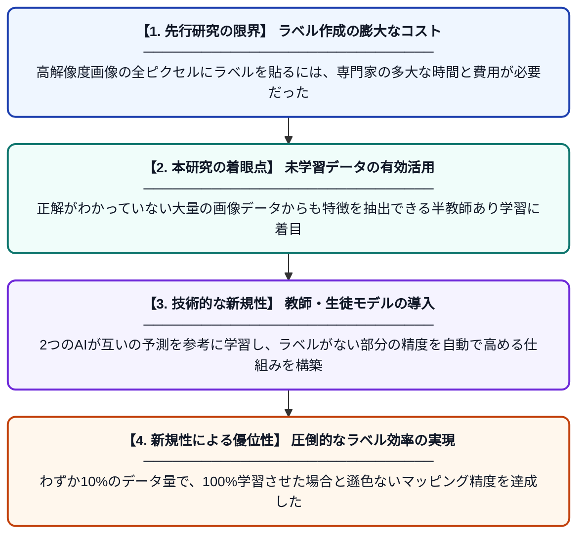

# グローバルサウス諸都市における高解像度な非公式居住地マッピングのためのラベル効率的な半教師あり学習フレームワーク

**Original Title**: *A label-efficient semi-supervised framework for high-resolution informal settlement mapping across Global South cities*

> **💡 一言要約**: 少ないデータで貧困地域の居住地をAIが高精度に特定

| 項目 | 内容 |
|---|---|
| **著者** | Z He, G Li, X Li, Y Cao, L Li |
| **掲載誌** | Computers, Environment and Urban Systems 2027 |
| **アラートキーワード** | Semi supervise |
| **原文リンク** | [https://www.sciencedirect.com/science/article/pii/S0198971526001584](https://www.sciencedirect.com/science/article/pii/S0198971526001584) |
| **PDF版要約** | [README.pdf](./README.pdf) |

---

## 📊 新規性の図解（先行研究との違いと本研究のブレークスルー）

## 📝 要約

ラベル付きデータが不足している発展途上国の都市部において、少量の教師データから高精度に非公式居住地（スラム等）を特定するAI手法を提案しました。教師・生徒学習（Teacher-Student learning）を用いた半教師あり学習により、わずか10%のラベルデータでも高い精度で地図を作成できることを実証しています。

## ❓ どんな問題に取り組んだか

都市計画や人道支援において非公式居住地の把握は重要ですが、高解像度の衛星画像に対して手作業でピクセル単位のラベルを付与するには膨大なコストと時間がかかります。特にデータの乏しいグローバルサウスでは、ラベル不足が正確なマッピングの大きな障壁となっていました。

## ✨ 何が新しい？何がすごい？（新規性）

本研究は、教師モデルと生徒モデルが相互に学習を補完し合う「半教師あり学習」の枠組みを、都市セグメンテーションに最適化して導入しました。先行研究が大量のラベルデータを前提としていたのに対し、本手法はラベルなしデータを知識獲得に活用することで、データ効率を劇的に向上させています。その結果、10%〜30%の教師データだけで、全データを用いた場合と同等の精度を達成した点が画期的な貢献です。

## 🎓 大学1年生向けの解説

発展途上国の都市では、地図に載っていない居住地の状況を把握することが、より良い街づくりや支援に必要です。しかし、広い範囲の写真を人間が手作業ですべてチェックして「ここはスラム」とマークするのは大変な作業になります。この研究では、AIに少しだけ正解を教えて、あとはAI自身が自分で考えて学習する仕組みを作ることで、少ない作業量で正確な地図を作ることに成功しました。これにより、お金や時間がなくても最新の街の様子を調べられるようになります。
