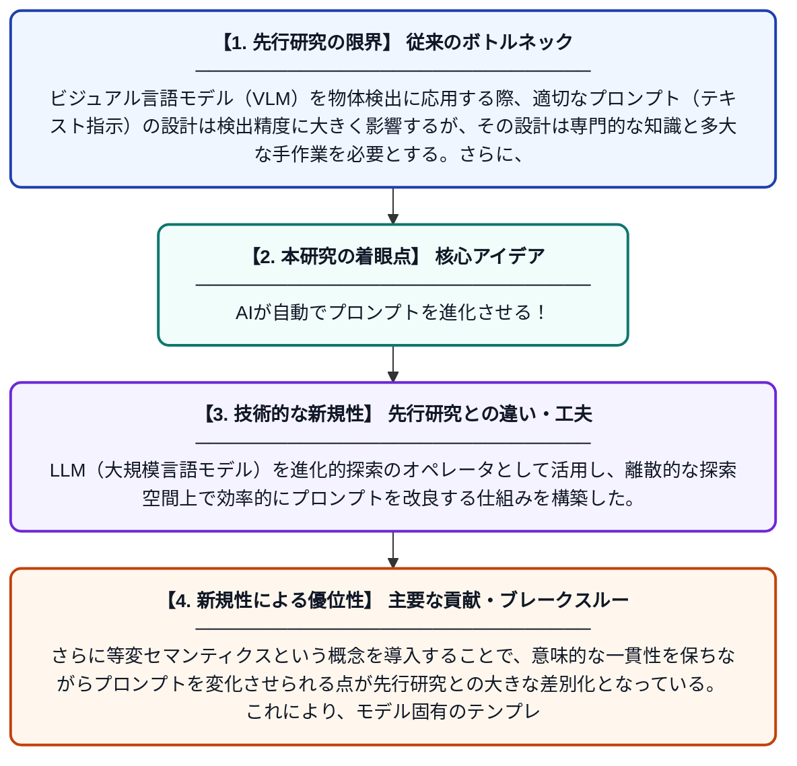

# 等変セマンティクスを用いたビジュアル言語モデルのための進化的プロンプト最適化

**Original Title**: *Evolutionary Prompt Optimization for Visual Language Models using Equivariant Semantics*

> **💡 一言要約**: AIが自動でプロンプトを進化させる！

| 項目 | 内容 |
|---|---|
| **著者** | G Villate-Castillo, EB Terres-Escudero |
| **アラートキーワード** | Open-Vocabulary Object ... |
| **PDF** | [http://linklings.s3.amazonaws.com/organizations/WCCI/wcci2026/submissions/stype102/fLUuh-cec_pap187s2.pdf](http://linklings.s3.amazonaws.com/organizations/WCCI/wcci2026/submissions/stype102/fLUuh-cec_pap187s2.pdf) |
| **原文リンク** | [http://linklings.s3.amazonaws.com/organizations/WCCI/wcci2026/submissions/stype102/fLUuh-cec_pap187s2.pdf](http://linklings.s3.amazonaws.com/organizations/WCCI/wcci2026/submissions/stype102/fLUuh-cec_pap187s2.pdf) |
| **PDF版要約** | [README.pdf](./README.pdf) |

---

## 📊 新規性の図解（先行研究との違いと本研究のブレークスルー）

## 📝 要約

本論文では、オープン語彙物体検出において、プロンプトとターゲットラベルの語彙を共進化させるLLM支援の進化的フレームワークを提案する。離散的な探索空間においてプロンプトをファーストクラスの表現として扱い、モデル固有のテンプレートと等変セマンティクスを活用することで、ビジュアル言語モデルの検出性能を向上させる。人手によるプロンプト設計の手間を省きながら、より効果的な表現を自動的に探索できる点が特徴である。

## ❓ どんな問題に取り組んだか

ビジュアル言語モデル（VLM）を物体検出に応用する際、適切なプロンプト（テキスト指示）の設計は検出精度に大きく影響するが、その設計は専門的な知識と多大な手作業を必要とする。さらに、ラベルの語彙選択とプロンプト設計は相互に依存しているにもかかわらず、従来研究ではそれらを独立して最適化するケースが多かった。このため、最適なプロンプトと語彙の組み合わせを効率よく発見する手法が求められていた。

## ✨ 何が新しい？何がすごい？（新規性）

本研究の最大の新規性は、プロンプトとターゲットラベルの語彙を「共進化する表現」として同時に最適化する進化的フレームワークを提案した点である。LLM（大規模言語モデル）を進化的探索のオペレータとして活用し、離散的な探索空間上で効率的にプロンプトを改良する仕組みを構築した。さらに等変セマンティクスという概念を導入することで、意味的な一貫性を保ちながらプロンプトを変化させられる点が先行研究との大きな差別化となっている。これにより、モデル固有のテンプレートと組み合わせた高精度な物体検出が実現される。

## 🎓 大学1年生向けの解説

AIに画像の中の物体を見つけさせるとき、「どんな言葉で指示するか（プロンプト）」がとても重要です。でも、最適な言葉を人間が考えるのはとても大変です。この研究では、生物の進化のように、AIが自動的にプロンプトをどんどん改良・進化させる仕組みを作りました。さらに、物体の名前（ラベル）とプロンプトを一緒に最適化することで、より賢い物体検出が可能になります。まるでAI同士が協力して「最良の言葉」を探し続けるイメージです！
