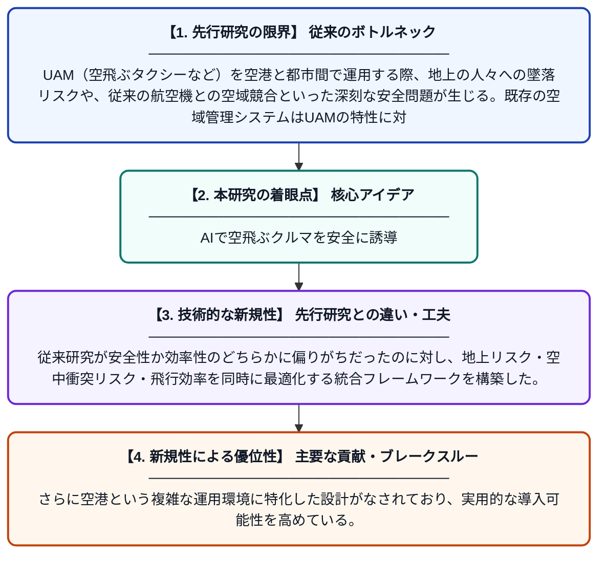

# U-Safe：生体模倣と強化学習に基づく軌道管理による都市航空モビリティの空港安全統合

**Original Title**: *U-Safe: Urban air mobility safe integration into aerodrome via bio-inspired and reinforcement learning-based trajectory management*

> **💡 一言要約**: AIで空飛ぶクルマを安全に誘導

| 項目 | 内容 |
|---|---|
| **著者** | X Hu, B Pang, S Alam, M Feroskhan |
| **掲載誌** | Reliability Engineering & System Safety 2026 |
| **アラートキーワード** | reinforcement |
| **原文リンク** | [https://www.sciencedirect.com/science/article/pii/S0951832026009622](https://www.sciencedirect.com/science/article/pii/S0951832026009622) |
| **PDF版要約** | [README.pdf](./README.pdf) |

---

## 📊 新規性の図解（先行研究との違いと本研究のブレークスルー）

## 📝 要約

本論文は、都市航空モビリティ（UAM）を空港と都市間の輸送に安全に統合するための新しい軌道管理システム「U-Safe」を提案している。地上の第三者へのリスクや空域の混雑といった安全課題に対し、生体模倣アルゴリズムと強化学習を組み合わせた手法で対処している。シミュレーション実験により、安全性と効率性の両立が可能であることを実証した。

## ❓ どんな問題に取り組んだか

UAM（空飛ぶタクシーなど）を空港と都市間で運用する際、地上の人々への墜落リスクや、従来の航空機との空域競合といった深刻な安全問題が生じる。既存の空域管理システムはUAMの特性に対応しておらず、安全かつ効率的な軌道計画手法が求められている。

## ✨ 何が新しい？何がすごい？（新規性）

本研究は、自然界の群れ行動にヒントを得た生体模倣アルゴリズムと、試行錯誤から最適解を学ぶ強化学習を組み合わせた点が独自である。従来研究が安全性か効率性のどちらかに偏りがちだったのに対し、地上リスク・空中衝突リスク・飛行効率を同時に最適化する統合フレームワークを構築した。さらに空港という複雑な運用環境に特化した設計がなされており、実用的な導入可能性を高めている。

## 🎓 大学1年生向けの解説

「空飛ぶタクシー」が空港と街の間を飛び回る未来を想像してみてください。でも、たくさんの機体が同時に飛ぶと、ぶつかったり地上の人に落下したりする危険があります。この研究では、鳥の群れが自然に衝突を避ける仕組みをヒントにしたアルゴリズムと、ゲームのAIのように経験から学ぶ技術を組み合わせて、安全な飛行ルートを自動で計画するシステムを作りました。コンピューターのシミュレーションで、安全に、かつ効率よく飛べることが確認されています。
