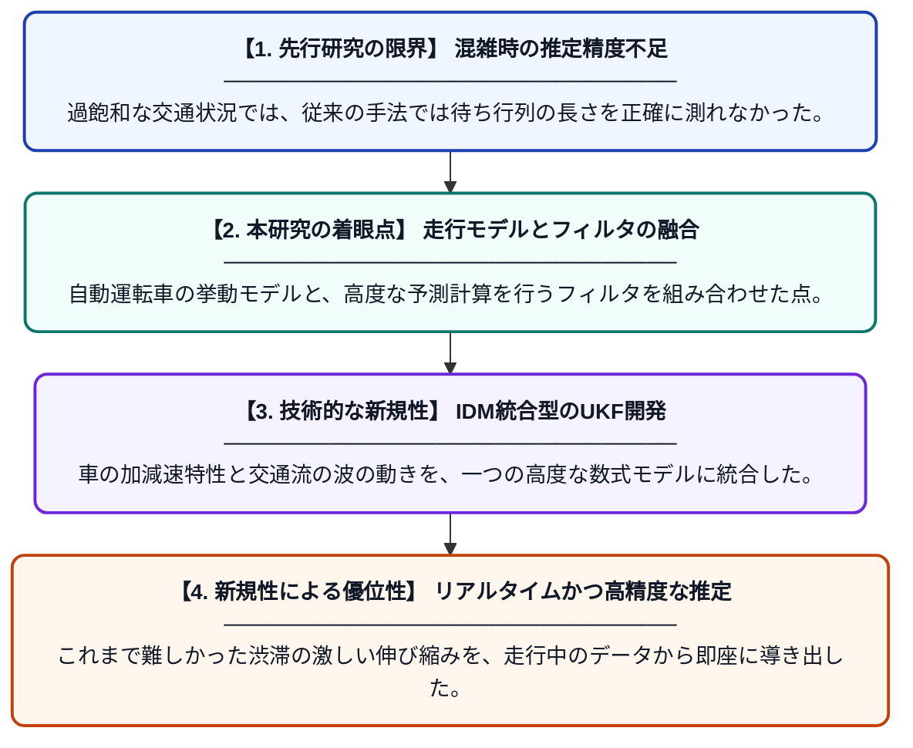

# 車追従モデル統合型無香料カルマンフィルタによる、待ち行列ダイナミクスと到着時間のリアルタイム同時推定

**Original Title**: *Real-Time Joint Estimation of Queue Dynamics and Arrival Time via a Car-Following-Model-Integrated Unscented Kalman Filter*

> **💡 一言要約**: 自動運転の目で見えない渋滞の先を予測する技術

| 項目 | 内容 |
|---|---|
| **著者** | Q Hu, C Tan, M Yang, M Wang |
| **アラートキーワード** | kalman filter |
| **PDF** | [https://heart-web.org/abstracts/2026/paper_101.pdf](https://heart-web.org/abstracts/2026/paper_101.pdf) |
| **原文リンク** | [https://heart-web.org/abstracts/2026/paper_101.pdf](https://heart-web.org/abstracts/2026/paper_101.pdf) |
| **PDF版要約** | [README.pdf](./README.pdf) |

---

## 📊 新規性の図解（先行研究との違いと本研究のブレークスルー）

## 📝 要約

接続自動運転車（CAV）の車載センサデータと衝撃波力学を融合し、信号待ちの列（待ち行列）の長さと車両の到着時間をリアルタイムで推定する手法を提案しています。特に交通が飽和した状態において、インテリジェント・ドライバー・モデル（IDM）を組み込んだ無香料カルマンフィルタ（UKF）を用いることで、高い精度での推定を実現しました。

## ❓ どんな問題に取り組んだか

従来の交通推定手法は、交通流が極めて混雑した「過飽和状態」において、待ち行列の長さや正確な到着時間を把握することが困難でした。また、限られたCAVのデータのみで周囲の車両を含めた複雑な交通状況をリアルタイムに把握する精度にも課題がありました。

## ✨ 何が新しい？何がすごい？（新規性）

本研究の核心は、車両の走行挙動を表す「IDM」と、非線形な状態推定に強い「UKF」を統合した点にあります。CAVが減速する際に得られる高精度な車載センサ情報と交通流の「衝撃波理論」を組み合わせることで、センサの検知範囲外も含めた広範な待ち行列の変化を動的に捉えることが可能です。これにより、複雑な加減速が繰り返される都市部の交差点でも、先行研究を上回る高い推定精度を維持できることを示しました。

## 🎓 大学1年生向けの解説

渋滞している道路で「列がどこまで続いているのか」「いつ信号を抜けられるのか」を、自動運転車のセンサーを使って正確に当てる研究です。自動運転車が前の車に合わせてブレーキを踏むときのデータを、数学的なフィルタリング技術で処理することで、見えない先の状況まで計算します。これによって、渋滞の中でもより賢くスムーズに走るための計画が立てられるようになります。難しい数学を実際の車の動きに応用した、スマートな交通管理の第一歩です。
