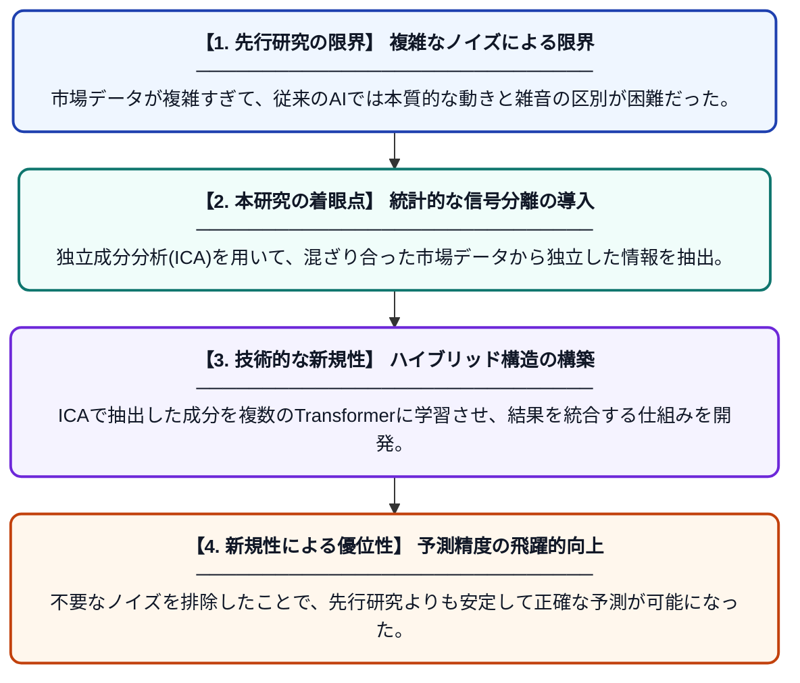

# インテリジェントな金融市場予測のためのハイブリッドTransformerアンサンブル学習フレームワーク

**Original Title**: *Hybrid Transformer Ensemble Learning Framework for Intelligent Financial Market Forecasting*

> **💡 一言要約**: ICAとAIの融合で金融予測の精度を極める

| 項目 | 内容 |
|---|---|
| **著者** | VKK Ravi, A Mukherjee, AP Codangudi, RM Bhandari… |
| **掲載誌** | IEEE International … 2026 |
| **アラートキーワード** | ICA |
| **原文リンク** | [https://ieeexplore.ieee.org/abstract/document/11742519/](https://ieeexplore.ieee.org/abstract/document/11742519/) |
| **PDF版要約** | [README.pdf](./README.pdf) |

---

## 📊 新規性の図解（先行研究との違いと本研究のブレークスルー）

## 📝 要約

金融市場の複雑なデータを解析するため、独立成分分析（ICA）とTransformerモデルを融合させた新しいアンサンブル学習手法を提案しています。信号処理技術を応用して市場データから純粋な成分を抽出することで、ノイズに強く精度の高い予測を実現しました。

## ❓ どんな問題に取り組んだか

金融市場のデータは極めて複雑でノイズが多く、従来の予測モデルでは本質的なトレンドを捉えきれず、予測精度が不安定になるという課題がありました。特に、複数の要因が混ざり合った「盲目的源信号」の状態から、予測に有用な情報を抽出することが困難でした。

## ✨ 何が新しい？何がすごい？（新規性）

音声処理などで用いられる独立成分分析（ICA）を金融データに適用し、統計的に独立した成分を抽出することでノイズを分離する手法を取り入れました。さらに、最新のTransformerアーキテクチャを複数組み合わせたアンサンブル学習を構築し、単一モデルでは達成できなかった予測の頑健性と精度を大幅に向上させた点が最大の貢献です。

## 🎓 大学1年生向けの解説

株価などの金融データは、たくさんのニュースや人の感情が混ざり合った「騒がしい音」のようなものです。この研究では、まず「ICA」という技術を使って、その騒音の中から特定の声だけを綺麗に聞き分けるような作業を行います。その整理された情報を、最新の高性能なAI（Transformer）たちに学習させることで、未来の市場がどう動くかをより正確に当てられるようになりました。
