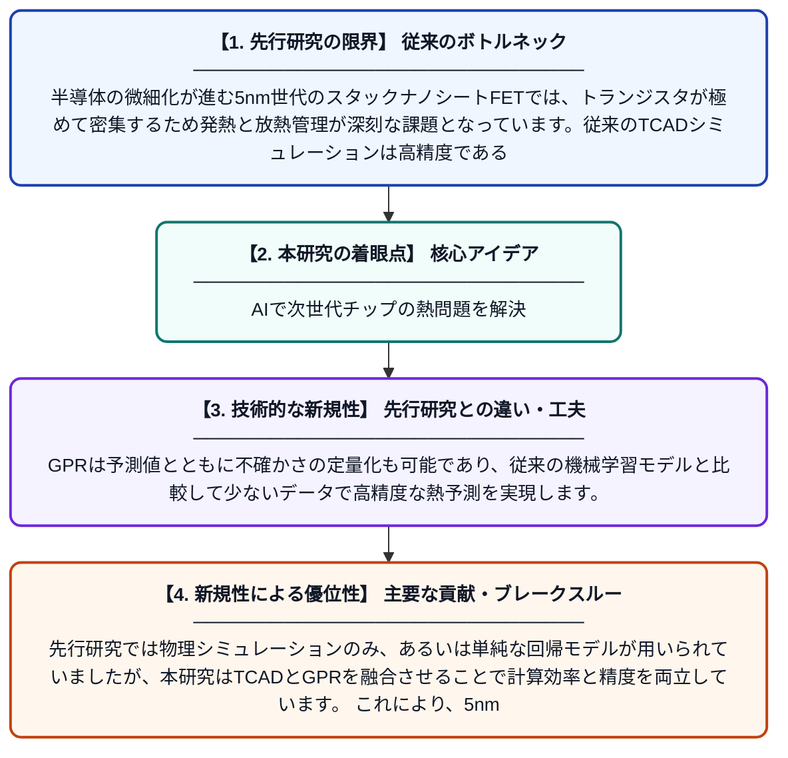

# ガウス過程回帰を用いた5nmスタックナノシートFETの熱モデリングによる先進CMOS熱管理と信頼性向上

**Original Title**: *Gaussian Process Regression–Driven Thermal Modeling of 5 nm Stacked Nanosheet FETs for Advanced CMOS Thermal Management and Reliability*

> **💡 一言要約**: AIで次世代チップの熱問題を解決

| 項目 | 内容 |
|---|---|
| **著者** | B Negi, H Kumar, H Muthusamy, V Kumar |
| **掲載誌** | IEEE Transactions on Components … 2026 |
| **アラートキーワード** | gaussian process |
| **原文リンク** | [https://ieeexplore.ieee.org/abstract/document/11622494/](https://ieeexplore.ieee.org/abstract/document/11622494/) |
| **PDF版要約** | [README.pdf](./README.pdf) |

---

## 📊 新規性の図解（先行研究との違いと本研究のブレークスルー）

## 📝 要約

本論文では、5nmプロセス世代のスタックナノシートFETにおける熱特性を効率的に予測するために、TCAD（技術コンピュータ支援設計）シミュレーションとガウス過程回帰（GPR）サロゲートモデルを組み合わせたアプローチを提案しています。GPRモデルはR²スコアで高精度な熱予測を実現し、従来の物理シミュレーションの計算コストを大幅に削減します。これにより、先進CMOSデバイスの熱管理と長期信頼性の向上に貢献します。

## ❓ どんな問題に取り組んだか

半導体の微細化が進む5nm世代のスタックナノシートFETでは、トランジスタが極めて密集するため発熱と放熱管理が深刻な課題となっています。従来のTCADシミュレーションは高精度である一方、計算コストが非常に大きく、設計最適化に膨大な時間を要します。このような熱的問題は、デバイスの性能低下や信頼性の損失に直結するため、迅速かつ正確な熱予測手法が求められています。

## ✨ 何が新しい？何がすごい？（新規性）

本研究の新規性は、高コストなTCADシミュレーションをガウス過程回帰（GPR）サロゲートモデルで代替・補完するという統合的アプローチにあります。GPRは予測値とともに不確かさの定量化も可能であり、従来の機械学習モデルと比較して少ないデータで高精度な熱予測を実現します。先行研究では物理シミュレーションのみ、あるいは単純な回帰モデルが用いられていましたが、本研究はTCADとGPRを融合させることで計算効率と精度を両立しています。これにより、5nmナノシートFET特有の複雑な三次元熱伝導を迅速にモデル化できる点が主要な貢献です。

## 🎓 大学1年生向けの解説

スマートフォンやパソコンに使われるチップは年々小さくなっていますが、小さくなるほど熱が逃げにくくなって壊れやすくなります。この研究では、最新の超微細トランジスタ（5nmナノシートFET）の熱をコンピュータでシミュレーションする際に、AIの一種である「ガウス過程回帰」を使うことで、時間のかかる計算をずっと速く・賢くできるようにしました。例えるなら、全部の料理を実際に作って試食する代わりに、少しのデータから味を賢く予測するレシピAIを作ったようなものです。これにより、チップ設計者が熱の問題を素早く発見・解決できるようになり、より安全で長持ちする電子機器の開発につながります。
