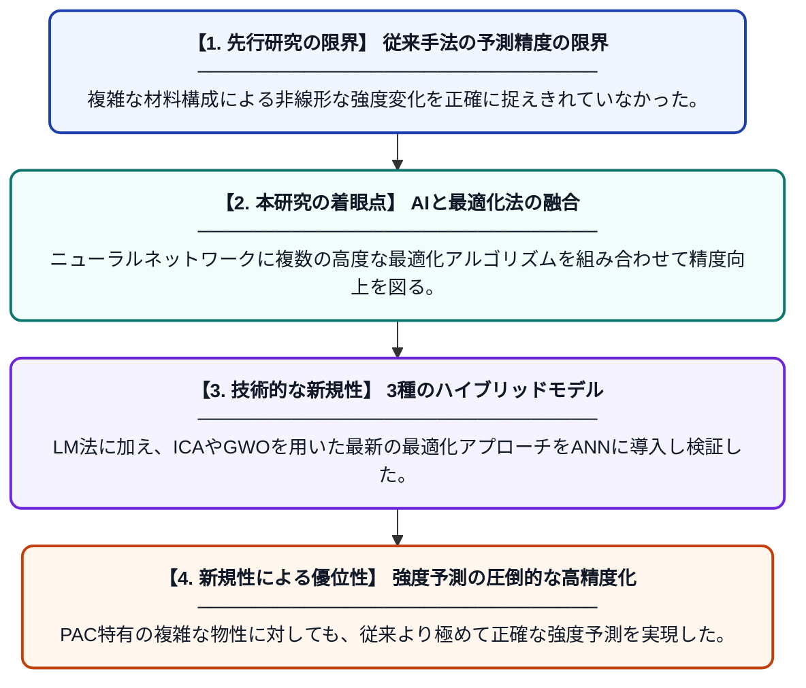

# ハイブリッド化されたANN-LM、ANN-ICA、ANN-GWO手法によるプレプレースド・アグリゲート・コンクリート（PAC）強度の高度な予測

**Original Title**: *Advanced prediction of pre-placed aggregate concrete (PAC) strength via hybridized ANN-LM, ANN-ICA, and ANN-GWO approaches*

> **💡 一言要約**: AIで特殊コンクリートの強度を精密に予測する

| 項目 | 内容 |
|---|---|
| **著者** | M Bahram, H Khosravi |
| **掲載誌** | Innovative Infrastructure Solutions 2026 |
| **アラートキーワード** | ICA |
| **原文リンク** | [https://link.springer.com/article/10.1007/s41062-026-03082-2](https://link.springer.com/article/10.1007/s41062-026-03082-2) |
| **PDF版要約** | [README.pdf](./README.pdf) |

---

## 📊 新規性の図解（先行研究との違いと本研究のブレークスルー）

## 📝 要約

プレプレースド・アグリゲート・コンクリート（PAC）の圧縮強度を正確に予測するため、人工ニューラルネットワーク（ANN）に複数の最適化アルゴリズムを組み合わせたハイブリッドモデルを開発しました。LM、ICA、GWOという3つの異なる最適化手法を比較検証し、複雑な材料構成が強度に与える影響を高い精度でモデル化することに成功しています。

## ❓ どんな問題に取り組んだか

PACは先に骨材を設置してからモルタルを注入する特殊な工法のため、材料間の複雑な相互作用により強度の予測が極めて困難です。従来の計算手法では、混合物の成分と最終的な機械的性能との間にある非線形な関係を十分に解明できていないという課題がありました。

## ✨ 何が新しい？何がすごい？（新規性）

本研究は、人工ニューラルネットワーク（ANN）に対して「帝国主義競争アルゴリズム（ICA）」や「灰色の狼最適化（GWO）」といった高度なメタヒューリスティック手法を統合した点が革新的です。これにより、単一のアルゴリズムでは陥りやすい局所解を回避し、予測モデルの汎用性と精度を大幅に向上させました。複数のハイブリッドモデルを系統的に比較し、PACの強度推定に最適な構造を特定した点が大きな貢献です。

## 🎓 大学1年生向けの解説

普通のコンクリートは材料を混ぜてから型に流しますが、PACは先に石を敷き詰めてから隙間にセメントを流し込む特殊な作り方をします。この方法は計算が難しく、どれくらいの強さになるか予想するのが大変でした。そこでこの研究では、AIに「生き物の群れの動き」などをヒントにした賢い計算方法を組み合わせ、強さをピタリと当てる新しい技術を作りました。これを使えば、実験で壊さなくてもコンクリートの丈夫さが正確にわかります。
