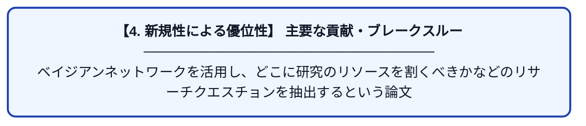

# ベイジアンネットワークを用いた臨床レジストリからのクリニカルクエスチョン 抽出の試み

| 項目 | 内容 |
|---|---|
| **PDF版要約** | [README.pdf](./README.pdf) |

---

## 📊 新規性の図解（先行研究との違いと本研究のブレークスルー）

## 📝 要約

ベイジアンネットワークを活用し、どこに研究のリソースを割くべきかなどのリサーチクエスチョンを抽出するという論文
